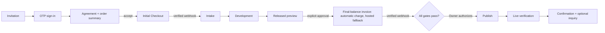
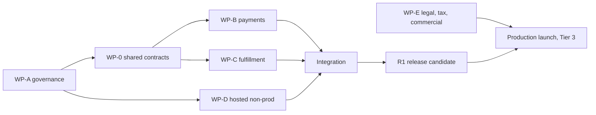

# 01 — Project Overview

| Field | Value |
|---|---|
| Version | 0.4.3 |
| Status | **Approved** (Owner, 2026-11-23, consolidated execution plan approval). v0.4.0: work packages and releases replace phases 3–5 (OI-67), R1/R2 journey and acceptance criteria (OI-68); status moved to [CURRENT-STATE.md](CURRENT-STATE.md). Earlier history: v0.3.2 final approval (Phase 1 authorization, 2026-11-23); v0.3.3 automatic final payment (OI-17 revised). v0.4.1 (**OI-74**, 2026-11-24): the automatic off-session final charge and mandatory payment method retention move to R1 (§9.1 items 10 and 13; §9.2 item 2); the Sales Representative role (§6, OI-77). v0.4.2 (Owner direction, 2026-11-24): integrated R1 browser acceptance criteria (§9.1.1). v0.4.3 (PWP-0, AUTH-011; OI-112, 2026-11-25): §7 records the contractual work packages PWP-0 to PWP-6 (proposed; each needs its own authorization) and §9.1 adds the contractual architecture and verification criterion (DEP-18, DEP-19). No existing criterion is removed or weakened. |
| Decisions | OI-01, OI-02, OI-03, OI-06, OI-07, OI-09, OI-24, OI-29, OI-41, OI-67, OI-68 |
| Labels | See [08 §2](08-DECISIONS-AND-CHANGELOG.md#2-requirement-classification-legend) |

## 1. Identity and purpose

| Item | Value |
|---|---|
| Organization | Spotlight Marketing LLC |
| Application | Spotlight Marketing Client Portal |
| Repository | `sjr425151-collab/spotlight-client-portal` |
| Production URL | `https://portal.spotlight-marketing.co` **[APPROVED OI-07]** |
| Agency website | `https://spotlight-marketing.co`. Remains on GoHighLevel and is independent of the portal. **[APPROVED OI-07]** |

The portal is a standalone web application on its own subdomain. It is not a page, path, or embed within the GoHighLevel website, and it is not served under `/clientportal`. **[APPROVED OI-07]**

**Purpose:** a premium, secure portal that takes each client from agreement acceptance and payment through onboarding, development, preview review, final payment, publication, and post-launch confirmation, with as much automation as possible.

## 2. Business objectives

1. Remove manual contract, invoicing, and onboarding handling for standard website packages.
2. Collect payment only against an accepted, versioned agreement with preserved evidence (OI-13, OI-17).
3. Prevent publication of any client website that has not met every contractual and quality gate (OI-22).
4. Give clients a premium, accessible experience that matches the agency brand (OI-12, OI-23).
5. Keep a complete, auditable record of every financial and approval event (OI-05, OI-19).

## 3. MVP scope

The MVP covers the following client journey **[APPROVED baseline]**, delivered in two releases **[APPROVED OI-68]**. The Release column shows where each step's behavior differs.

| # | Step | Authoritative evidence | Spec | Release |
|---|---|---|---|---|
| 1 | Client receives a secure invitation | Invitation record | 03 §6 | R1 |
| 2 | Client authenticates with passwordless email OTP | Supabase Auth session and auth audit event | 03 §5 | R1 |
| 3 | Client reviews the versioned agreement and project-specific order summary | Agreement version and order summary snapshot | 04 §1–§4 | R1 |
| 4 | Client affirmatively accepts (unchecked checkbox) | Acceptance evidence record | 04 §3 | R1 |
| 5 | Client completes Stripe Checkout for deposit + first $99 maintenance. Stripe securely saves the payment method for the final balance, as authorized in the agreement. | Verified webhook and ledger entries | 04 §3.1, §8 | R1 |
| 6 | Verified payment unlocks the branded onboarding intake | Deposit state = `verified` | 05 §3 | R1 |
| 7 | Client submits business details, logos, service areas, photos, contact info, and preferences | Intake submission and asset records | 05 §3–§5 | R1 |
| 8 | Project enters development | Development state | 05 §2 | R1 |
| 9 | Client reviews an immutable, versioned website preview | Preview release record | 05 §6 | R1: staff record the release. R2: automated delivery. |
| 10 | Client explicitly approves the current released preview (**Approve Website & Authorize Final Payment**) | Approval record bound to the release ID | 05 §7 | R1: approval makes the balance due (wording per 05 §7). R2: the label shown here. |
| 11 | Stripe automatically charges the remaining 80% balance to the saved payment method and issues the invoice and receipt. If the charge fails or needs authentication, the client completes it on a secure Stripe-hosted page. | Verified webhook and ledger entries | 04 §10 | R1: the client pays the single final-balance invoice on its Stripe-hosted page. R2: automatic charge, hosted page as fallback. |
| 12 | Owner authorizes publication after all gates pass | Gate evaluation and Owner authorization record | 06 §2–§3 | R1 |
| 13 | System verifies the live deployment | Verification record | 06 §9 | R1: staff deploy exactly the authorized release, then verification runs. R2: the portal drives the deployment. |
| 14 | Client receives confirmation and may optionally inquire about more services | Notification and inquiry record | 06 §10–§11 | R1: in-portal confirmation. R2: email confirmation and inquiries. |

Ongoing billing self-service: through the hosted Stripe Customer Portal, clients manage payment methods and view invoices and subscription details. Self-service cancellation is disabled. Cancellation requests follow 04 §15.1.1. **[APPROVED OI-29; R2]** In R1, clients pay and update payment details on Stripe-hosted invoice pages.

## 4. Exclusions and future roadmap

The following items are **not** MVP commitments. They are recorded only as future opportunities and need separate owner decisions:

- A full future client dashboard (beyond the journey in §3).
- Autonomous AI agents.
- Google Sheets or Google Drive integrations.
- Client CRM integrations.
- Automated execution of marketing campaigns, and marketing automation email sequences (OI-04).
- Automatic purchase of upsell services. Post-publication offers are inquiry-only (OI-24).
- Multi-agency SaaS tenancy (OI-09).
- An active Fulfillment role. It may be defined, but stays disabled (OI-03).

## 5. Tenancy summary

One agency (Spotlight Marketing) serves many **client businesses**. Each business has one or more **projects**. Access is granted through **project memberships**, enforced by Supabase RLS, private storage, and server-side authorization. **[APPROVED OI-09]** Details are in 03.

## 6. Roles overview **[APPROVED OI-03, amended by OI-77]**

| Role | Summary |
|---|---|
| Owner | Spotlight Marketing principal. Full administrative authority. Sole authority for financial exceptions, staff management, and publication authorization. |
| Admin | Spotlight staff. Day-to-day project operations. No financial exceptions, staff management, or publication authorization. |
| Sales Representative | Spotlight staff who onboard customers: create the customer and project, issue the catalog order, and invite the client, for assigned customers only. No administrative, financial, fulfillment, or publication authority (OI-77; 03 §4.1). |
| Client | An authorized contact of a client business. Access is limited to projects where they hold membership. Only a client can approve their own project's released preview. |
| Fulfillment (future) | Defined for future use only. **Disabled.** It cannot be assigned in the MVP. |

The full permission matrix is in [03 §4](03-SECURITY-AUTH-AND-TENANCY.md#4-permissions-matrix).

## 7. Work packages and releases **[APPROVED OI-02, revised by OI-67]**

Phases 1 (foundation and CI) and 2 (authentication, security, and tenant isolation) are complete. The remaining work is organized as work packages delivered in two releases (OI-68). Each work package runs only under an active record in [AUTHORIZATIONS.md](AUTHORIZATIONS.md). Status is in [CURRENT-STATE.md](CURRENT-STATE.md).

| Work package | Scope | Replaces | Depends on |
|---|---|---|---|
| **WP-A** | Governance and specification correction | — | — |
| **WP-0** | Shared contracts (below), as one migration | — | WP-A |
| **WP-B** | Agreements, order summaries, Checkout, webhook ingestion, ledger, reconciliation, holds, final-balance invoice | Phase 3 | WP-0; Stripe sandbox work needs AUTH-002 active |
| **WP-C** | Intake, uploads and scanning, preview release records, approvals, gate evaluator, publication authorization and deployment records, derived queues | Phase 4 (R1 part) | WP-0; releasing scanned uploads needs DEP-07 |
| **WP-D** | Hosted non-production environments, then production readiness | Phase 5 | AUTH-003 (non-production); Tier 3 for production |
| **WP-E** | Legal, tax, and commercial approvals | — | Owner and advisors; runs in parallel from now |

**Contractual work packages [APPROVED OI-112, Owner 2026-11-25; proposed, none authorized except PWP-0 (AUTH-011)]:** PWP-0 documentation and decision reconciliation; PWP-1 contractual instruments, bundles and governance events; PWP-2 standardized issuance and snapshot v2; PWP-3 counsel and publication evidence; PWP-4 non-production contractual materialization and verification; PWP-5 project-specific scope confirmation, operational notes and the inactivity reconciliation. PWP-0 to PWP-5 are required for R1; PWP-6 (automated additional-work billing) is post-R1. Production activation is separately authorized (DEP-20). Existing WP-I, WP-H and WP-D18 ownership and merge order are unchanged.

**Shared contracts (WP-0) [PROPOSED]**, created before WP-B and WP-C start in parallel:
- `domain_events`: typed, append-only domain events (for example `agreement.accepted`, `payment.deposit_verified`, `release.approved`, `publication.authorized`), written in the same transaction as the state change.
- `notification_outbox` (07 §2), written in the same transaction; delivery is R2.
- State-domain types for agreement, payment, subscription, fulfillment, approval, and deployment (05 §2).
- The audit action names used by both packages.
- Gate interfaces: `private.project_financial_status(project_id)` (owned by WP-B: deposit verified, balance verified or settled, billing holds) and `private.project_fulfillment_status(project_id)` (owned by WP-C: intake accepted, current release, approval of the current release, QA and security evidence, fulfillment holds). The single gate evaluator (06 §2), owned by WP-C and reviewed by WP-B, reads only these.

**Ownership and integration [PROPOSED]:**
- WP-B owns the billing tables, and WP-C owns the fulfillment tables. Neither writes to the other's tables. WP-C emits `release.approved`; WP-B consumes it to create the final-balance invoice.
- Migrations are timestamped, are never edited after merge (T-MIG-02), and are merged in order by the integration stream, which also owns the end-to-end R1 journey test.
- Each package's pull requests carry their own evidence and CURRENT-STATE updates (OI-67).

## 8. Approval governance **[APPROVED OI-01, revised by OI-67]**

The four approval stages remain: architecture, specification reconciliation, implementation authorization, and production launch authorization. Implementation is authorized per work package under the risk tiers in [AUTHORIZATIONS.md](AUTHORIZATIONS.md); production launch is a separate Tier 3 authorization. Current status is in [CURRENT-STATE.md](CURRENT-STATE.md).

Approving this or any specification does not authorize implementation.

Documentation governance **[APPROVED OI-06]**: owner-approved decisions (08) establish architectural requirements. Reconciled specifications (01–07) define detailed implementation requirements once approved. CLAUDE.md sets operating instructions. README is the developer entry point. Conflicts are escalated to the Owner, never silently resolved.

## 9. Release acceptance criteria **[APPROVED OI-68]**

A release candidate is accepted only when every item passes in **staging with Stripe test mode**, evidenced by automated tests or recorded verification. A release candidate is not production launch authorization.

### 9.1 R1: a complete, controlled transaction

1. **Access.** A user without an invitation cannot create an account or sign in (T-AUTH-01).
2. **Isolation.** A client of project A cannot read, write, or list any record or file of project B, through any API, RLS-protected query, or storage path. This holds for every table and path added in R1 (T-TEN-01 to 05, T-UP-06, T-PAY-11).
3. **Agreement.** Acceptance uses an unchecked-by-default checkbox and stores an immutable copy, its hash, the signer, their authority, and the price snapshot. Initial Checkout cannot start without a current acceptance (T-AGR-01 to 07). The test-only fixture cannot load in production (T-AGR-08).
4. **Initial Checkout.** The first invoice equals deposit + 9,900 cents for each of the five packages, with no discount or promotion code (T-PAY-01, T-BIL-20).
5. **Payment state from Stripe evidence only.** A success redirect alone leaves the deposit `pending` (T-PAY-04). Webhook signatures are verified on the raw body; events are stored durably and deduplicated before acknowledgement; replays add no ledger entries; out-of-order events cannot move state backwards (T-PAY-03 to 08, T-ARC-01 to 03).
6. **Outbound safety.** Every Stripe create is recorded before the call and uses a derived idempotency key. At most one open Checkout Session and one final-balance invoice exist per project and order summary (T-ARC-04, T-ARC-05).
7. **Financial integrity.** The ledger is append-only in integer cents. A state change and its ledger entry commit in one transaction. Reconciliation quarantines and alerts on any mismatch (T-PAY-02, T-ARC-06, T-ARC-07).
8. **Refunds and disputes.** Refunds, disputes, and chargebacks from Stripe are recorded in the ledger, and disputes apply the OI-37 rules. Issuing a refund is a Tier 3 Owner action recorded by the portal (T-BIL-09, T-ARC-08).
9. **Separate state domains.** Agreement, payment, subscription, fulfillment, approval, and deployment are tracked separately. Gates are computed from records, never from an editable status (T-LC-02, T-LC-03).
10. **Intake and uploads.** Intake is locked until the deposit is verified and a reusable card is authorized (OI-74), and can be saved and resumed. Uploads are private, validated by content, quarantined and scanned before release, and within the OI-20 limits (T-LC-01, T-LC-04, T-UP-01 to 09).
11. **Status and queue.** The client status page shows only authoritative state. The admin queue is derived from records (T-LC-03).
12. **Approval.** Staff record an immutable preview release. The client explicitly approves that release; a new release invalidates the old approval for publication; staff outreach is recorded (T-LC-05 to 09, T-LC-11 to 13, T-LC-15).
13. **Final balance.** Approval creates exactly one final-balance invoice for the snapshot balance, charged automatically off-session to the authorized saved card (the same invoice's Stripe-hosted page is the fallback) and verified only by webhook (OI-74; T-PAY-13, T-PAY-14, T-PAY-18 to T-PAY-26). No adjustment is offered (T-PAY-09, T-PAY-12, T-PAY-17, T-BIL-22).
14. **Publication authorization.** The server issues it only when gates G1–G8 pass, with the Owner's fresh reauthentication, for exactly one release (T-PUB-01 to 05, T-PUB-07, T-PUB-11, T-PUB-12, T-PUB-17).
15. **Staff-assisted publication.** Staff deploy exactly the authorized release to the client's isolated deployment and record the deployment, live verification, and rollback reference. A deployment that does not match the authorization fails verification. A failed deployment after verified payment keeps the paid status and goes to recovery with no new charge (T-PUB-06, T-PUB-08 to 10, T-PUB-15, T-PUB-18, T-PUB-19).
16. **Subscription lifecycle.** Failed maintenance renewals are recorded from webhooks; the 7-day recovery period, `maintenance_payment_hold`, and Owner review apply; an unexpected Stripe cancellation creates an exception review; cancellation requests record the request and effective dates and compute M1 and M2 (T-BIL-01 to 03, T-BIL-07, T-BIL-08, T-BIL-14 to 19). M1 and M2 are not enforced against production clients until counsel-approved terms exist (04 §15.1).
17. **Audit and quality.** Each privileged action produces an immutable audit event (T-AUD-01). Portal pages meet the OI-23 Lighthouse thresholds in CI and on the staging build (02 §7).
18. **Contractual architecture and verification [APPROVED OI-112; not implemented].** The contractual architecture is implemented and verified (DEP-19: PWP-1, PWP-2, PWP-5), authorized non-production contractual materialization has passed integrity and end-to-end verification covering the complete R1 lifecycle, including mandatory scope confirmation and acknowledgment (DEP-18; R-04), and the DEP-03 evidence for the R1 instruments is reconciled. Production contractual activation (DEP-20) is not a release-candidate prerequisite.

### 9.1.1 Integrated R1 browser acceptance (Owner direction, 2026-11-24)

Run with Playwright in CI against the local stack, with the mocked Stripe gateway, synthetic signed webhook events (OI-63), and the mock scanner. Owned by the integration stream after WP-C and WP-B merge; each package adds browser tests for its own pages in the states it can reach alone. Every test also asserts the server-side outcome (database state and audit event), never only the page.

| ID | Criterion |
|---|---|
| T-E2E-01 | **Onboarding:** staff (Owner or Admin; the Sales Representative after WP-S) creates the customer and project, issues the catalog order summary, and sends the invitation; the client receives it (Mailpit) and signs in with an email code |
| T-E2E-02 | **Agreement and payment readiness:** the client sees the fixed package and agreed pricing, accepts with an unchecked-by-default checkbox, and starts Checkout; the success redirect alone shows "processing" and leaves intake locked; after the signed `checkout.session.completed`, the deposit is verified and `payment_authorization_ready` is true; a verified deposit without a reusable card leaves intake locked |
| T-E2E-03 | **Intake:** save and resume, submit, staff requests changes, client resubmits, staff accepts; intake routes deny another project's client |
| T-E2E-04 | **Uploads:** a valid file is quarantined, scanned clean (mock), and becomes available; a file the mock scanner flags is never served; a type mismatch is rejected by content; a guessed URL for another project's asset is denied |
| T-E2E-05 | **Approval:** staff record a release; the client approves it with **Approve Website & Authorize Final Payment**; a superseded release cannot be approved; a double submission creates one approval |
| T-E2E-06 | **Final balance:** approval creates one final-balance invoice and one automatic charge attempt (mock); a signed `invoice.paid` verifies the balance; a failed or authentication-required charge shows the hosted completion link for the same invoice, and publication stays blocked |
| T-E2E-07 | **Fulfillment evidence:** QA, security, and domain-readiness results are recorded; the admin queue shows derived states only |
| T-E2E-08 | **Publication:** the Owner, with fresh reauthentication, authorizes exactly the approved release only when G1–G8 pass; any failing gate (for example an active hold) is rejected server-side; the deployment record and live verification are recorded; a mismatched build fails verification |
| T-E2E-09 | **Role separation:** Admin sees derived payment states and agreed pricing only; a client of project B cannot reach project A's pages or assets; a Sales Representative (after WP-S) sees only assigned customers |
| T-E2E-10 | **Quality:** the R1 pages meet the OI-23 Lighthouse thresholds (02 §7) and have no console errors |

### 9.2 R2: fulfillment automation

R2 is accepted when the R1 criteria still pass and the following pass:
1. Automated preview delivery, the OI-25 reminders, and the day-21 queue (T-LC-10).
2. *(Moved to R1 by OI-74: the automatic off-session final charge, T-PAY-13, T-PAY-14, T-LC-14.)*
3. Portal-sent payment recovery reminders (07 §13) and the Customer Portal (T-BIL-04).
4. Adjusted final balances (T-BIL-05, T-BIL-06, T-BIL-11 to 13, T-BIL-21).
5. Portal-driven deployment from the publication authorization (06 §8.1).
6. Resend delivery from the outbox for the 07 §4 catalog (07 §13).
7. Post-publication inquiries (T-INQ-01 to 03).
