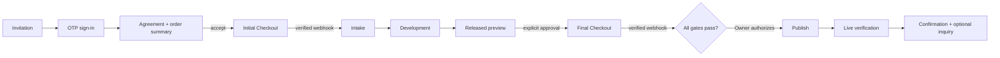

# 01 — Project Overview

| Field | Value |
|---|---|
| Version | 0.3.2 |
| Status | **Approved (final): v0.3.2.** Conditional [sign-off](OWNER-SIGNOFF-FOUNDATION-2026-11-22.md) on 2026-11-22; final approval of v0.3.2 in the Owner's written Phase 1 authorization, 2026-11-23 (recorded in 08 §4). Stage table updated for the Phase 2 authorization (status line only; 08 §5 v0.8.0). |
| Decisions | OI-01, OI-02, OI-03, OI-06, OI-07, OI-09, OI-24, OI-29, OI-41 |
| Labels | See [08 §2](08-DECISIONS-AND-CHANGELOG.md#2-requirement-classification-legend) |

## 1. Identity and purpose

| Item | Value |
|---|---|
| Organization | Spotlight Marketing LLC |
| Application | Spotlight Marketing Client Portal |
| Repository | `sjr425151-collab/spotlight-client-portal` |
| Production URL | `https://portal.spotlight-marketing.co` **[APPROVED OI-07]** |
| Agency website | `https://spotlight-marketing.co`. Remains on GoHighLevel and is independent of the portal. **[APPROVED OI-07]** |

The portal is a standalone web application on its own subdomain. It is not a page, path, or embed within the GoHighLevel website, and it is not served under `/clientportal`. **[APPROVED OI-07]**

**Purpose:** a premium, secure portal that takes each client from agreement acceptance and payment through onboarding, development, preview review, final payment, publication, and post-launch confirmation, with as much automation as possible.

## 2. Business objectives

1. Remove manual contract, invoicing, and onboarding handling for standard website packages.
2. Collect payment only against an accepted, versioned agreement with preserved evidence (OI-13, OI-17).
3. Prevent publication of any client website that has not met every contractual and quality gate (OI-22).
4. Give clients a premium, accessible experience that matches the agency brand (OI-12, OI-23).
5. Keep a complete, auditable record of every financial and approval event (OI-05, OI-19).

## 3. MVP scope

The MVP covers the following client journey **[APPROVED baseline]**:

| # | Step | Authoritative evidence | Spec |
|---|---|---|---|
| 1 | Client receives a secure invitation | Invitation record | 03 §6 |
| 2 | Client authenticates with passwordless email OTP | Supabase Auth session and auth audit event | 03 §5 |
| 3 | Client reviews the versioned agreement and project-specific order summary | Agreement version and order summary snapshot | 04 §1–§4 |
| 4 | Client affirmatively accepts (unchecked checkbox) | Acceptance evidence record | 04 §3 |
| 5 | Client completes Stripe Checkout for deposit + first $99 maintenance | Verified webhook and ledger entries | 04 §8 |
| 6 | Verified payment unlocks the branded onboarding intake | Deposit state = `verified` | 05 §3 |
| 7 | Client submits business details, logos, service areas, photos, contact info, and preferences | Intake submission and asset records | 05 §3–§5 |
| 8 | Project enters development | Development state | 05 §2 |
| 9 | Client reviews an immutable, versioned website preview | Preview release record | 05 §6 |
| 10 | Client explicitly approves the current released preview | Approval record bound to the release ID | 05 §7 |
| 11 | Client completes the remaining 80% balance | Verified webhook and ledger entries | 04 §10 |
| 12 | Owner authorizes publication after all gates pass | Gate evaluation and Owner authorization record | 06 §2–§3 |
| 13 | System verifies the live deployment | Verification record | 06 §9 |
| 14 | Client receives confirmation and may optionally inquire about more services | Notification and inquiry record | 06 §10–§11 |

Ongoing billing self-service: through the hosted Stripe Customer Portal, clients manage payment methods and view invoices and subscription details. Self-service cancellation is disabled. Cancellation requests follow 04 §15.1.1. **[APPROVED OI-29]**

## 4. Exclusions and future roadmap

The following items are **not** MVP commitments. They are recorded only as future opportunities and need separate owner decisions:

- A full future client dashboard (beyond the journey in §3).
- Autonomous AI agents.
- Google Sheets or Google Drive integrations.
- Client CRM integrations.
- Automated execution of marketing campaigns, and marketing automation email sequences (OI-04).
- Automatic purchase of upsell services. Post-publication offers are inquiry-only (OI-24).
- Multi-agency SaaS tenancy (OI-09).
- An active Fulfillment role. It may be defined, but stays disabled (OI-03).

## 5. Tenancy summary

One agency (Spotlight Marketing) serves many **client businesses**. Each business has one or more **projects**. Access is granted through **project memberships**, enforced by Supabase RLS, private storage, and server-side authorization. **[APPROVED OI-09]** Details are in 03.

## 6. Roles overview **[APPROVED OI-03]**

| Role | Summary |
|---|---|
| Owner | Spotlight Marketing principal. Full administrative authority. Sole authority for financial exceptions, staff management, and publication authorization. |
| Admin | Spotlight staff. Day-to-day project operations. No financial exceptions, staff management, or publication authorization. |
| Client | An authorized contact of a client business. Access is limited to projects where they hold membership. Only a client can approve their own project's released preview. |
| Fulfillment (future) | Defined for future use only. **Disabled.** It cannot be assigned in the MVP. |

The full permission matrix is in [03 §4](03-SECURITY-AUTH-AND-TENANCY.md#4-permissions-matrix).

## 7. Development phases **[APPROVED OI-02]**

Each phase requires **separate written owner authorization**. None is currently authorized.

| Phase | Scope | Entry criteria **[PROPOSED]** | Exit criteria **[PROPOSED]** |
|---|---|---|---|
| 1. Foundation and CI | Repository tooling, CI, environments, design tokens scaffold | Specs 01, 02 and CLAUDE.md approved (sign-off 2026-11-22) with the mandatory reconciliation confirmed; DEP-10 (branch protection) and DEP-08 logo confirmation complete; DEP-11 (version pins) planned; Phase 1 authorized | CI green on lint, typecheck, unit and e2e smoke; environments documented |
| 2. Auth, security, tenant isolation | Supabase Auth, memberships, RLS, audit log, MFA | Spec 03 approved; Phase 1 exited; Supabase items of DEP-06 verified; Phase 2 authorized | All 03 §13 tests pass |
| 3. Agreement and Stripe test-mode billing | Agreement acceptance, initial Checkout, Customer Portal (test), webhooks, ledger, holds, adjustments | Spec 04 approved; DEP-01 (test catalog) complete; OI-47 decided; Stripe items of DEP-06 verified, including the OI-44 discount restriction and the OI-46 `past_due` behavior; Phase 3 authorized | All 04 §16 tests pass in test mode |
| 4. Intake, fulfillment, previews, final payment, publishing | 05, 06, 07 workflows | Specs 05–07 approved; DEP-07 (scanner) selected; Vercel/Resend items of DEP-06 verified; Phase 4 authorized | All 05, 06, 07 acceptance tests pass |
| 5. Hardening and production readiness | Performance, security review, runbooks, production config | Phases 1–4 exited; Phase 5 authorized | 02 §11 prerequisites P-1–P-8 evidenced; DEP-02–DEP-05, DEP-08, DEP-09 complete; production launch requires separate authorization (OI-01 stage 4) |

**Stripe test-mode catalog exception [APPROVED OI-30]:** the Owner has narrowly authorized creating the test-mode products and prices in 04 §6. This is not Phase 3 authorization, and it authorizes no integration code, webhook deployment, or live-mode change.

## 8. Approval governance **[APPROVED OI-01]**

| Stage | Status |
|---|---|
| 1. Architecture approval | Approved |
| 2. Specification reconciliation | Specs 01 (v0.3.2), 02 (v0.4.0) and CLAUDE.md: **approved (final, 2026-11-23)**. Spec 03 (v0.4.0): **approved 2026-11-23**. Specs 04–08: in review. |
| 3. Implementation authorization | Phase 1 (Foundation and CI) authorized 2026-11-23 and merged. **Phase 2 (Auth, security, tenant isolation) authorized 2026-11-23** (local Supabase, synthetic data). Phases 3–5 not authorized. |
| 4. Production launch authorization | **Not authorized** |

Approving this or any specification does not authorize implementation.

Documentation governance **[APPROVED OI-06]**: owner-approved decisions (08) establish architectural requirements. Reconciled specifications (01–07) define detailed implementation requirements once approved. CLAUDE.md sets operating instructions. README is the developer entry point. Conflicts are escalated to the Owner, never silently resolved.

## 9. Measurable MVP acceptance criteria **[PROPOSED]**

The MVP is complete only when every item below passes in staging with Stripe test mode, and is evidenced by automated tests or recorded verification:

1. A user without an invitation cannot create an account or sign in (03 §13 T-AUTH-01).
2. A client of project A cannot read, write, or list any record or file of project B, through any API, RLS-protected query, or storage path (03 §13 T-TEN-01 to 05).
3. Initial Checkout cannot be started without a recorded acceptance of the current agreement version for that project (04 §16 T-AGR-02).
4. The initial invoice total equals deposit + 9,900 cents for each of the five packages (04 §16 T-PAY-01).
5. A Checkout success redirect without a processed, signature-verified webhook leaves the deposit state at `pending` (04 §16 T-PAY-04).
6. Replaying any webhook event produces no additional ledger entries (04 §16 T-PAY-05).
7. Intake is inaccessible until the deposit is verified (05 §11 T-LC-01).
8. An approval recorded for preview release *n* does not satisfy the approval gate after release *n+1* is released (05 §9 T-LC-06).
9. Publication cannot run when any mandatory gate fails, including through an Owner action (06 §12 T-PUB-01 to 09).
10. Each privileged action produces an immutable audit event (03 §13 T-AUD-01).
11. Post-publication inquiries create a queue entry and notification, and create no Stripe objects (06 §12 T-INQ-02).
12. Portal pages meet the OI-23 Lighthouse thresholds in CI on the staging build (02 §7).
