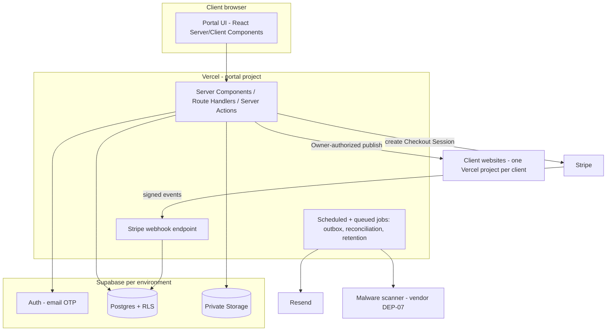

# 02 — Architecture and Environments

| Field | Value |
|---|---|
| Version | 0.3.1 |
| Status | **Draft — pending owner sign-off** |
| Decisions | OI-07, OI-10, OI-11, OI-22, OI-23, OI-29, OI-32, OI-39, OI-41, OI-43 |
| Dependencies | DEP-06, DEP-09, DEP-11, DEP-12 (DEP-10 complete) |

## 1. Application architecture

The portal is one Next.js App Router application, written in strict TypeScript and deployed on Vercel at `portal.spotlight-marketing.co`. **[APPROVED OI-07, OI-10, OI-11]**

Architectural principles:
- **[APPROVED OI-09, OI-17, OI-22]** All authorization, payment verification, and gate evaluation run on the server. The browser is never trusted for these decisions.
- **[PROPOSED]** The Supabase service-role key is used only in server-side code paths that need it (webhooks, jobs, admin operations). Every other request uses the caller's session so that RLS applies.
- **[PROPOSED]** Business rules (state transitions, gate evaluation, money calculations) sit in a framework-independent domain layer, for testability and portability (OI-10).

## 2. Portal versus client website separation **[APPROVED OI-07, OI-22]**

| Concern | Portal | Client websites |
|---|---|---|
| Purpose | Onboarding, billing, approval, publishing control | Each client's public website |
| Hosting | Vercel project for the portal | **Agency-managed Vercel. An independent project per client website**, with separate environment configuration and release history **[APPROVED OI-32]** (06 §4) |
| Domain | `portal.spotlight-marketing.co` | Each client's own domain |
| Code | This repository | Not in this repository. Referenced only by immutable release identifiers. |
| Data | Portal database and storage | None of the portal's data. Approved assets are copied in at build time by a controlled process. |

The GoHighLevel agency site is a third, independent system. The portal does not read from it, write to it, or depend on it.

## 3. Technology stack **[APPROVED OI-11]**

| Layer | Choice | Note |
|---|---|---|
| Runtime | Node.js 24 LTS | Exact version pinned in Phase 1 |
| Package manager | pnpm | Lockfile committed in Phase 1 |
| Framework | Next.js App Router | — |
| Language | TypeScript, `strict` | — |
| Styling | Tailwind CSS with centralized tokens | 07 §10 |
| Lint/format | ESLint, Prettier | — |
| Unit/integration tests | Vitest | — |
| E2E tests | Playwright | — |
| Auth/DB/storage | Supabase Auth, Postgres, RLS, Storage | — |
| Payments | Stripe Checkout, Billing, and hosted Customer Portal (OI-29) | 04 |
| Email | Resend (operational), Supabase Auth email (auth) | 07 |
| Hosting/CI | Vercel, GitHub Actions | — |

No tooling is installed as part of this documentation change set.

## 4. Environment isolation **[APPROVED OI-10]**

| Environment | Purpose | Supabase | Stripe | Resend | Data |
|---|---|---|---|---|---|
| Development | Local engineering | Local or dedicated dev project **[PROPOSED]** | Test mode | Sandbox, or sends suppressed **[PROPOSED]** | Synthetic only |
| Preview | Per-PR Vercel previews | Shared non-production project **[PROPOSED]** | Test mode | Sends suppressed or allow-listed **[PROPOSED]** | Synthetic only |
| Staging | Release candidate verification | Dedicated staging project | Test mode | Verified staging sender domain **[PROPOSED]** | Synthetic only |
| Production | Live clients | Dedicated production project | **Live mode** (requires production authorization) | Verified production domain | Real client data |

Rules:
1. **[APPROVED OI-10]** Each environment has separate credentials. No production secret is ever available to development, preview, or staging.
2. **[PROPOSED]** Non-production environments may never hold live Stripe keys. Deployment configuration fails closed if a live key is detected outside production.
3. **[PROPOSED]** Production data is never copied into non-production environments.
4. **[APPROVED OI-10]** Preview deployments are protected (access-restricted) **[VERIFY-PROVIDER — Vercel plan feature, OI-39]**.

## 5. Vercel and GitHub Actions responsibilities

| Responsibility | Owner system |
|---|---|
| Lint, typecheck, unit tests, e2e tests, Lighthouse budgets, dependency audit, secret scan | GitHub Actions **[PROPOSED]** |
| Preview deployment per PR | Vercel |
| Staging deployment from `main` | Vercel **[PROPOSED]** |
| Production promotion | Vercel. **Owner-initiated only.** **[APPROVED OI-10]** |
| Required status checks before merge | GitHub. Branch protection is configured by the Owner, not by an agent. The ruleset `protect-main` is active (DEP-10). Phase 1 CI checks are added as required status checks once they exist. |

## 6. Deployment and rollback architecture (portal)

- **[APPROVED OI-10]** Releases are owner-controlled. Each production deployment corresponds to an identified commit SHA.
- **[PROPOSED]** Production is promoted from a staging-verified build artifact rather than rebuilt.
- **[APPROVED OI-10]** Rollback means promoting the previous known-good deployment **[VERIFY-PROVIDER]**. Database migrations must be backward-compatible with the previous release (expand/contract), so that an application rollback never needs a destructive migration rollback. **[PROPOSED]**
- Client website publishing and rollback are specified separately in 06.

## 7. Performance budgets **[APPROVED OI-23]**

| Metric | Target | Measurement **[PROPOSED]** |
|---|---|---|
| LCP (p75) | ≤ 2.5 s | Field RUM in production; lab in CI |
| INP (p75) | ≤ 200 ms | Field RUM |
| CLS (p75) | ≤ 0.1 | Field RUM and lab |
| Lighthouse mobile Performance | ≥ 90 | CI against staging/preview, median of ≥ 3 runs |
| Lighthouse Accessibility | ≥ 95 | CI |
| Lighthouse Best Practices | ≥ 95 | CI |
| Lighthouse SEO (public pages) | ≥ 90 | CI. Authenticated pages are `noindex` and excluded from the SEO budget. |
| Ordinary application reads | p95 < 500 ms | Server timing in monitoring |

Release policy **[APPROVED OI-23]**:
- A performance regression requires release review by the Owner.
- Security and payment-correctness failures are hard release gates that cannot be waived.

## 8. Monitoring **[APPROVED OI-10, OI-23]**

**[PROPOSED]** Minimum signals:
- Error tracking (server and client).
- Uptime checks on the portal and the webhook endpoint.
- Webhook processing lag and failures.
- Outbox backlog and failed sends.
- Reconciliation mismatches (04 §13).
- Core Web Vitals.
- Cost alerts on Vercel, Supabase, and Resend usage (OI-10 cost controls).

The monitoring vendor is not selected; it is chosen in Phase 1 or Phase 5.

## 9. Secrets and configuration management

1. **[APPROVED baseline]** No secrets are committed to the repository. `.env.example` (created during Phase 1) lists variable *names* only.
2. **[PROPOSED]** Secrets live in Vercel environment variables, scoped per environment, and in GitHub Actions secrets where CI needs them.
3. **[PROPOSED]** Only server code may reference server-only secrets. The build fails if one is exposed to client bundles.
4. **[PROPOSED]** The Stripe webhook signing secret, the Supabase service-role key, and the Resend API key are rotated on staff change or suspected exposure, following a documented procedure.
5. Stripe **Price IDs** are identifiers, not credentials. They may be stored in versioned configuration (04 §5).

## 10. Provider verification **[APPROVED OI-39]**

Before implementing any integration, verify these against current official provider sources and record the result in the relevant spec (DEP-06):
- current APIs
- supported features
- authentication requirements
- webhook capabilities
- security controls
- usage limits
- costs
- recovery and failure behavior

This applies to Stripe, Supabase, Vercel, Resend, and any future Google integration. A finding that materially changes the architecture or cost is **escalated to the Owner** before work continues.

| Provider | Items marked **[VERIFY-PROVIDER]** |
|---|---|
| Stripe | One-time prices in subscription-mode Checkout; Customer Portal configuration (cancellation disabled); retry settings; dispute events; Stripe Tax; webhook event set |
| Supabase | Email OTP and custom SMTP; disabling sign-ups; MFA/AAL2; RLS on Storage; resumable uploads and the 250 MB object limit; PITR/backup retention versus 30 days |
| Vercel | Protected previews; separate environments; instant rollback; per-client project and domain limits; team separation; costs at scale |
| Resend | Domain verification per environment; idempotency keys; bounce and complaint webhooks |

## 11. Production infrastructure **[APPROVED OI-41]**

**Approved architecture:**
- `portal.spotlight-marketing.co` on Vercel
- Supabase, Stripe, Resend, and GitHub
- independent Vercel deployments for client websites

**The main agency website remains unchanged.**

Prerequisites before **production deployment**, each requiring evidence:

| # | Prerequisite |
|---|---|
| P-1 | Isolated environments (§4) configured and verified |
| P-2 | Protected DNS: registrar lock and MFA on the DNS account; only a `portal` subdomain record added; GoHighLevel apex records untouched **[PROPOSED detail]** |
| P-3 | Authentication and authorization verified (03 §13 all passing) |
| P-4 | Stripe test-mode payment scenarios verified (04 §16 all passing in test mode) |
| P-5 | Security testing completed (03 §13 and an independent review **[PROPOSED]**) |
| P-6 | Monitoring active (§8) |
| P-7 | Backup restore tested and portal rollback rehearsed (§6) |
| P-8 | Release-specific QA for the portal release |
| P-9 | **Explicit Owner production launch authorization (OI-01 stage 4)** |

None of P-1 to P-9 is complete. Documenting this architecture does **not** authorize creating production infrastructure, changing DNS, or deploying (DEP-09).

## 12. Dependencies

| Item | Reference |
|---|---|
| Provider verification | DEP-06 |
| Malware scanning vendor | DEP-07 |
| Production infrastructure and DNS | DEP-09 |
| Branch protection on `main` (Owner action) | DEP-10: **complete** |
| Toolchain version pins | DEP-11 |
| Monitoring vendor | DEP-12 |

## 13. Deadline calendar and time handling **[APPROVED OI-43]**

This one calendar is shared by notifications, billing, fulfillment, and administrative deadlines. It is never re-implemented per feature **[PROPOSED]**.

| Rule | Specification |
|---|---|
| Storage | All authoritative timestamps are stored in **UTC** |
| Evaluation time zone | **`America/Detroit`** (Eastern Time, including daylight saving transitions) for every business-day and calendar-day rule |
| Business day | Monday through Friday, excluding U.S. federal holidays (§13.1) |
| Business-day deadline | Ends at **23:59:59 America/Detroit** (11:59:59 PM Eastern Time) on the applicable business day |
| Calendar-day period | Uses Michigan local time (America/Detroit) and **includes** weekends and holidays |
| Prohibited | Approximating business or calendar days by adding 24-hour periods to a UTC timestamp |

### 13.1 U.S. federal holiday calendar

**[APPROVED OI-43]** A defined U.S. federal holiday calendar is required. **[PROPOSED]** The source is 5 U.S.C. § 6103:
- New Year's Day (Jan 1)
- Birthday of Martin Luther King, Jr. (3rd Monday of January)
- Washington's Birthday (3rd Monday of February)
- Memorial Day (last Monday of May)
- Juneteenth National Independence Day (Jun 19)
- Independence Day (Jul 4)
- Labor Day (1st Monday of September)
- Columbus Day (2nd Monday of October)
- Veterans Day (Nov 11)
- Thanksgiving Day (4th Thursday of November)
- Christmas Day (Dec 25)

**[PROPOSED]** Observed-date rule: a fixed-date holiday that falls on a Saturday is observed the preceding Friday, and one on a Sunday is observed the following Monday. The observed date is not a business day.

**[PROPOSED]** Calendar maintenance:
- The calendar is stored as versioned data, generated per year and reviewed annually.
- Ad hoc federal closures are added only through an Owner-approved, audited calendar change.
- Every computed deadline records the calendar version used.

### 13.2 Counting conventions

| Convention | Rule |
|---|---|
| Trigger date | **Excluded** from counting. Counting starts on the next calendar day, or the next business day for business-day rules. **[PROPOSED — subject to legal confirmation, DEP-03]** |
| *N* business days after trigger *T* | Deadline = 23:59:59 America/Detroit on the *N*th business day after *T*'s local date |
| *N* full calendar days after trigger *T* | The period ends at 23:59:59 America/Detroit on the *N*th calendar day after *T*'s local date. Example: a payment fails Monday 22:00 local; seven full calendar days run Tuesday through the following Monday; recovery ends the following Monday at 23:59:59. |
| Day-*N* milestone | Day *N* is the local date *N* calendar days after the trigger's local date. The milestone is due from 00:00 local on that date. **[PROPOSED]** Client reminders are sent at 10:00 America/Detroit on that date. |
| Daylight saving | Local times are converted with the IANA time-zone database. 23:59:59 local always exists, because transitions occur at 02:00. |
| Consistency | Deadlines are computed once at the trigger, stored in UTC together with the calendar version, and reused by every system. They are recomputed only by an audited correction. |

### 13.3 Applications

| Rule | Day type | Spec |
|---|---|---|
| 12-business-day post-cancellation website transition | Business days | 04 §15.1 |
| Seven-full-calendar-day failed-payment recovery (**never** business days) | Calendar days | 04 §9.1 |
| Preview follow-up days 3, 7, 14, 21 | Calendar days | 05 §7.1 |
| Contractual business-day obligations (for example the draft agreement's five-business-day review) | Business days | 05 §7 |
| Administrative deadlines (dispute evidence reminders, retention due dates) | As defined per rule | 04 §15.4, 07 §6 |

Final contractual wording for all of these remains subject to legal review (DEP-03).

### 13.4 Acceptance tests **[PROPOSED]**

| ID | Test |
|---|---|
| T-CAL-01 | 12 business days from an effective date spanning Thanksgiving, or Christmas and New Year's, skips weekends and holidays, and ends at 23:59:59 America/Detroit |
| T-CAL-02 | Seven full calendar days across a DST change ends at 23:59:59 local on the 7th day after the trigger date, not trigger + 168 hours |
| T-CAL-03 | Observed holidays (for example July 4 on a Saturday) are treated as non-business days |
| T-CAL-04 | All stored deadlines are UTC, and each records its calendar version. Notification, billing, and fulfillment read the same stored deadline. |
| T-CAL-05 | No code path computes deadlines by adding 24-hour multiples (code search and unit tests) |
