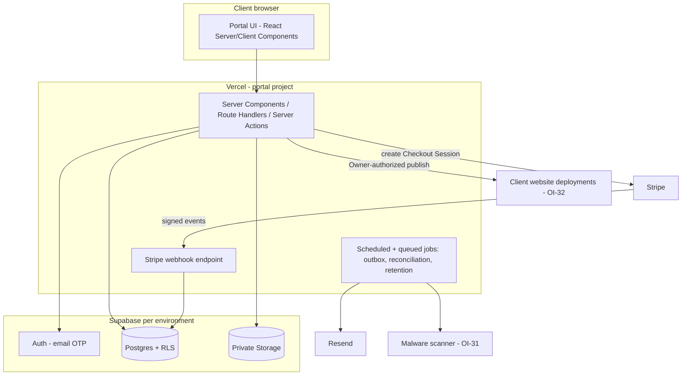

# 02 — Architecture and Environments

| Field | Value |
|---|---|
| Version | 0.1.0 |
| Status | **Draft — pending owner sign-off** |
| Decisions | OI-07, OI-10, OI-11, OI-22, OI-23 |
| Open issues | OI-32, OI-39, OI-41 |

## 1. Application architecture

The portal is one Next.js App Router application, written in strict TypeScript and deployed on Vercel at `portal.spotlight-marketing.co`. **[APPROVED OI-07, OI-10, OI-11]**

Architectural principles:
- **[APPROVED OI-09, OI-17, OI-22]** All authorization, payment verification, and gate evaluation run on the server. The browser is never trusted for these decisions.
- **[PROPOSED]** The Supabase service-role key is used only in server-side code paths that need it (webhooks, jobs, admin operations). Every other request uses the caller's session so that RLS applies.
- **[PROPOSED]** Business rules (state transitions, gate evaluation, money calculations) sit in a framework-independent domain layer, for testability and portability (OI-10).

## 2. Portal versus client website separation **[APPROVED OI-07, OI-22]**

| Concern | Portal | Client websites |
|---|---|---|
| Purpose | Onboarding, billing, approval, publishing control | Each client's public website |
| Hosting | Vercel project for the portal | **Isolated per-client deployments.** Platform and account model pending (**[PENDING OI-32]**). |
| Domain | `portal.spotlight-marketing.co` | Each client's own domain |
| Code | This repository | Not in this repository. Referenced only by immutable release identifiers. |
| Data | Portal database and storage | None of the portal's data. Approved assets are copied in at build time by a controlled process. |

The GoHighLevel agency site is a third, independent system. The portal does not read from it, write to it, or depend on it.

## 3. Technology stack **[APPROVED OI-11]**

| Layer | Choice | Note |
|---|---|---|
| Runtime | Node.js 24 LTS | Exact version pinned in Phase 1 |
| Package manager | pnpm | Lockfile committed in Phase 1 |
| Framework | Next.js App Router | — |
| Language | TypeScript, `strict` | — |
| Styling | Tailwind CSS with centralized tokens | 07 §10 |
| Lint/format | ESLint, Prettier | — |
| Unit/integration tests | Vitest | — |
| E2E tests | Playwright | — |
| Auth/DB/storage | Supabase Auth, Postgres, RLS, Storage | — |
| Payments | Stripe Checkout and Billing | 04 |
| Email | Resend (operational), Supabase Auth email (auth) | 07 |
| Hosting/CI | Vercel, GitHub Actions | — |

No tooling is installed as part of this documentation change set.

## 4. Environment isolation **[APPROVED OI-10]**

| Environment | Purpose | Supabase | Stripe | Resend | Data |
|---|---|---|---|---|---|
| Development | Local engineering | Local or dedicated dev project **[PROPOSED]** | Test mode | Sandbox, or sends suppressed **[PROPOSED]** | Synthetic only |
| Preview | Per-PR Vercel previews | Shared non-production project **[PROPOSED]** | Test mode | Sends suppressed or allow-listed **[PROPOSED]** | Synthetic only |
| Staging | Release candidate verification | Dedicated staging project | Test mode | Verified staging sender domain **[PROPOSED]** | Synthetic only |
| Production | Live clients | Dedicated production project | **Live mode** (requires production authorization) | Verified production domain | Real client data |

Rules:
1. **[APPROVED OI-10]** Each environment has separate credentials. No production secret is ever available to development, preview, or staging.
2. **[PROPOSED]** Non-production environments may never hold live Stripe keys. Deployment configuration fails closed if a live key is detected outside production.
3. **[PROPOSED]** Production data is never copied into non-production environments.
4. **[APPROVED OI-10]** Preview deployments are protected (access-restricted) **[VERIFY-PROVIDER — Vercel plan feature, OI-39]**.

## 5. Vercel and GitHub Actions responsibilities

| Responsibility | Owner system |
|---|---|
| Lint, typecheck, unit tests, e2e tests, Lighthouse budgets, dependency audit, secret scan | GitHub Actions **[PROPOSED]** |
| Preview deployment per PR | Vercel |
| Staging deployment from `main` | Vercel **[PROPOSED]** |
| Production promotion | Vercel. **Owner-initiated only.** **[APPROVED OI-10]** |
| Required status checks before merge | GitHub. Branch protection is configured by the Owner, not by an agent. |

## 6. Deployment and rollback architecture (portal)

- **[APPROVED OI-10]** Releases are owner-controlled. Each production deployment corresponds to an identified commit SHA.
- **[PROPOSED]** Production is promoted from a staging-verified build artifact rather than rebuilt.
- **[APPROVED OI-10]** Rollback means promoting the previous known-good deployment **[VERIFY-PROVIDER]**. Database migrations must be backward-compatible with the previous release (expand/contract), so that an application rollback never needs a destructive migration rollback. **[PROPOSED]**
- Client website publishing and rollback are specified separately in 06.

## 7. Performance budgets **[APPROVED OI-23]**

| Metric | Target | Measurement **[PROPOSED]** |
|---|---|---|
| LCP (p75) | ≤ 2.5 s | Field RUM in production; lab in CI |
| INP (p75) | ≤ 200 ms | Field RUM |
| CLS (p75) | ≤ 0.1 | Field RUM and lab |
| Lighthouse mobile Performance | ≥ 90 | CI against staging/preview, median of ≥ 3 runs |
| Lighthouse Accessibility | ≥ 95 | CI |
| Lighthouse Best Practices | ≥ 95 | CI |
| Lighthouse SEO (public pages) | ≥ 90 | CI. Authenticated pages are `noindex` and excluded from the SEO budget. |
| Ordinary application reads | p95 < 500 ms | Server timing in monitoring |

Release policy **[APPROVED OI-23]**:
- A performance regression requires release review by the Owner.
- Security and payment-correctness failures are hard release gates that cannot be waived.

## 8. Monitoring **[APPROVED OI-10, OI-23]**

**[PROPOSED]** Minimum signals:
- Error tracking (server and client).
- Uptime checks on the portal and the webhook endpoint.
- Webhook processing lag and failures.
- Outbox backlog and failed sends.
- Reconciliation mismatches (04 §13).
- Core Web Vitals.
- Cost alerts on Vercel, Supabase, and Resend usage (OI-10 cost controls).

The monitoring vendor is not selected; it is chosen in Phase 1 or Phase 5.

## 9. Secrets and configuration management

1. **[APPROVED baseline]** No secrets are committed to the repository. `.env.example` (created during Phase 1) lists variable *names* only.
2. **[PROPOSED]** Secrets live in Vercel environment variables, scoped per environment, and in GitHub Actions secrets where CI needs them.
3. **[PROPOSED]** Only server code may reference server-only secrets. The build fails if one is exposed to client bundles.
4. **[PROPOSED]** The Stripe webhook signing secret, the Supabase service-role key, and the Resend API key are rotated on staff change or suspected exposure, following a documented procedure.
5. Stripe **Price IDs** are identifiers, not credentials. They may be stored in versioned configuration (04 §5).

## 10. Dependencies and unresolved infrastructure decisions

| Item | Reference |
|---|---|
| Client website hosting/account model | OI-32 |
| Provider plan capabilities (protected previews, PITR retention, MFA, resumable uploads) | OI-39 |
| Production DNS for the `portal` subdomain alongside GoHighLevel | OI-41 |
| Monitoring vendor | To be proposed in Phase 1 **[PROPOSED]** |
| Malware scanning infrastructure | OI-31 |
