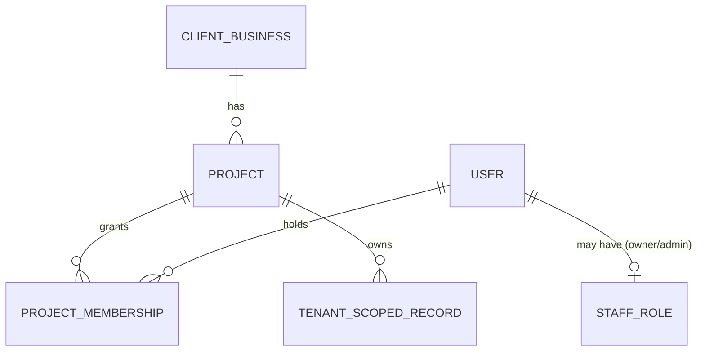

# 03 — Security, Authentication, and Tenancy

| Field | Value |
|---|---|
| Version | 0.3.0 |
| Status | **Draft — pending owner sign-off** |
| Decisions | OI-03, OI-08, OI-09, OI-19, OI-25–OI-29, OI-31, OI-35, OI-37, OI-39, OI-44–OI-46 |
| Open issues | OI-47 |
| Dependencies | DEP-06 |

## 1. Security objectives

1. No client can access another project's data or files (OI-09).
2. No payment, approval, or QA state can be fabricated (OI-17, OI-19).
3. No client website can be published without every mandatory gate (OI-22).
4. Every privileged action is attributable and immutable in the audit log (OI-03, OI-19).

## 2. Threat model **[PROPOSED]**

| # | Threat | Primary controls |
|---|---|---|
| TM-1 | Cross-tenant read/write through API or direct Supabase queries | RLS on every tenant table; server authorization; isolation tests (§13) |
| TM-2 | Cross-tenant storage access through guessed or leaked paths | Private buckets; path-scoped RLS on `storage.objects`; short-lived signed URLs issued server-side after authorization |
| TM-3 | Account takeover through email compromise or OTP brute force | OTP rate limits and expiry **[VERIFY-PROVIDER]**; session revocation; admin MFA |
| TM-4 | Privilege escalation (client to admin, admin to owner) | Roles held in server-controlled tables that clients cannot write; role checks in RLS and in server code |
| TM-5 | Forged payment state (fake webhook, redirect spoofing, replay) | Signature verification; event-ID idempotency; redirect never trusted (04 §11) |
| TM-6 | Malicious uploads (malware, SVG script, polyglots, decompression bombs) | Quarantine and scan; content sniffing; SVG sanitization; size limits (05 §5) |
| TM-7 | Insider misuse of overrides | Owner-only exceptions; reauthentication; reasons; immutable audit; no fabrication paths (§12) |
| TM-8 | Secret leakage (service-role key in client bundle, logs) | Server-only secrets; CI bundle scan; log redaction (02 §9) |
| TM-9 | Unauthorized publication | Server gate evaluator; Owner authorization with reauthentication (06) |
| TM-10 | CSRF / clickjacking / XSS on portal pages | Framework CSRF protections for server actions **[VERIFY-PROVIDER]**; CSP; `frame-ancestors 'none'`; output encoding |

## 3. Roles **[APPROVED OI-03]**

- **Owner**: one or more Spotlight principals designated by the Owner. Holds every Admin permission, plus financial exceptions, staff management, and publication authorization.
- **Admin**: Spotlight staff with operational permissions.
- **Client**: a contact of a client business. Permissions are scoped per project membership.
- **Fulfillment (future)**: may be defined in the schema as a reserved value. It **must not be assignable**. Any attempt to assign it is rejected and audited **[APPROVED OI-03; enforcement detail PROPOSED]**.

Staff roles (Owner, Admin) are global to the single agency. Client access always goes through a project membership.

## 4. Permissions matrix

Key: ✅ allowed · ❌ denied · **M** = only for projects where the client holds an active membership.

| Action | Owner | Admin | Client | Fulfillment (disabled) |
|---|---|---|---|---|
| Invite / remove staff | ✅ | ❌ | ❌ | ❌ |
| Change staff role | ✅ | ❌ | ❌ | ❌ |
| Create client business and project | ✅ | ✅ | ❌ | ❌ |
| Invite client contact to a project | ✅ | ✅ | ❌ **[PROPOSED]** | ❌ |
| Revoke client membership or sessions | ✅ | ✅ | ❌ | ❌ |
| Prepare order summary (package selection) | ✅ | ✅ | ❌ | ❌ |
| View agreement and order summary | ✅ | ✅ | M | ❌ |
| Accept agreement | ❌ | ❌ | M (authorized signer) | ❌ |
| Start initial / final Checkout | ❌ | ❌ | M | ❌ |
| View payments and ledger | ✅ | ✅ (read) | M (own invoices) | ❌ |
| Discount, credit, partial waiver, or full waiver **[APPROVED OI-27]** | ✅ (reauthentication) | ❌ | ❌ | ❌ |
| Hold exceptions (clear a system hold) **[APPROVED OI-26]** | ✅ (reauthentication) | ❌ | ❌ | ❌ |
| Place / clear `owner_manual_hold` or `dispute_risk_hold` | ✅ | ❌ | ❌ | ❌ |
| Place `approval_nonresponsive_hold` (day 21+, after documented outreach) **[APPROVED OI-45]** | ✅ | ✅ | ❌ | ❌ |
| Clear `approval_nonresponsive_hold` **without** a client response **[APPROVED OI-45]** | ✅ (reason required) | ❌ | ❌ | ❌ |
| Clear `approval_nonresponsive_hold` after a qualifying client response **[APPROVED OI-45]** | ✅ | ✅ | ❌ | ❌ |
| Approve or request revisions on a held preview **[APPROVED OI-45]** | ❌ | ❌ | M | ❌ |
| Authorize a final-balance discount (adjusted Checkout) **[APPROVED OI-44]** | ✅ (reauthentication) | ❌ | ❌ | ❌ |
| Billing hold Owner review: continue collection, authorize exception, or initiate documented service termination **[APPROVED OI-46]** | ✅ (reauthentication for exception or termination) | ❌ | ❌ | ❌ |
| Resolve an unexpected Stripe cancellation exception **[APPROVED OI-46]** | ✅ | ❌ | ❌ | ❌ |
| Record personal follow-up outreach (OI-25) | ✅ | ✅ | ❌ | ❌ |
| Respond to or settle a dispute **[APPROVED OI-37]** | ✅ (reauthentication) | ❌ | ❌ | ❌ |
| Discretionary refund decision **[APPROVED OI-35]** | ✅ (reauthentication) | ❌ | ❌ | ❌ |
| Open Stripe Customer Portal for own billing **[APPROVED OI-29]** | ❌ | ❌ | M (billing contact) | ❌ |
| Submit subscription cancellation request **[APPROVED OI-35]** | ❌ | ❌ | M | ❌ |
| Confirm cancellation / schedule it in Stripe | ✅ | ❌ **[PROPOSED]** | ❌ | ❌ |
| Decommission a client site after the transition deadline | ✅ (reauthentication) | ❌ | ❌ | ❌ |
| Submit / edit intake | ❌ | ✅ (correct on client's behalf, audited) **[PROPOSED]** | M | ❌ |
| Upload assets | ✅ | ✅ | M | ❌ |
| Approve non-standard file types / quota exceptions | ✅ | ✅ (within approved rules) | ❌ | ❌ |
| Create internal preview drafts | ✅ | ✅ | ❌ | ❌ |
| Release a preview to the client | ✅ | ✅ | ❌ | ❌ |
| **Approve a released preview** | ❌ | ❌ | M | ❌ |
| Record QA and security checklist results | ✅ | ✅ | ❌ | ❌ |
| **Authorize publication** | ✅ (reauthentication) | ❌ | ❌ | ❌ |
| Initiate rollback | ✅ (reauthentication) | ❌ **[PROPOSED]** | ❌ | ❌ |
| Submit post-publication inquiry | ❌ | ❌ | M | ❌ |
| View audit log | ✅ | ✅ (read, non-financial) **[PROPOSED]** | ❌ | ❌ |
| Process data export / deletion requests | ✅ | ✅ (prepare; Owner executes deletion) **[PROPOSED]** | Request only | ❌ |

Owner and Admin **cannot** approve a preview on a client's behalf, accept an agreement on a client's behalf, or record a payment as received. **[APPROVED OI-03, OI-19]**

## 5. Authentication **[APPROVED OI-08]**

- Supabase Auth with passwordless email OTP. Password sign-in is disabled. **[VERIFY-PROVIDER]**
- Self-service sign-up is disabled. Only invited email addresses can authenticate.
- **[PROPOSED]** OTP lifetime ≤ 10 minutes. Per-email and per-IP rate limits. Generic error messages that do not reveal whether an email exists. **[VERIFY-PROVIDER]** for configurable values.
- Auth emails use a properly configured custom SMTP sender, per environment (OI-04, 07). **[VERIFY-PROVIDER]**

## 6. Invitation and session lifecycle

**Workflow: invite client contact**

| Element | Specification |
|---|---|
| Actors | Owner/Admin (inviter), invitee |
| Preconditions | Project exists. Inviter has permission (§4). |
| Inputs | Email, full name, business, project, intended role (`client`) |
| Authoritative records | `invitations` (status, expiry, token hash), `project_memberships` |
| States | `pending → accepted` · `pending → expired` · `pending → revoked` |
| Failure states | Expired token; already-used token; email mismatch; revoked invitation |
| Recovery | Inviter re-issues an invitation (new token). The old one stays revoked or expired. |
| Audit events | `invitation.created`, `invitation.accepted`, `invitation.revoked`, `invitation.expired` |
| Idempotency | Accepting an already-accepted invitation is a no-op and does not create a duplicate membership. |
| Security | Single-use token, stored hashed. **[PROPOSED]** 7-day expiry. Membership is created only after OTP verification of the invited email. |

**Sessions:**
- **[APPROVED OI-08]** Sessions are revocable.
- Revoking a membership or deactivating a user invalidates the user's sessions, or denies them server-side on the next request **[PROPOSED: within 60 s]**.
- **[PROPOSED]** Session lifetimes: client idle 7 days; staff idle 12 hours and absolute 7 days.
- **[APPROVED OI-08]** Routing is decided server-side. An unauthenticated or unauthorized request never renders protected data, even partially.

## 7. MFA and reauthentication **[APPROVED OI-08, OI-19]**

- Owner and Admin accounts must enroll in MFA (TOTP or stronger) before any privileged action. Staff routes require an AAL2 session. **[VERIFY-PROVIDER]**
- **High-risk actions** need a fresh reauthentication (**[PROPOSED]** MFA challenge within the last 5 minutes):
  - authorize publication
  - initiate rollback
  - financial adjustment (discount, credit, waiver) **[APPROVED OI-27]**
  - discretionary refund, dispute response or settlement
  - hold exception
  - site decommissioning
  - staff role change
  - deletion execution
  - billing hold clearance where manual clearance is allowed
- Client MFA is not required in the MVP **[PROPOSED]**.

## 8. Tenant and project isolation model **[APPROVED OI-09]**

- Every tenant-scoped record carries a non-null `project_id` (and a `client_business_id` where useful). **[PROPOSED]**
- Client visibility = an active `project_membership` row with matching `user_id` and `project_id`.
- Staff visibility comes from the staff role. Staff never need a membership.
- Storage object paths are prefixed with `project_id`. Bucket policies enforce the same membership check. **[PROPOSED]**

## 9. RLS design requirements

1. **[APPROVED OI-09]** RLS is enabled on every table in exposed schemas. A table without policies is a CI failure **[PROPOSED]**.
2. **[PROPOSED]** Default-deny. Separate policies for `select`, `insert`, `update`, and `delete`. No `using (true)` on tenant tables.
3. **[PROPOSED]** Membership and role checks run through `security definer` helper functions with a fixed `search_path`.
4. **[PROPOSED]** Clients cannot write to: roles, memberships, payments, ledger, webhook events, gate results, approvals of other users, audit logs, or preview releases.
5. **[PROPOSED]** The audit log and ledger are append-only. No `update`/`delete` grants exist for any role except controlled retention jobs, which are themselves audited.
6. **[PROPOSED]** Service-role access is confined to server modules (webhooks, jobs). Those modules perform explicit authorization checks, because RLS is bypassed.

## 10. Server authorization

- **[APPROVED OI-09]** Every server action and route handler authorizes the caller against the target project *before* acting. RLS is defense in depth, not the only control.
- **[PROPOSED]** Authorization helpers are centralized and unit-tested. An endpoint without an authorization call fails a lint or test check.
- **[PROPOSED]** Object IDs from the client are never trusted to imply scope. They are re-resolved to `project_id` on the server.

## 11. Audit events **[APPROVED OI-03, OI-08, OI-19]**

Each audit event records:
- actor user ID, role, and AAL
- action and target (type, ID, `project_id`)
- timestamp (UTC)
- request ID, IP, and user agent **[PROPOSED]**
- reason (required for overrides)
- before/after summary, with no secrets

Minimum event catalog **[PROPOSED]**:
- **Auth:** sign-in success/failure, OTP requested, MFA enrolled/challenged, session revoked.
- **Membership:** invitation lifecycle, membership granted/revoked, staff role changed, Fulfillment assignment attempted.
- **Agreement:** order summary created/superseded, agreement accepted, reacceptance required.
- **Payment:** Checkout session created, webhook received/processed/rejected, ledger entry posted, hold placed/cleared, adjustment and discount authorized, billing hold Owner review decision, service termination authorized/effective/withdrawn, unexpected Stripe cancellation exception.
- **Lifecycle:** intake submitted, asset uploaded/quarantined/released/rejected/marked used, preview released, approval recorded/superseded, follow-up outreach recorded, approval hold placed/cleared (with actor, authorization, reason, outreach evidence), client response during hold, resumption decision.
- **Publishing:** gate evaluated, publication authorized, deployment started/succeeded/failed, verification result, rollback.
- **Privacy:** export, correction, and deletion requested/executed; legal hold placed/removed; retention deletion executed (metadata-only evidence); project closed.

## 12. Owner override restrictions **[APPROVED OI-19]**

| Rule | Status |
|---|---|
| Exceptions require Owner role, a written reason, high-risk reauthentication, and an immutable audit event | Approved |
| No override may create a payment, a successful Stripe status, a client approval, or a QA pass | Approved |
| No general-purpose "mark as paid" action exists in any interface or API | Approved |
| No override may silently bypass a mandatory publication gate | Approved |
| Discounts, credits, and partial or full waivers are Owner-only ledger entries, with reason, reauthentication, and audit. A full waiver is recorded as a waiver, never as a Stripe payment. | **Approved (OI-27, OI-44)**. Mechanism: an Owner-authorized discount on the standard final-balance price in Checkout (04 §10.1). Deposit-stage adjustments: **[PENDING OI-47]**. |
| The only permitted QA exception is a documented, Owner-approved performance exception. Security, payment/settlement, and client approval cannot be bypassed. | **Approved (OI-33)** |
| Dispute evidence is compiled from authoritative records only. No fabricated evidence and no automatic concession. | **Approved (OI-37)** |
| No website is decommissioned solely because a payment failed or because Stripe cancelled a subscription. Only an Owner-authorized, documented termination starts the transition. | **Approved (OI-46)** |
| An approval hold never represents approval. Admin cannot clear it without a qualifying client response. | **Approved (OI-45)** |
| An Owner may *add* holds or *block* publication at any time | **[PROPOSED]** |

## 13. Security acceptance tests **[PROPOSED]**

| ID | Test | Type |
|---|---|---|
| T-AUTH-01 | An un-invited email requesting an OTP gets a generic response and no account or session | Negative, e2e |
| T-AUTH-02 | An expired, revoked, or used invitation cannot create a membership | Negative |
| T-AUTH-03 | After a membership is revoked, the next request to that project is denied | Integration |
| T-AUTH-04 | A staff user without MFA cannot access staff routes | Negative |
| T-AUTH-05 | A high-risk action without fresh reauthentication is rejected | Negative |
| T-TEN-01 | Client A `select` on every tenant table returns zero rows for project B (RLS, through the anon/authenticated client) | Cross-tenant |
| T-TEN-02 | Client A `insert`/`update`/`delete` targeting project B is rejected on every tenant table | Cross-tenant |
| T-TEN-03 | Client A cannot read, list, or create signed URLs for project B storage objects | Cross-tenant |
| T-TEN-04 | Client A calling every server action or route with project B IDs gets 403/404 and no side effects | Cross-tenant |
| T-TEN-05 | An automated check enumerates all exposed tables and fails if any lacks RLS | CI |
| T-ROLE-01 | A client cannot write roles, memberships, payments, ledger, approvals of others, or audit rows | Negative |
| T-ROLE-02 | Admin cannot authorize publication, perform financial exceptions, or manage staff | Negative |
| T-ROLE-03 | Assigning the Fulfillment role is rejected and audited | Negative |
| T-ROLE-04 | Owner/Admin cannot record a client approval or agreement acceptance | Negative |
| T-ROLE-05 | Admin cannot clear an approval hold without a qualifying client response. The Owner can, with a reason, and the clearance is audited. (OI-45) | Negative |
| T-ROLE-06 | Only the Owner, with reauthentication, can authorize a discount or initiate service termination (OI-44, OI-46) | Negative |
| T-AUD-01 | Each privileged action in §11 produces exactly one audit event. Update/delete on the audit log is rejected. | Integration |
| T-SEC-01 | The production client bundle contains no service-role key, webhook secret, or Resend key | CI |
| T-SEC-02 | Security headers (CSP, HSTS, frame-ancestors, referrer policy) are present on all portal responses | e2e |
