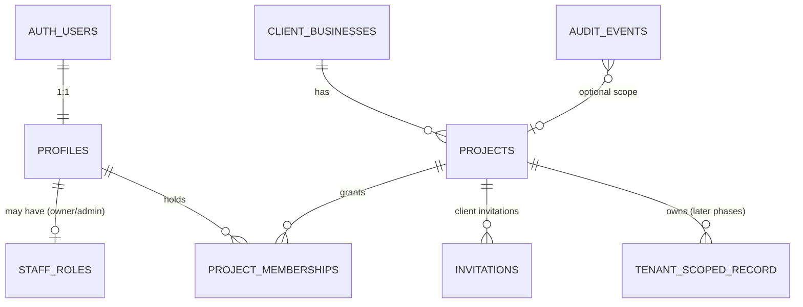

# 03 — Security, Authentication, and Tenancy

| Field | Value |
|---|---|
| Version | 0.4.1 |
| Status | **Draft: Phase 2 finalization, pending Owner sign-off.** Not implementation authorization. v0.4.1 amends two §4 permission rows for the automatic final payment (Owner instruction, 2026-11-23; OI-17 revised). |
| Decisions | OI-03, OI-08, OI-09, OI-19, OI-25–OI-29, OI-31, OI-35, OI-37, OI-39, OI-44–OI-46 |
| Open issues | OI-47; new OI-50, OI-51, OI-52 |
| Dependencies | DEP-06, DEP-13, DEP-14 |
| Provider evidence | [03A — Supabase and Next.js Provider Verification](03A-SUPABASE-PROVIDER-VERIFICATION.md). Findings are cited as **F-nn**, unverified items as **U-nn**. |

**How to read this document.**
- **[APPROVED OI-nn]** marks an existing Owner decision.
- Everything new in v0.4.0 is **[PROPOSED]** until the Owner signs off this specification.
- Signing off does not authorize implementation (OI-01).

## 1. Security objectives and Phase 2 scope

Objectives:
1. No client can access another project's data or files (OI-09).
2. No payment, approval, or QA state can be fabricated (OI-17, OI-19).
3. No client website can be published without every mandatory gate (OI-22).
4. Every privileged action is attributable and immutable in the audit log (OI-03, OI-19).

**Phase 2 scope [APPROVED OI-02; detail PROPOSED].** Authentication, security, and tenant isolation only:

**In scope:**
- invitation-only OTP sign-in
- staff and client roles
- MFA and fresh reauthentication
- client businesses, projects, and memberships
- the RLS and server-authorization framework
- the append-only audit log
- session and membership revocation
- the nonce-based CSP (DEP-13)
- the private storage bucket and its isolation policies (no upload UI)
- database migrations and tests

**Out of scope:** agreements, billing, intake, uploads UI, previews, publishing, notifications through Resend, and every Phase 3–5 workflow.

Rows in §4 that belong to later phases are enforced by the same framework when their phase is authorized.

## 2. Threat model **[PROPOSED]**

| # | Threat | Primary controls |
|---|---|---|
| TM-1 | Cross-tenant read/write through API or direct Supabase queries | RLS on every table in exposed schemas (F-22); server authorization (§10); database-backed isolation tests (§13) |
| TM-2 | Cross-tenant storage access through guessed or leaked paths | Private bucket; path-scoped RLS on `storage.objects` (F-29); server-issued short-lived signed URLs (Phase 4) |
| TM-3 | Account takeover through email compromise or OTP brute force | 6-digit OTP with short expiry (F-01, F-02); Supabase and app rate limits (F-09, §17); staff MFA (§7); session revocation (§6) |
| TM-4 | Privilege escalation (client to admin, admin to owner) | Roles held in tables clients cannot write; live role checks in RLS and server code, never trusted from JWT custom claims (§9) |
| TM-5 | Forged payment state | Phase 3 (04 §11) |
| TM-6 | Malicious uploads | Phase 4 (05 §5) |
| TM-7 | Insider misuse of overrides | Owner-only exceptions; fresh reauthentication; reasons; immutable audit; no fabrication paths (§12) |
| TM-8 | Secret leakage (secret key in a client bundle, logs, or `NEXT_PUBLIC_*`) | Secret key only in a `server-only` module (§10); env validation; CI bundle scan (T-SEC-01); log redaction |
| TM-9 | Unauthorized publication | Phase 4 (06) |
| TM-10 | XSS, clickjacking, CSRF | Nonce-based CSP without `'unsafe-inline'` scripts (§14); `frame-ancestors 'none'`; output encoding; same-origin server actions |
| TM-11 | Invitation token theft or replay | 256-bit random token, stored only as a SHA-256 hash; single-use atomic acceptance; 7-day expiry; email binding; revocation (§6) |
| TM-12 | Account enumeration and email bombing through OTP requests | Server-side OTP request with a generic response; per-email and per-IP limits; IP forwarding to Supabase (F-09); optional CAPTCHA (OI-52) |
| TM-13 | Stale or downgraded MFA | Restrictive `aal2` policies (F-12); freshness from `amr` timestamps (F-13); factor removal Owner-only and audited |
| TM-14 | Use of a revoked session's still-valid access token (F-17) | Live checks of membership, profile status, and `auth.sessions` on every request (§6) |
| TM-15 | Session leakage through caching (F-19) | No caching of authenticated HTML; `Cache-Control: private, no-store` on authenticated responses; no ISR for authenticated routes |

## 3. Roles **[APPROVED OI-03]**

- **Owner**: one or more Spotlight principals designated by the Owner. Holds every Admin permission, plus financial exceptions, staff management, and publication authorization.
- **Admin**: Spotlight staff with operational permissions.
- **Client**: a contact of a client business. Permissions are scoped per project membership.
- **Fulfillment (future)**: may be defined in the schema as a reserved value. It **must not be assignable**. Any attempt to assign it is rejected and audited **[APPROVED OI-03; enforcement detail PROPOSED: §9.3]**.

Staff roles (Owner, Admin) are global to the single agency. Client access always goes through a project membership.

**[PROPOSED]** At least one active Owner must always exist. The database rejects removing or demoting the last active Owner (T-ROLE-08).

## 4. Permissions matrix

Key: ✅ allowed · ❌ denied · **M** = only for projects where the client holds an active membership.

**Phase column:**
- **2**: implemented and tested in Phase 2.
- **3 / 4 / 5**: enforced by the Phase 2 framework when that phase is authorized.

| Action | Owner | Admin | Client | Fulfillment (disabled) | Phase |
|---|---|---|---|---|---|
| Invite / remove staff | ✅ (fresh MFA) | ❌ | ❌ | ❌ | 2 |
| Change staff role | ✅ (fresh MFA) | ❌ | ❌ | ❌ | 2 |
| Create client business and project | ✅ | ✅ | ❌ | ❌ | 2 |
| Invite client contact to a project | ✅ | ✅ | ❌ | ❌ | 2 |
| Revoke client membership or sessions | ✅ | ✅ | ❌ | ❌ | 2 |
| Revoke or resend a pending invitation | ✅ | ✅ (client invitations only) | ❌ | ❌ | 2 |
| Reset a staff member's MFA factor (lost device) | ✅ (fresh MFA) | ❌ | ❌ | ❌ | 2 |
| View own profile and memberships | ✅ | ✅ | ✅ | ❌ | 2 |
| Prepare order summary (package selection) | ✅ | ✅ | ❌ | ❌ | 3 |
| View agreement and order summary | ✅ | ✅ | M | ❌ | 3 |
| Accept agreement | ❌ | ❌ | M (authorized signer) | ❌ | 3 |
| Start initial Checkout | ❌ | ❌ | M | ❌ | 3 |
| Approve the website and authorize the final payment (automatic charge, 04 §10), or complete a failed or authentication-required final payment on the Stripe-hosted page **[APPROVED OI-17, revised 2026-11-23]** | ❌ | ❌ | M | ❌ | 3–4 |
| View payments and ledger | ✅ | ✅ (read) | M (own invoices) | ❌ | 3 |
| Discount, credit, partial waiver, or full waiver **[APPROVED OI-27]** | ✅ (reauthentication) | ❌ | ❌ | ❌ | 3 |
| Hold exceptions (clear a system hold) **[APPROVED OI-26]** | ✅ (reauthentication) | ❌ | ❌ | ❌ | 3 |
| Place / clear `owner_manual_hold` or `dispute_risk_hold` | ✅ | ❌ | ❌ | ❌ | 3 |
| Place `approval_nonresponsive_hold` (day 21+, after documented outreach) **[APPROVED OI-45]** | ✅ | ✅ | ❌ | ❌ | 4 |
| Clear `approval_nonresponsive_hold` **without** a client response **[APPROVED OI-45]** | ✅ (reason required) | ❌ | ❌ | ❌ | 4 |
| Clear `approval_nonresponsive_hold` after a qualifying client response **[APPROVED OI-45]** | ✅ | ✅ | ❌ | ❌ | 4 |
| Approve or request revisions on a held preview **[APPROVED OI-45]** | ❌ | ❌ | M | ❌ | 4 |
| Authorize a final-balance discount (applied to the automatic final-balance invoice) **[APPROVED OI-44, OI-55]** | ✅ (reauthentication) | ❌ | ❌ | ❌ | 3 |
| Billing hold Owner review: continue collection, authorize exception, or initiate documented service termination **[APPROVED OI-46]** | ✅ (reauthentication for exception or termination) | ❌ | ❌ | ❌ | 3 |
| Resolve an unexpected Stripe cancellation exception **[APPROVED OI-46]** | ✅ | ❌ | ❌ | ❌ | 3 |
| Record personal follow-up outreach (OI-25) | ✅ | ✅ | ❌ | ❌ | 4 |
| Respond to or settle a dispute **[APPROVED OI-37]** | ✅ (reauthentication) | ❌ | ❌ | ❌ | 3 |
| Discretionary refund decision **[APPROVED OI-35]** | ✅ (reauthentication) | ❌ | ❌ | ❌ | 3 |
| Open Stripe Customer Portal for own billing **[APPROVED OI-29]** | ❌ | ❌ | M (billing contact) | ❌ | 3 |
| Submit subscription cancellation request **[APPROVED OI-35]** | ❌ | ❌ | M | ❌ | 3 |
| Confirm cancellation / schedule it in Stripe | ✅ | ❌ **[PROPOSED]** | ❌ | ❌ | 3 |
| Discontinue maintenance and designated recurring infrastructure after M1 (12 business days) **[APPROVED OI-35, revised]** | ✅ (reauthentication) | ❌ | ❌ | ❌ | 4 |
| Deactivate remaining agency-managed services after M2 (60 calendar days) and the required notices **[APPROVED OI-35, revised]** | ✅ (reauthentication) | ❌ | ❌ | ❌ | 4 |
| Submit / edit intake | ❌ | ✅ (correct on client's behalf, audited) **[PROPOSED]** | M | ❌ | 4 |
| Upload assets | ✅ | ✅ | M | ❌ | 4 |
| Approve non-standard file types / quota exceptions | ✅ | ✅ (within approved rules) | ❌ | ❌ | 4 |
| Create internal preview drafts | ✅ | ✅ | ❌ | ❌ | 4 |
| Release a preview to the client | ✅ | ✅ | ❌ | ❌ | 4 |
| **Approve a released preview** | ❌ | ❌ | M | ❌ | 4 |
| Record QA and security checklist results | ✅ | ✅ | ❌ | ❌ | 4 |
| **Authorize publication** | ✅ (reauthentication) | ❌ | ❌ | ❌ | 4 |
| Initiate rollback | ✅ (reauthentication) | ❌ **[PROPOSED]** | ❌ | ❌ | 4 |
| Submit post-publication inquiry | ❌ | ❌ | M | ❌ | 4 |
| View audit log | ✅ | ✅ (read, non-financial) **[PROPOSED]** | ❌ | ❌ | 2 |
| Process data export / deletion requests | ✅ | ✅ (prepare; Owner executes deletion) **[PROPOSED]** | Request only | ❌ | 4 |

Owner and Admin **cannot** approve a preview on a client's behalf, accept an agreement on a client's behalf, or record a payment as received. **[APPROVED OI-03, OI-19]**

## 5. Authentication **[APPROVED OI-08; configuration PROPOSED]**

Supabase Auth. Invitation-only, passwordless **email OTP** (six-digit code, F-01). Passwords are not offered.

| Setting | Value | Evidence |
|---|---|---|
| Public sign-up | **Disabled** ("Allow new users to sign up" off; `enable_signup = false`) | F-03 |
| Defense in depth | A **before-user-created hook** (Postgres function in the `private` schema) rejects any user creation whose email has no pending, unexpired invitation | F-06; plan availability U-08 |
| Sign-in method | `signInWithOtp({ email, options: { shouldCreateUser: false } })`, then `verifyOtp({ email, token, type: 'email' })` | F-01 |
| Email templates | "Magic Link" and "Invite user" templates use `{{ .Token }}` (code). No auto-consumable confirmation links in emails. | F-05 |
| OTP expiry | **10 minutes** (`otp_expiry = 600`) | F-02; allowed range U-06 |
| OTP request frequency | Supabase per-email minimum interval (`max_frequency`), plus app limits (§17) | F-09 |
| Signing keys | **Asymmetric (ES256)** JWT signing keys. No HS256 in hosted projects. | F-21 |
| API keys | Browser: **publishable** key. Server: **secret** key, only in `src/server/supabase/admin.ts`. Legacy `anon` and `service_role` keys are not used. | F-20 |
| Server verification | Proxy refreshes with `getClaims()`. Protected server code authorizes with `getClaims()` **plus** live database checks (§6). `getSession()` is never trusted in server code. | F-18, F-19 |
| Auth email delivery | Local: the CLI's email testing server. Hosted: custom SMTP, provider **[PENDING OI-51]**. Built-in SMTP is not usable for clients. | F-07, F-08, F-25 |

**OTP request handling.**
- OTP requests go through a **server action**, so the response is always generic: "If this email has access, a code has been sent." The real Supabase result is never revealed (U-03).
- The server action forwards the end-user IP to Supabase with `Sb-Forwarded-For`, with IP forwarding enabled on the project. Otherwise every user shares the server's rate-limit bucket (F-09).

## 6. Invitations and sessions

### 6.1 Invitation design (two layers) **[PROPOSED]**

Supabase invitation links and OTPs share one short expiry (F-02). So the **authoritative invitation is an application record**, and Supabase is only used to provision the auth user and send the email (03A C-1).

| Element | Specification |
|---|---|
| Actors | Inviter: Owner or Admin for client invitations; Owner only for staff invitations. Invitee. |
| Preconditions | Client invitation: the project exists and is not archived, and the inviter has permission (§4). Staff invitation: Owner with fresh MFA (§7). |
| Inputs | Email (trimmed, lower-cased), full name, kind (`client` or `staff`), `project_id` (client) or intended staff role (`admin` or `owner`; never `fulfillment`) |
| Token | 32 bytes from a CSPRNG, base64url-encoded, delivered **only** inside the invitation link. Stored as `sha256(token)` (`token_hash`, unique). Compared in constant time. Never logged. |
| Expiry | **7 days** from creation **[PROPOSED]** |
| Authoritative records | `public.invitations`, `public.project_memberships`, `public.staff_roles` (§9) |
| States | `pending → accepted` · `pending → revoked` · `pending → expired` (computed: `now() >= expires_at`; a job marks it for reporting) |
| Duplicates | At most one `pending` invitation per (email, project) for clients, and per email for staff (partial unique index). "Resend" revokes the old invitation and creates a new token. |

**Flow:**
1. **Create.** The server action authorizes the inviter, then inserts the invitation in one transaction, with an audit event written by a trigger.
2. **Provision.** If no auth user exists for the email, the server calls `auth.admin.inviteUserByEmail(email, { redirectTo: <site>/invite/accept?id=<invitation_id>&t=<token> })` with the secret key (F-04). The redirect URL must be allow-listed, or Supabase silently ignores it (F-04).
   - If the user already exists (for example, an existing client invited to a second project), Supabase returns an error by design (F-04). The app then sends no Supabase invitation. The invitee signs in normally and sees the pending invitation, which needs no email link.
3. **Accept.** On `/invite/accept`, the invitee requests a fresh sign-in OTP (§5) and enters the code. U-02 decides whether the first sign-in uses `type: 'invite'` or `type: 'email'`.
4. **Bind.** With a verified session, the server calls the security-definer function `private.accept_invitation(invitation_id, token)`. In **one transaction** it:
   - locks the row (`select … for update`)
   - checks `status = 'pending'`, `expires_at > now()`, `token_hash = sha256(token)`, and that the invitation email equals the **verified email of the caller's auth user** (from `auth.users`, not from client input)
   - creates the membership or staff role
   - sets `status = 'accepted'`, `accepted_by`, and `accepted_at`
   - writes audit events

   Any failed check returns one generic error and records `invitation.accept_failed` with a reason code.

| Failure | Behavior |
|---|---|
| Expired, revoked, or already-accepted invitation | Generic error. No membership. Audited (T-AUTH-02). |
| Replay of an accepted token | Generic error. Still exactly one membership (T-AUTH-06). |
| Email mismatch (signed in as someone else) | Generic error. Audited with the reason code (T-AUTH-07). |
| Tampered or guessed token | Generic error. Per-IP and per-invitation attempt limit (§17) (T-AUTH-08). |
| `fulfillment` role requested | Rejected by a check constraint. Attempt audited (T-ROLE-03). |

**Recovery:** the inviter resends. The old token is revoked, and a new token and email are issued.

**Audit:** `invitation.created`, `invitation.resent`, `invitation.revoked`, `invitation.accepted`, `invitation.accept_failed`, `invitation.expired`.

### 6.2 Sessions and revocation

| Rule | Specification |
|---|---|
| Access token lifetime | **15 minutes** (`jwt_expiry = 900`) **[PROPOSED]**. Shorter than the 1-hour default (F-15) to bound the life of a revoked token. Within the documented 5-minute to 1-hour range. |
| Refresh tokens | Rotation on, reuse interval 10 s (defaults, F-15). Reuse detection left **enabled**. |
| Time-box and inactivity | Proposed: clients inactivity 7 days; staff inactivity 12 hours and time-box 7 days. **Requires a Pro plan (F-16) [PENDING OI-50].** Locally and before OI-50, the proxy enforces equivalent limits from `auth.sessions` timestamps. |
| Membership revocation | Sets `project_memberships.status = 'revoked'`. RLS and server checks read memberships **live**, so access ends on the **next request**, regardless of token lifetime (03A C-2; T-AUTH-03). |
| User deactivation | Sets `profiles.status = 'deactivated'` (live check in every helper function), and terminates Supabase sessions with the admin API (U-11) (T-AUTH-09). |
| Sign-out | `signOut({ scope: 'global' })` on explicit sign-out from staff accounts. Clients use the `local` scope (F-17). |
| Signed-out sessions | Staff routes and high-risk actions verify that the JWT's `session_id` still exists in `auth.sessions`, via a security-definer helper (F-17) (T-AUTH-10). |
| Routing **[APPROVED OI-08]** | Decided on the server. Unauthenticated or unauthorized requests never render protected data. Authenticated responses are `Cache-Control: private, no-store` (TM-15). |

## 7. MFA and reauthentication **[APPROVED OI-08, OI-19; mechanics PROPOSED]**

| Rule | Specification |
|---|---|
| Factor | **TOTP only.** Free and enabled on hosted projects (F-11). Phone MFA is not enabled. Locally, `[auth.mfa.totp] enroll_enabled = true` and `verify_enabled = true`. |
| Staff enrollment | Owner and Admin must enroll at first sign-in. Until enrolled, staff can reach only the enrollment page. **[PROPOSED]** At least two factors are recommended (for example, two devices); the maximum is 10 (F-11). |
| Staff access | Every staff route requires `aal = 'aal2'` (server check). Every staff **write** policy also has a **restrictive** RLS policy requiring `(select auth.jwt()->>'aal') = 'aal2'` (F-12) (T-AUTH-04). |
| Fresh reauthentication | High-risk actions require the most recent `amr` entry to be `totp`, with `timestamp ≥ now() − 5 minutes` **[PROPOSED]** (F-13). Checked in the server action **and** inside the security-definer function that performs the action (T-AUTH-05). Re-challenge behavior: U-04. |
| High-risk actions (Phase 2) | Staff invitation; staff role change or removal; staff MFA factor reset; Owner-only audit-log export. Later phases add the actions marked "(reauthentication)" in §4. |
| Factor removal | Unenrolling downgrades `aal2` only after refresh (F-14). The app therefore forces `refreshSession()` and checks `aal` and factors live for staff. Resetting another staff member's factor is Owner-only with fresh MFA, and audited (U-05). |
| Lost Owner device | **[PROPOSED]** Every Owner keeps at least two enrolled factors. Break-glass recovery uses the Supabase dashboard, through the Owner's own Supabase account, and is recorded afterwards as an audit event. |
| Clients | No MFA requirement in the MVP **[PROPOSED]**. `aal1` is sufficient. |

## 8. Tenant and project isolation model **[APPROVED OI-09; schema PROPOSED]**



- Every tenant-scoped record carries a non-null `project_id` with a foreign key and an index.
- Client visibility = an **active** `project_memberships` row for (`user_id`, `project_id`), and the user's profile is `active`.
- Staff visibility comes from an active `staff_roles` row. Staff never need memberships.
- Storage object paths begin with `<project_id>/`. Bucket policies apply the same membership check (§9.4).
- Roles and memberships are **always read from tables**, never from JWT custom claims, so revocation is immediate (TM-4, TM-14).

### 8.1 Schema (Phase 2) **[PROPOSED]**

Schemas:
- `public` is exposed through the Data API, with RLS on every table.
- `private` is **not exposed**. It holds the security-definer helpers and the hook.
- `auth` and `storage` are managed by Supabase.

| Table | Key columns | Constraints and notes |
|---|---|---|
| `public.profiles` | `id uuid` PK (references `auth.users(id)` on delete restrict), `email citext` unique, `full_name text`, `status` (`active` or `deactivated`), `created_at`, `updated_at`, `deactivated_at` | Created only by the invitation acceptance function. Users may update only `full_name`. Column-level grant (T-ROLE-01). |
| `public.staff_roles` | `user_id` PK (references profiles), `role staff_role` (`owner`, `admin`, `fulfillment`), `status` (`active` or `revoked`), `granted_by`, `granted_at`, `revoked_by`, `revoked_at`, `reason` | `check (role <> 'fulfillment')` (reserved, unassignable). A trigger rejects revoking or demoting the last active Owner. |
| `public.client_businesses` | `id uuid` PK, `legal_name`, `display_name`, `created_by`, `created_at`, `archived_at` | Staff write only |
| `public.projects` | `id uuid` PK, `client_business_id` FK, `name`, `created_by`, `created_at`, `archived_at` | **No status field** (OI-05). State comes from records in later phases. |
| `public.project_memberships` | `id uuid` PK, `project_id` FK, `user_id` FK, `role` (`client` only in the MVP), `status` (`active` or `revoked`), `invitation_id` FK, `created_at`, `revoked_at`, `revoked_by`, `revoke_reason` | Partial unique index (`project_id`, `user_id`) where `status = 'active'`. Index on (`user_id`, `status`). |
| `public.invitations` | `id uuid` PK, `kind` (`client` or `staff`), `email citext`, `full_name`, `project_id` (null for staff), `intended_role`, `token_hash bytea` unique, `status`, `expires_at`, `created_by`, `created_at`, `accepted_by`, `accepted_at`, `revoked_by`, `revoked_at`, `failed_attempts int` | `check` that kind matches `project_id` and role. Partial unique index on pending rows (§6.1). **The `token_hash` column is never granted to `authenticated`.** |
| `public.audit_events` | `id bigint` identity PK, `occurred_at timestamptz default now()`, `actor_user_id`, `actor_role`, `actor_aal`, `session_id`, `action text`, `target_type`, `target_id`, `project_id`, `request_id`, `ip inet`, `user_agent`, `reason`, `summary jsonb` | Append-only (§11). Index on (`project_id`, `occurred_at`) and (`actor_user_id`, `occurred_at`). |
| `private.rate_limits` | `bucket text`, `window_start timestamptz`, `count int` | App-level limits (§17). Not exposed. |

The storage bucket `project-assets` (private, `public = false`) is created in Phase 2 with policies only. Uploads arrive in Phase 4.

## 9. RLS and database security requirements **[APPROVED OI-09; detail PROPOSED]**

### 9.1 Baseline

1. RLS is **enabled on every table in `public`** (F-22). A CI catalog check fails if any table in an exposed schema has RLS disabled (T-TEN-05).
2. **Default deny.** Default privileges are revoked from `anon`, `authenticated`, and `public` (F-22). Explicit, minimal table and column grants are then given to `authenticated` only. **`anon` has no grants on any application table.**
3. Separate policies for `select`, `insert`, `update`, and `delete`, all `to authenticated`. No `using (true)`. `auth.uid()` is always wrapped as `(select auth.uid())` (F-22).
4. Policies that read other tables call **security-definer helpers in `private`**. Each has `set search_path = ''`, fully qualified names, `stable` volatility, and `execute` revoked from `public` and `anon` (granted to `authenticated` only where policies need it) (F-23). The CI catalog check is T-TEN-06.
5. **No views** in Phase 2. Any future view must use `security_invoker = true` (F-22) (T-TEN-07).
6. The secret key is used only in `src/server/supabase/admin.ts`, for invitation provisioning, session termination, and MFA factor reset. Every use is preceded by an explicit authorization check (§10) and followed by an audit event.

### 9.2 Helper functions (`private`, security definer)

| Function | Returns true when |
|---|---|
| `private.is_active_user()` | The caller's `profiles.status = 'active'` |
| `private.is_staff()` | `is_active_user()` and an active `staff_roles` row exists |
| `private.is_owner()` | `is_staff()` with `role = 'owner'` |
| `private.is_project_member(project_id)` | `is_active_user()` and an active membership exists for the caller |
| `private.can_access_project(project_id)` | `is_staff()` or `is_project_member(project_id)` |
| `private.session_is_active()` | The JWT `session_id` exists in `auth.sessions` (F-17) |
| `private.mfa_is_fresh(max_age interval)` | `amr[0].method = 'totp'` and its timestamp is within `max_age` (F-13) |

### 9.3 Policy summary

| Table | select | insert | update | delete |
|---|---|---|---|---|
| `profiles` | Own row; staff all | None (acceptance function only) | Own `full_name` only (column grant); staff `status` with `aal2` | None |
| `staff_roles` | Own row; staff all | None (Owner function with fresh MFA) | None (Owner function) | None |
| `client_businesses` | Staff; clients through membership of any of its projects | Staff (`aal2`) | Staff (`aal2`) | None (archive instead) |
| `projects` | `can_access_project(id)` | Staff (`aal2`) | Staff (`aal2`) | None (archive instead) |
| `project_memberships` | Own rows; staff all | None (acceptance function only) | Staff, setting `status = 'revoked'` only (`aal2`) | None |
| `invitations` | Staff (excluding `token_hash`); an invitee sees own pending invitations by verified email (excluding `token_hash`) | Staff (`aal2`; staff kind Owner-only, enforced in the function) | Staff revoke only (`aal2`) | None |
| `audit_events` | Owner all; Admin non-financial actions | None (trigger and `private.record_audit_event` only) | **Never** | **Never** |

Every staff write policy is paired with the restrictive `aal2` policy (§7).

### 9.4 Storage **[PROPOSED]**

- Bucket `project-assets` is private.
- Policies on `storage.objects` allow `select` (and, in Phase 4, `insert`) only when `bucket_id = 'project-assets'` and `private.can_access_project(((storage.foldername(name))[1])::uuid)` (F-29).
- `update` and `delete` are not granted to clients.
- Phase 2 verifies isolation with synthetic objects only (T-TEN-03).

## 10. Server authorization **[APPROVED OI-09; detail PROPOSED]**

- Every server action and route handler authorizes the caller against the target project **before** acting. RLS is defense in depth, not the only control.
- Centralized, unit-tested guards live in `src/server/auth/`:
  - `requireUser()`: verified claims, active profile
  - `requireStaff({ aal2: true, fresh?: '5m', session: 'live' })`
  - `requireOwner(...)`
  - `requireProjectAccess(projectId)`
- A test enumerates every server action and route and fails if any lacks a guard call (T-TEN-04).
- Data access uses the **user-scoped client** (publishable key plus the user's cookies), so RLS always applies (F-20). The admin (secret-key) client is importable only from `src/server/**` (ESLint boundary, `server-only`).
- Object IDs from the client are never trusted to imply scope. They are re-resolved to `project_id` on the server, and inputs are validated with zod.
- Authenticated pages and actions are dynamic and uncached (TM-15).

## 11. Audit events **[APPROVED OI-03, OI-08, OI-19]**

Each audit event records:
- actor user ID, role, AAL, and session ID
- action and target (type, ID, `project_id`)
- timestamp (UTC)
- request ID, IP, and user agent **[PROPOSED]**
- reason (required for overrides)
- before/after summary, with no secrets

**Append-only enforcement [PROPOSED]:**
- No `update` or `delete` grants for any role, including `service_role`.
- A `before update or delete` trigger raises an exception.
- Inserts happen only through row triggers on audited tables (memberships, staff roles, invitations, profiles) and through `private.record_audit_event()`, called in the same transaction as the action (T-AUD-01, T-AUD-02).
- OTPs, tokens, token hashes, cookies, and keys are never written to the log (T-AUD-03).

**Retention [APPROVED OI-21, OI-40]:** administrative audit logs 3 years; security logs 12 months. Supabase's own auth log (`auth.audit_log_entries`, F-24) is a supplementary source, not the system of record.

Minimum event catalog **[PROPOSED]**:
- **Auth:** OTP requested (generic outcome), sign-in success/failure, MFA enrolled/challenged/factor reset, session revoked, user deactivated/reactivated.
- **Membership:** invitation lifecycle (§6.1), membership granted/revoked, staff role granted/changed/revoked, Fulfillment assignment attempted, last-Owner protection triggered.
- **Agreement (Phase 3):** order summary created/superseded, agreement accepted, reacceptance required.
- **Payment (Phase 3):** Checkout session created, webhook received/processed/rejected, ledger entry posted, hold placed/cleared, adjustment and discount authorized, billing hold Owner review decision, service termination authorized/effective/withdrawn, unexpected Stripe cancellation exception.
- **Lifecycle (Phase 4):** intake submitted, asset uploaded/quarantined/released/rejected/marked used, preview released, approval recorded/superseded, follow-up outreach recorded, approval hold placed/cleared, client response during hold, resumption decision.
- **Publishing (Phase 4):** gate evaluated, publication authorized, deployment started/succeeded/failed, verification result, rollback.
- **Privacy (Phase 4):** export, correction, and deletion requested/executed; legal hold placed/removed; retention deletion executed (metadata-only evidence); project closed.

## 12. Owner override restrictions **[APPROVED OI-19]**

| Rule | Status |
|---|---|
| Exceptions require Owner role, a written reason, high-risk reauthentication, and an immutable audit event | Approved |
| No override may create a payment, a successful Stripe status, a client approval, or a QA pass | Approved |
| No general-purpose "mark as paid" action exists in any interface or API | Approved |
| No override may silently bypass a mandatory publication gate | Approved |
| Discounts, credits, and partial or full waivers are Owner-only ledger entries, with reason, reauthentication, and audit. A full waiver is recorded as a waiver, never as a Stripe payment. | **Approved (OI-27, OI-44)**. Mechanism: an Owner-authorized discount on the standard final-balance price in Checkout (04 §10.1). Deposit-stage adjustments: **[PENDING OI-47]**. |
| The only permitted QA exception is a documented, Owner-approved performance exception. Security, payment/settlement, and client approval cannot be bypassed. | **Approved (OI-33)** |
| Dispute evidence is compiled from authoritative records only. No fabricated evidence and no automatic concession. | **Approved (OI-37)** |
| No service is discontinued or deactivated, and no website is removed, solely because a payment failed or because Stripe cancelled a subscription. Only an Owner-authorized, documented termination starts the post-cancellation milestones. | **Approved (OI-46)** |
| An approval hold never represents approval. Admin cannot clear it without a qualifying client response. | **Approved (OI-45)** |
| An Owner may *add* holds or *block* publication at any time | **[PROPOSED]** |

## 13. Security acceptance tests and Phase 2 traceability **[PROPOSED]**

### 13.1 Test catalog

Every database-facing test runs against a **real local Supabase stack**: Postgres with the actual migrations and policies, plus Auth. Mocked permission checks alone never count as evidence. Each test lists its phase. Later-phase tests stay defined here and run when their phase is built.

| ID | Test | Type | Phase |
|---|---|---|---|
| T-AUTH-01 | An un-invited email requesting an OTP gets the generic response, no email, no user, and no session | Negative, e2e | 2 |
| T-AUTH-02 | An expired, revoked, or already-used invitation cannot create a membership | Negative | 2 |
| T-AUTH-03 | After a membership is revoked, the next request to that project is denied, while the access token is still unexpired | Integration | 2 |
| T-AUTH-04 | A staff user without MFA (`aal1`) cannot reach staff routes, and staff writes are rejected by RLS | Negative | 2 |
| T-AUTH-05 | A high-risk action with stale MFA (`amr` totp older than 5 min) is rejected by both the server and the database function | Negative | 2 |
| T-AUTH-06 | Replaying an accepted invitation token fails. Exactly one membership exists. Concurrent double-acceptance yields one success. | Negative, concurrency | 2 |
| T-AUTH-07 | A signed-in user whose verified email differs from the invitation email cannot accept it | Negative | 2 |
| T-AUTH-08 | A wrong or tampered token is rejected. Repeated attempts hit the attempt limit. | Negative | 2 |
| T-AUTH-09 | A deactivated user with an unexpired access token is denied on the next request (RLS and server) | Integration | 2 |
| T-AUTH-10 | A staff session signed out globally (session row deleted) is denied for staff routes before access-token expiry | Integration | 2 |
| T-AUTH-11 | OTP requests beyond the per-email and per-IP limits get the same generic response and send no email | Abuse | 2 |
| T-AUTH-12 | With public sign-up disabled, direct sign-up or `shouldCreateUser: true` for an un-invited email creates no user (setting plus hook) | Negative | 2 |
| T-AUTH-13 | Server code never authorizes from `getSession()` | Static (code search, lint) | 2 |
| T-TEN-01 | Client A `select` on every tenant table returns zero rows for project B (RLS, through the authenticated client) | Cross-tenant, database | 2 |
| T-TEN-02 | Client A `insert`/`update`/`delete` targeting project B is rejected on every tenant table | Cross-tenant, database | 2 |
| T-TEN-03 | Client A cannot read, list, or create signed URLs for project B objects in `project-assets` | Cross-tenant, storage | 2 |
| T-TEN-04 | Client A calling every server action or route with project B IDs gets 403/404 and no side effects. Every action has a guard. | Cross-tenant, integration | 2 |
| T-TEN-05 | A catalog check fails if any table in an exposed schema lacks RLS, or if `anon` holds any table grant | CI, database | 2 |
| T-TEN-06 | A catalog check fails if any security-definer function is in an exposed schema, lacks `search_path = ''`, or is executable by `anon` or `public` | CI, database | 2 |
| T-TEN-07 | A catalog check fails if any view in an exposed schema lacks `security_invoker = true` | CI, database | 2 |
| T-ROLE-01 | A client cannot write roles, memberships, invitations, profiles (except own `full_name`), or audit rows | Negative, database | 2 (later-phase tables added in 3–4) |
| T-ROLE-02 | Admin cannot manage staff, invite staff, or reset MFA factors. Later phases add publication and financial exceptions. | Negative | 2 (3–4 extend) |
| T-ROLE-03 | Assigning the Fulfillment role is rejected by the database and the attempt is audited | Negative | 2 |
| T-ROLE-04 | Owner/Admin cannot record a client approval or agreement acceptance | Negative | 3–4 |
| T-ROLE-05 | Admin cannot clear an approval hold without a qualifying client response. The Owner can, with a reason, and the clearance is audited. (OI-45) | Negative | 4 |
| T-ROLE-06 | Only the Owner, with reauthentication, can authorize a discount or initiate service termination (OI-44, OI-46) | Negative | 3 |
| T-ROLE-07 | Staff role changes require Owner role, `aal2`, and fresh MFA | Negative | 2 |
| T-ROLE-08 | Removing or demoting the last active Owner is rejected | Negative, database | 2 |
| T-AUD-01 | Each Phase 2 privileged action produces exactly one audit event, in the same transaction | Integration, database | 2 |
| T-AUD-02 | `update`/`delete` on `audit_events` are rejected for `authenticated` and `service_role` | Negative, database | 2 |
| T-AUD-03 | No audit row or application log contains OTPs, invitation tokens, token hashes, cookies, or keys | Static and integration | 2 |
| T-SEC-01 | The production client bundle contains no secret key (`sb_secret_`), service-role key, webhook secret, or Resend key | CI | 1 (extended in 2) |
| T-SEC-02 | Security headers (CSP, HSTS, frame-ancestors, referrer policy) are present on all portal responses | e2e | 1 |
| T-SEC-03 | `script-src` uses a per-request nonce with `'strict-dynamic'` and contains no `'unsafe-inline'`. The nonce differs between requests. **Resolves DEP-13.** | e2e | 2 |
| T-SEC-04 | No CSP violations are reported on any page in the e2e suite. No inline `style` attributes remain. | e2e | 2 |
| T-SEC-05 | Env validation rejects a secret key in any `NEXT_PUBLIC_*` variable, and rejects a missing Supabase configuration when Phase 2 features are enabled | Unit | 2 |
| T-SEC-06 | Authenticated responses carry `Cache-Control: private, no-store` | e2e | 2 |
| T-MIG-01 | `supabase db reset` applies every migration and the synthetic seed from scratch in CI | CI, database | 2 |
| T-MIG-02 | Migrations already merged to `main` are never edited (CI diff check). New migrations are additive or follow expand/contract (§16). | CI | 2 |
| T-PERF-01 | Lighthouse budgets (02 §7) still pass after all pages become dynamic for the nonce CSP | CI | 2 |

### 13.2 Phase 2 traceability matrix

**CI execution methods** (all against local Supabase started by the pinned CLI in GitHub Actions, §15):
- **DB:** `supabase test db` (pgTAP, impersonation through `set local role` and `request.jwt.claims`, F-28).
- **INT:** Vitest integration tests that sign in real users against local Auth. OTPs are read from the local email testing server (F-25).
- **E2E:** Playwright against the app plus local Supabase.
- **STAT:** static and catalog checks.

| Test | Requirement | Implementation component | Type | Expected result | CI | Sign-off evidence |
|---|---|---|---|---|---|---|
| T-AUTH-01 | OI-08; §5 | OTP server action; Supabase `enable_signup = false`; before-user-created hook | E2E | Generic message. Zero rows added to `auth.users`. No message in the local email testing server. | E2E | Passing run; screenshot of generic response; query output showing no user |
| T-AUTH-02 | §6.1 | `private.accept_invitation` | DB + INT | Error for expired, revoked, and accepted invitations. Zero memberships. `accept_failed` audit rows. | DB, INT | pgTAP output; audit rows |
| T-AUTH-03 | §6.2 | `private.is_project_member`; project RLS; `requireProjectAccess` | INT | Request after revocation returns 403/empty with an unexpired JWT | INT | Test log showing the token `exp` is still in the future |
| T-AUTH-04 | OI-08; §7 | Staff route guard; restrictive `aal2` policies | DB + E2E | `aal1` staff redirected to enrollment. RLS rejects staff writes. | DB, E2E | pgTAP output; e2e run |
| T-AUTH-05 | OI-19; §7 | `private.mfa_is_fresh`; `requireStaff({fresh})` | DB + INT | Stale `amr` rejected; fresh accepted | DB, INT | pgTAP output with crafted claims; integration log |
| T-AUTH-06 | §6.1 | Row lock and status transition in `accept_invitation` | DB (concurrency) + INT | Second acceptance fails. One membership. Of two parallel acceptances, one wins. | DB, INT | Test output; membership count = 1 |
| T-AUTH-07 | §6.1 | Email binding from `auth.users` | DB | Mismatch rejected | DB | pgTAP output |
| T-AUTH-08 | §6.1, §17 | Constant-time hash compare; `failed_attempts`; `private.rate_limits` | DB + INT | Rejected. Limit reached after N attempts. | DB, INT | Output; audit rows |
| T-AUTH-09 | §6.2 | `profiles.status` in helpers; admin session termination | INT | Denied on next request | INT | Test log |
| T-AUTH-10 | §6.2 | `private.session_is_active` | INT | Staff denied after global sign-out, before `exp` | INT | Test log |
| T-AUTH-11 | §17 | App limiter; IP forwarding | INT | Requests over the limit return the generic message and no email | INT | Test log; email testing server message count |
| T-AUTH-12 | §5 | Sign-up setting; hook | INT | No user created | INT | Query output |
| T-AUTH-13 | §5 | Lint rule / code search | STAT | No `getSession(` in `src/server/**` or `src/app/**` server code | STAT | CI log |
| T-TEN-01 | OI-09; §9 | RLS on every table | DB | Zero rows for each table | DB | pgTAP per-table output |
| T-TEN-02 | OI-09; §9 | RLS write policies | DB | `throws_ok` / zero rows affected per table and command | DB | pgTAP output |
| T-TEN-03 | §9.4 | `storage.objects` policies | DB + INT | Read, list, and signed URL denied | DB, INT | Output |
| T-TEN-04 | §10 | Guards on every action | INT + STAT | 403/404, no writes; guard enumeration passes | INT, STAT | Test log; guard coverage report |
| T-TEN-05 | §9.1 | Catalog query | DB | No table without RLS; `anon` has no grants | DB | pgTAP output |
| T-TEN-06 | §9.1 | Catalog query | DB | All definer functions in `private`, with `search_path=''`, not executable by `anon` | DB | pgTAP output |
| T-TEN-07 | §9.1 | Catalog query | DB | No insecure views | DB | pgTAP output |
| T-ROLE-01 | §9.3 | Grants and policies | DB | All forbidden writes rejected | DB | pgTAP output |
| T-ROLE-02 | §4 | Owner-only functions | DB + INT | Admin rejected | DB, INT | Output |
| T-ROLE-03 | OI-03 | Check constraint; audit | DB | Insert rejected; attempt audited | DB | Output |
| T-ROLE-07 | §7 | Owner function with freshness | DB + INT | Rejected without Owner, `aal2`, or fresh MFA | DB, INT | Output |
| T-ROLE-08 | §3 | Last-Owner trigger | DB | Rejected | DB | Output |
| T-AUD-01 | OI-19; §11 | Audit triggers and `record_audit_event` | DB + INT | Exactly one event per action, same transaction (rolled back together) | DB, INT | Output |
| T-AUD-02 | §11 | Grants and trigger | DB | Rejected for every role | DB | Output |
| T-AUD-03 | §11 | Redaction; schema | STAT + INT | No secret patterns in rows or logs | STAT, INT | Scan output |
| T-SEC-01 | 02 §9 | Bundle scan (extended patterns) | STAT | No findings | STAT | CI log |
| T-SEC-02 | 02 §4 | Proxy headers | E2E | Headers present | E2E | CI log |
| T-SEC-03 | DEP-13; §14 | `proxy.ts` nonce CSP | E2E | Nonce present and unique per request; no `'unsafe-inline'` in `script-src` | E2E | CI log; header samples |
| T-SEC-04 | §14 | No inline style attributes; CSP report check | E2E | Zero violations | E2E | CI log |
| T-SEC-05 | 02 §9 | `env-schema.ts` | Unit | Rejections as specified | Unit (quality job) | CI log |
| T-SEC-06 | TM-15 | Response headers | E2E | `private, no-store` on authenticated pages | E2E | CI log |
| T-MIG-01 | §16 | Migrations and seed | DB | Reset succeeds | DB | CI log |
| T-MIG-02 | §16 | Migration diff check | STAT | No edits to merged migrations | STAT | CI log |
| T-PERF-01 | OI-23 | Dynamic rendering | Lighthouse | Budgets met | Lighthouse job | Lighthouse report artifact |

**Phase 2 sign-off evidence package [PROPOSED]:**
- A green CI run on the Phase 2 PR, covering every Phase 2 test above.
- The pgTAP and integration logs, as artifacts.
- The 03A unverified items U-01 to U-05 and U-11 resolved with recorded results.
- A reviewer checklist confirming no secret key outside `src/server/**`.

## 14. Content Security Policy (resolves DEP-13) **[PROPOSED]**

- A `proxy.ts` (Next.js 16 proxy, Node.js runtime, F-31) generates a per-request nonce (128 random bits, base64). It sets `Content-Security-Policy` on the response and `x-nonce` on the request (F-30). Next.js applies the nonce to its scripts automatically.
- The same proxy refreshes the Supabase session (F-19). The two concerns share one proxy, and the refreshed cookies are always copied onto the returned response.

Production policy:

```text
default-src 'self';
script-src 'self' 'nonce-{n}' 'strict-dynamic';
style-src 'self' 'nonce-{n}';
img-src 'self' data: blob:;
font-src 'self';
connect-src 'self' {SUPABASE_URL};
object-src 'none'; base-uri 'self'; form-action 'self'; frame-ancestors 'none'
```

- Development adds `'unsafe-eval'` and `ws:` only (F-30).
- **Consequence (03A C-4):** every HTML route becomes **dynamically rendered**, because nonces require it (F-30). This includes the public home page. Performance budgets must still pass (T-PERF-01).
- **Inline `style` attributes are removed**, because a style nonce does not cover them. The Phase 1 logo mask and design-system swatches move to classes or CSS custom properties set from stylesheets (T-SEC-04).
- The proxy matcher skips `_next/static`, `_next/image`, and prefetch requests (F-30). The CSP header is still applied to every document response.

## 15. Environments, secrets, and CI **[PROPOSED]**

| Environment | Supabase | Data | Authorization |
|---|---|---|---|
| Local development | Supabase CLI local stack (Docker, at least 7 GB RAM, F-25). Local email testing server. | **Synthetic seed only** (`supabase/seed.sql`) | Covered by Phase 2 implementation authorization |
| CI | Same local stack started inside GitHub Actions. CLI version pinned. | Synthetic | Covered by Phase 2 implementation authorization |
| Hosted dev / staging | Not created | — | **Separate Owner authorization required (DEP-14)** |
| Production | Not created | — | Production launch authorization (OI-01 stage 4) |

- **New variables** (names only in `.env.example`):
  - `NEXT_PUBLIC_SUPABASE_URL`
  - `NEXT_PUBLIC_SUPABASE_PUBLISHABLE_KEY` (`sb_publishable_…`)
  - `SUPABASE_SECRET_KEY` (`sb_secret_…`, server-only)
- **Validation:**
  - `env-schema.ts` rejects any `sb_secret_` value in a `NEXT_PUBLIC_*` variable.
  - It rejects a non-local Supabase URL outside `staging` and `production`.
  - The bundle scan adds the `sb_secret_` pattern (T-SEC-01, T-SEC-05).
- **Local keys:** the local stack prints its own publishable and secret keys (F-20). They are not secrets of any hosted environment, but are still never committed.
- **No hosted access:** no hosted project is linked from the repository. CLI commands run locally by default (F-26). Agents must never pass `--remote` or `--yes`.
- **New CI job "Database and integration":**
  1. Install the pinned Supabase CLI (checksum or pinned action SHA).
  2. `supabase start`.
  3. `supabase db reset` (T-MIG-01).
  4. `supabase test db` (pgTAP).
  5. Vitest integration tests.
  6. Playwright e2e against the stack.
  7. Migration-diff check (T-MIG-02).

  The Owner adds this job to the required checks after its first green run.

## 16. Database migration safety and rollback compatibility **[PROPOSED]**

1. Migrations live in `supabase/migrations/`, are created with `supabase migration new`, and are reviewed in PRs. **Never change a hosted database directly** (F-27).
2. **Forward-only.** A migration merged to `main` is never edited (T-MIG-02). Mistakes are fixed by a new migration.
3. **Expand/contract.**
   - Additive changes (new tables, nullable columns, new policies) ship first.
   - Code switches over in a later release.
   - Destructive changes (drop, rename, type narrowing) ship only after no deployed release depends on the old shape.
   - This keeps the previous application release working against the new schema, so an application rollback never needs a schema rollback (02 §6).
4. Every migration enables RLS and sets grants for any new table **in the same migration**. Catalog tests (T-TEN-05 to T-TEN-07) block merges otherwise.
5. `supabase db reset` from scratch must succeed in CI (T-MIG-01). The seed contains synthetic data only.
6. **No hosted pushes.** Applying migrations to any hosted project (`db push --remote`) requires separate authorization (DEP-14). `migration repair` corrects history only and is used only with Owner approval (F-27).

## 17. Abuse prevention **[PROPOSED]**

| Control | Specification |
|---|---|
| OTP request limits | Supabase limits (F-09), plus app limits in `private.rate_limits`: **per email 5 per hour; per IP 20 per hour**. Responses are always generic. |
| OTP verification limits | Supabase `token_verifications` limit (F-09), plus app limit per IP. OTP expiry 10 minutes. |
| Invitation acceptance attempts | `failed_attempts` per invitation (lock after 10, so the inviter must resend). Per-IP limit. |
| Invitation creation | Per inviter 50 per hour. Per project 20 pending invitations. |
| IP attribution | `Sb-Forwarded-For` with IP forwarding enabled (F-09). The app limiter keys on the first trusted proxy hop. |
| CAPTCHA | Supported by Supabase (F-10). **[PENDING OI-52]** whether to enable it, which would add a vendor. |
| Enumeration | Identical responses and timing for known and unknown emails (U-03) |
| Alerting | Repeated failures are recorded as security events. Real-time alerting depends on DEP-12. |

## 18. Phase 2 verification spike (first implementation task) **[PROPOSED]**

Before any user-facing flow is built, a local-only spike resolves:
- 03A U-01 (invite with sign-up disabled)
- U-02 (first sign-in path)
- U-03 (unknown-email response)
- U-04 (fresh TOTP `amr` timestamp)
- U-05 (admin MFA factor reset)
- U-11 (admin session termination for deactivated users)

Results are recorded in 03A. Any result that contradicts this specification is **escalated to the Owner** before implementation continues. Specification wording is never changed silently.
