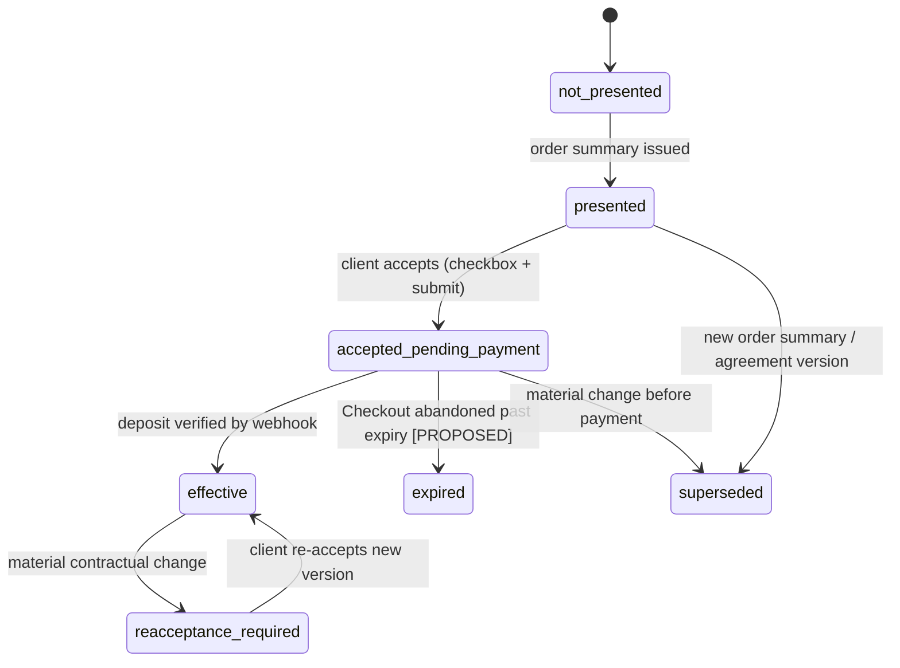

# 04 — Agreement and Billing

| Field | Value |
|---|---|
| Version | 0.7.3 |
| Status | **Approved for Phase 3 Stripe test-mode implementation only** (Owner, 2026-11-23). Not approved for production: qualified legal review (DEP-03, OI-34) and provider verification of every **[VERIFY-PROVIDER]** item (DEP-06, OI-39) remain conditions for production use. This approval does not authorize Phase 3 or any Stripe request (CLAUDE.md §1, §5). History: v0.5.0 automatic final-balance collection (OI-17 revised); v0.5.1 OI-47 approved (Option A); v0.6.0 test-mode approval and webhook testing strategy (OI-63); v0.7.0 test-mode catalog manifest (§6.1–§6.3; OI-64, OI-65 approved), with no change to any other approved text or value; v0.7.1 records provider verification of the `livemode` field and clarifies `tax_behavior` (§6.1, §6.3), with no change to any catalog value or procedure; v0.7.2 records verified Stripe key, sandbox, and idempotency behavior and strengthens execution safety (§6.2–§6.4), with no change to any catalog value; v0.7.3 clarifies the `Stripe-Should-Retry: false` rule (§6.4; OI-66), with no change to any catalog value or other safeguard. |
| Decisions | OI-05, OI-13–OI-17, OI-19, OI-26–OI-30, OI-34–OI-37, OI-39, OI-43, OI-44, OI-46, OI-47, OI-55, OI-63, OI-64, OI-65, OI-66 |
| Open issues | None |
| Dependencies | DEP-01, DEP-02, DEP-03, DEP-04, DEP-06, DEP-15 (see [OPEN-ISSUES.md](../OPEN-ISSUES.md)) |

> Nothing in this document authorizes any Stripe operation. No Stripe products, prices, customers, subscriptions, or Checkout configurations were created, queried, or modified in preparing it.

## 1. Agreement lifecycle **[APPROVED OI-13]**

There is **one** versioned *Website Development & Maintenance Services Agreement*. Each project gets a **project-specific order summary** that is incorporated by reference.



- The owner-authored draft (v1.0, outside the repository) makes the agreement effective "upon electronic acceptance and successful initial payment." **[APPROVED OI-34]** Electronic acceptance (`agreement.accepted`) and service activation (`agreement.effective`, triggered by deposit verification) are recorded as **separate events**.
- **[APPROVED OI-34]** The current agreement is **not legally finalized**. Qualified legal review is required before production (DEP-03). Phase 3 test mode may use the draft only with a visible "DRAFT — not for production use" marker **[PROPOSED]**.

## 2. Agreement versioning and immutable copy **[APPROVED OI-13]**

Each agreement version record holds:
- the version label (for example `1.0`)
- the canonical text (stored immutably)
- a SHA-256 hash of the canonical bytes
- the effective-from date
- a status (`draft` / `approved` / `retired`)
- the approval reference

Rules **[PROPOSED]**:
- Version records are insert-only. A text change is a new version.
- The hash is computed over a canonical serialization (UTF-8, normalized line endings) and verified on read.
- Clients are only ever shown `approved` versions in production.

## 3. Acceptance evidence **[APPROVED OI-13]**

| Evidence | Source |
|---|---|
| Agreement version ID and document hash | Version record |
| Order summary ID and its snapshot hash **[PROPOSED]** | Order summary |
| Client business legal name, project ID | Project record |
| Signer user ID and **verified email** (OTP-verified) | Auth **[APPROVED OI-28]** |
| Signer's **full legal name** | Acceptance form, required **[APPROVED OI-28]** |
| **Business legal name** | Acceptance form, required; must match the order summary or be flagged for staff review **[APPROVED OI-28; matching rule PROPOSED]** |
| Signer's **position or title** | Acceptance form, required **[APPROVED OI-28]** |
| **Authority confirmation**: a *separate*, unchecked-by-default checkbox, distinct from the agreement acceptance checkbox | Acceptance form **[APPROVED OI-28]**. Final wording requires legal review (DEP-03). |
| Scope and price snapshot (package, cents values, maintenance price) | Order summary |
| Acceptance timestamp (server UTC) | Server |
| IP address, user agent, request ID | Server request **[PROPOSED]** |
| Checkbox state was unchecked by default, then affirmatively checked | UI contract and server validation |
| The accepted agreement version contains the **Authorization for Final Payment** clause (§3.1) | Version record (the clause is part of the hashed canonical text) **[APPROVED OI-17, revised 2026-11-23]** |

**Workflow: accept agreement**

| Element | Specification |
|---|---|
| Actors | Client (authorized signer) |
| Preconditions | Active membership. Order summary `presented`. Agreement version `approved` (or `draft` in test mode). No existing effective acceptance for this order summary. |
| Inputs | Explicit `accepted = true`; explicit, separate `authority_confirmed = true`; signer full legal name, business legal name, title |
| Records | `agreement_acceptances` (insert-only) |
| Transitions | `presented → accepted_pending_payment` |
| Permissions | Client membership on the project. Staff **cannot** accept on a client's behalf (03 §4). |
| Failure states | Stale order summary (superseded) → reject and reload; hash mismatch → reject and alert |
| Idempotency | One acceptance per (order summary, signer). A resubmission returns the existing record. |
| Audit | `agreement.accepted` |
| Negative tests | Pre-checked or missing checkbox value rejected; acceptance for another project rejected; acceptance of a superseded summary rejected |

### 3.1 Authorization for Final Payment clause **[APPROVED OI-17, revised 2026-11-23]**

The following clause is **legal-adviser-approved** (Owner instruction, 2026-11-23). It is incorporated into the Website Development & Maintenance Services Agreement, in the section covering payment terms, **verbatim**. Its wording must not be edited, paraphrased, or reformatted in meaning (CLAUDE.md §7). Accepting the agreement (§3) and submitting the initial deposit (§8) constitute the client's authorization under this clause.

> **Authorization for Final Payment**
>
> By accepting this agreement and submitting the initial deposit, I authorize Spotlight Marketing LLC to securely retain my payment method through Stripe for the purpose of collecting the remaining project balance.
>
> I understand that the outstanding balance, as specified in my accepted order, will become due upon my final approval of the completed website.
>
> Upon my explicit approval, I authorize Spotlight Marketing LLC to automatically charge the outstanding balance to my saved payment method without requiring a separate checkout.
>
> I understand that publication of the website is contingent upon successful payment. An itemized invoice and payment receipt will be provided electronically.

- The rest of the agreement remains subject to qualified legal review before production (DEP-03, OI-34).
- The outstanding balance is the balance in the accepted order summary snapshot (§4, §5.1), adjusted only as §10.1 allows.

## 4. Order summaries and reacceptance

The order summary is an immutable snapshot. It holds:
- the package key
- package total, deposit, and balance (cents)
- the maintenance price (cents/month)
- the Stripe Price IDs used (§5–§6)
- included scope items
- optional project notes approved by staff **[PROPOSED]**

**Material change** (requires a new order summary and re-acceptance) **[APPROVED OI-13]**. **[PROPOSED]** definition:
- any change to price, deposit, balance, maintenance rate, package, or scope
- a new agreement version with substantive changes

Non-material corrections, such as a typo in the business name, are audited staff edits with no price effect, pending owner confirmation of this definition.

## 5. Package pricing and live Stripe catalog reference **[APPROVED OI-14, OI-15]**

### 5.1 Package pricing (integer cents)

| Package key | Package | Total | Deposit (20%) | Balance (80%) |
|---|---|---|---|---|
| `essential` | Essential | 80000 ($800.00) | 16000 ($160.00) | 64000 ($640.00) |
| `professional` | Professional | 149500 ($1,495.00) | 29900 ($299.00) | 119600 ($1,196.00) |
| `advanced` | Advanced | 249500 ($2,495.00) | 49900 ($499.00) | 199600 ($1,996.00) |
| `signature` | Signature | 349500 ($3,495.00) | 69900 ($699.00) | 279600 ($2,796.00) |
| `prestige` | Prestige | 499500 ($4,995.00) | 99900 ($999.00) | 399600 ($3,996.00) |

Maintenance: **9900 cents ($99.00) per month**.

### 5.2 Live catalog reference — owner-supplied

> **LIVE MODE IDENTIFIERS.** These are Stripe Price **identifiers**, not credentials. They were supplied by the owner as previously verified against the live catalog. They were **not** queried from or verified against Stripe in this change set. Production integration must re-verify each ID's amount, currency, type (one-time vs recurring), interval, and active status in the authorized live environment before use **[VERIFY-PROVIDER, OI-39]**. They must never be used in non-production environments.

| Package | Deposit Price ID (one-time) | Balance Price ID (one-time) |
|---|---|---|
| Essential | `price_1UeTToGhzSDGlgsAGdFFdvH5` | `price_1UeTVuGhzSDGlgsAjhF4PVBa` |
| Professional | `price_1UeTXyGhzSDGlgsAlp8GFdH1` | `price_1UeTYvGhzSDGlgsAUT6n2Wbk` |
| Advanced | `price_1UeTaZGhzSDGlgsAuMiOBTxu` | `price_1UeTbSGhzSDGlgsAU4xNByks` |
| Signature | `price_1UeTcIGhzSDGlgsAxytYFM2U` | `price_1UeTcrGhzSDGlgsAOFvImCjA` |
| Prestige | `price_1UeTdvGhzSDGlgsAGsSJXCqB` | `price_1UeTeKGhzSDGlgsAhJassjEw` |

| Product | Recurring Price ID (monthly) |
|---|---|
| Website Care & Maintenance ($99/month) | `price_1UeCtAGhzSDGlgsAoVGWX4eh` |

Catalog rules **[APPROVED OI-14]**:
- Existing live products, prices, customers, and subscriptions are preserved.
- Legacy and custom products stay preserved and are excluded from standard package selection.
- No new or duplicate prices are created, and no inline (`price_data`) pricing is used.
- The mapping is versioned. A change to any ID is a recorded change (08 §6).
- **[PROPOSED]** The application keeps a versioned catalog mapping (package key → environment → Price IDs, plus expected cents). At startup or deploy time, a verification compares the Stripe price amounts against the expected cents, and fails closed on mismatch.

## 6. Test-mode catalog mapping **[APPROVED OI-30] — creation BLOCKED (DEP-01)**

**[APPROVED OI-30]** The test catalog must match §5.1 exactly: five packages, each with a one-time deposit price and a one-time balance price, plus one recurring maintenance price of 9900 cents per month, all in USD. The Owner has narrowly authorized creating these **test-mode** products and prices. That authorization does not extend to Stripe integration code, webhook deployment, or any live-mode change.

Required procedure for the creation action:
1. Verify the credential is test mode (`livemode: false`) **before** any write. A live-mode credential aborts the action.
2. Search the existing test-mode products and prices for matches, and reuse them instead of creating duplicates.
3. Create only what is missing. Use idempotency keys and metadata `catalog_key` (for example `essential.deposit`) **[PROPOSED]**.
4. Verify each price's amount, currency, type, and interval after creation.
5. Record the resulting Price IDs in the table below. Price IDs are identifiers, not credentials. Credentials are never committed.

**Status (2026-11-23): blocked.** In this documentation session, `api.stripe.com` was initially not reachable from the session environment. A credential was then supplied, and Stripe identified it as a **live-mode** key (`sk_live_` prefix) and rejected it as invalid. Work stopped before any search or write. **No Stripe object was created or modified.** A valid test-mode key is required (DEP-01). No placeholder IDs are recorded.

**Owner instruction (2026-11-23):** make **no Stripe API requests** until the Owner separately authorizes a verified test-mode credential workflow. DEP-01 remains blocked until then. The catalog design below is approved (OI-64, OI-65). That approval is a design approval only and authorizes no Stripe request.

### 6.1 Catalog manifest, version 1 **[APPROVED OI-30, OI-64, OI-65]**

**Structure [APPROVED OI-64]:** 11 products and 11 prices: a deposit product and a final-balance product for each of the five packages, and one maintenance product. Each product has exactly one price. The final-balance products are separate so that an adjustment discount can be restricted to the balance product (§10.1; OI-55).

**Naming, metadata, catalog keys, lookup keys, and versioning [APPROVED OI-65]**, provided no existing test-mode object conflicts (§6.2):

| # | `catalog_key` | Product `name` | `component` | `service_category` | Price type | `unit_amount` (cents) | Recurring | Price `lookup_key` |
|---|---|---|---|---|---|---|---|---|
| 1 | `essential.deposit` | Essential Website, Deposit | `deposit` | `development` | `one_time` | 16000 | — | `spotlight_v1_essential_deposit` |
| 2 | `essential.balance` | Essential Website, Final Balance | `balance` | `development` | `one_time` | 64000 | — | `spotlight_v1_essential_balance` |
| 3 | `professional.deposit` | Professional Website, Deposit | `deposit` | `development` | `one_time` | 29900 | — | `spotlight_v1_professional_deposit` |
| 4 | `professional.balance` | Professional Website, Final Balance | `balance` | `development` | `one_time` | 119600 | — | `spotlight_v1_professional_balance` |
| 5 | `advanced.deposit` | Advanced Website, Deposit | `deposit` | `development` | `one_time` | 49900 | — | `spotlight_v1_advanced_deposit` |
| 6 | `advanced.balance` | Advanced Website, Final Balance | `balance` | `development` | `one_time` | 199600 | — | `spotlight_v1_advanced_balance` |
| 7 | `signature.deposit` | Signature Website, Deposit | `deposit` | `development` | `one_time` | 69900 | — | `spotlight_v1_signature_deposit` |
| 8 | `signature.balance` | Signature Website, Final Balance | `balance` | `development` | `one_time` | 279600 | — | `spotlight_v1_signature_balance` |
| 9 | `prestige.deposit` | Prestige Website, Deposit | `deposit` | `development` | `one_time` | 99900 | — | `spotlight_v1_prestige_deposit` |
| 10 | `prestige.balance` | Prestige Website, Final Balance | `balance` | `development` | `one_time` | 399600 | — | `spotlight_v1_prestige_balance` |
| 11 | `maintenance.monthly` | Website Care & Maintenance | `maintenance` | `maintenance` | `recurring` | 9900 | `month`, interval count 1, `licensed` | `spotlight_v1_maintenance_monthly` |

Check: each deposit plus its balance equals the §5.1 total, and each deposit equals `round_half_up(total × 20%)` (§7).

Attributes common to every entry:

| Object | Attribute | Value |
|---|---|---|
| Product | metadata `catalog_key` | the row's catalog key |
| Product | metadata `catalog_version` | `1` |
| Product | metadata `package_key` | `essential`, `professional`, `advanced`, `signature`, or `prestige`. **Omitted for row 11**, which is not a package. |
| Product | metadata `component`, `service_category` | as in the table (OI-36) |
| Product | metadata `environment` | `test` |
| Product | `active` | `true` |
| Product | not set | `description`, `tax_code`, `statement_descriptor`, `unit_label`, custom `id` |
| Price | `product` | the row's product |
| Price | `currency` | `usd` |
| Price | `unit_amount` | the row's integer cents. Never `unit_amount_decimal` or `price_data`. |
| Price | `lookup_key` | the row's lookup key |
| Price | metadata `catalog_key`, `catalog_version`, `expected_unit_amount` | the row's key, `1`, and the row's cents as a string |
| Price | `active` | `true` |
| Price | not set | `tax_behavior` (left unspecified pending DEP-04, because once it is set to `inclusive` or `exclusive` it cannot be changed), `nickname`, `transfer_lookup_key`, tiers |

**Versioning:** `catalog_version` and the `spotlight_v1_` prefix identify this manifest. Any change to an amount, name, or structure is a new version (`v2`), recorded in 08, with new objects. Existing objects are never edited to fit a new version. Retiring an old version is a separate, Owner-authorized Stripe change.

The machine-readable form of this manifest (used to drive and check the creation run):

```json
{
  "catalog_version": 1,
  "currency": "usd",
  "environment": "test",
  "entries": [
    { "catalog_key": "essential.deposit", "package_key": "essential", "component": "deposit", "service_category": "development", "name": "Essential Website, Deposit", "type": "one_time", "unit_amount": 16000, "lookup_key": "spotlight_v1_essential_deposit" },
    { "catalog_key": "essential.balance", "package_key": "essential", "component": "balance", "service_category": "development", "name": "Essential Website, Final Balance", "type": "one_time", "unit_amount": 64000, "lookup_key": "spotlight_v1_essential_balance" },
    { "catalog_key": "professional.deposit", "package_key": "professional", "component": "deposit", "service_category": "development", "name": "Professional Website, Deposit", "type": "one_time", "unit_amount": 29900, "lookup_key": "spotlight_v1_professional_deposit" },
    { "catalog_key": "professional.balance", "package_key": "professional", "component": "balance", "service_category": "development", "name": "Professional Website, Final Balance", "type": "one_time", "unit_amount": 119600, "lookup_key": "spotlight_v1_professional_balance" },
    { "catalog_key": "advanced.deposit", "package_key": "advanced", "component": "deposit", "service_category": "development", "name": "Advanced Website, Deposit", "type": "one_time", "unit_amount": 49900, "lookup_key": "spotlight_v1_advanced_deposit" },
    { "catalog_key": "advanced.balance", "package_key": "advanced", "component": "balance", "service_category": "development", "name": "Advanced Website, Final Balance", "type": "one_time", "unit_amount": 199600, "lookup_key": "spotlight_v1_advanced_balance" },
    { "catalog_key": "signature.deposit", "package_key": "signature", "component": "deposit", "service_category": "development", "name": "Signature Website, Deposit", "type": "one_time", "unit_amount": 69900, "lookup_key": "spotlight_v1_signature_deposit" },
    { "catalog_key": "signature.balance", "package_key": "signature", "component": "balance", "service_category": "development", "name": "Signature Website, Final Balance", "type": "one_time", "unit_amount": 279600, "lookup_key": "spotlight_v1_signature_balance" },
    { "catalog_key": "prestige.deposit", "package_key": "prestige", "component": "deposit", "service_category": "development", "name": "Prestige Website, Deposit", "type": "one_time", "unit_amount": 99900, "lookup_key": "spotlight_v1_prestige_deposit" },
    { "catalog_key": "prestige.balance", "package_key": "prestige", "component": "balance", "service_category": "development", "name": "Prestige Website, Final Balance", "type": "one_time", "unit_amount": 399600, "lookup_key": "spotlight_v1_prestige_balance" },
    { "catalog_key": "maintenance.monthly", "package_key": null, "component": "maintenance", "service_category": "maintenance", "name": "Website Care & Maintenance", "type": "recurring", "recurring": { "interval": "month", "interval_count": 1, "usage_type": "licensed" }, "unit_amount": 9900, "lookup_key": "spotlight_v1_maintenance_monthly" }
  ]
}
```

### 6.2 Duplicate detection, conflicts, and idempotency **[APPROVED OI-65 (conflict proviso); procedure PROPOSED]**

**Every execution, including any resumed or repeated run, begins with a complete read and classification of all 11 approved entries before any write.** If any entry is a conflict, or its classification is ambiguous, the run stops with no write at all.

| Class | Condition | Action |
|---|---|---|
| Match | One active product whose metadata `catalog_key` equals the entry and whose name and metadata all equal the manifest, **and** one active price with the entry's `lookup_key` on that product, with equal amount, currency, type, recurrence, and metadata | Reuse it. No write. |
| Price missing | The product is a match and no price (active or archived) has the entry's `lookup_key` | Create the price only |
| Missing | No product has the entry's `catalog_key` or the entry's exact name, and no price has the entry's `lookup_key` | Create the product, then the price |
| **Conflict** | Anything else, including: the `lookup_key` exists with any difference, on another product, or archived; the `catalog_key` exists with any difference, archived, or on more than one product; a product with the entry's exact name exists without a matching `catalog_key` | **Stop the whole run before any write and report to the Owner.** No update, archive, or workaround. |

Idempotency:
- Each create request sends the approved fixed `Idempotency-Key`: `dep01-v1-<catalog_key>-product` or `dep01-v1-<catalog_key>-price`. The keys are never changed, and no other key is ever used for the same object.
- **Provider-verified (2026-11-23)** ([Idempotent requests](https://docs.stripe.com/api/idempotent_requests); [Low-level error handling: Idempotency](https://docs.stripe.com/error-low-level#idempotency)):
  - Stripe retains idempotency keys for **at least 24 hours** and may remove them afterward. Reusing a key after it has been removed **may execute a new request**.
  - Stripe saves the status code and body of the first request with a key once endpoint execution begins. Identical retries with the same key return that saved response, **including HTTP 500**.
  - A request with the same key but different parameters returns an error.
  - A `Stripe-Should-Retry: false` response header means the request must not be retried.
- A Stripe idempotency error stops the run.
- **An idempotency key is never assumed to prevent duplicates after it may have expired.** Duplicate prevention relies on the complete read and classification at the start of every run, not on idempotency keys.
- Price `lookup_key` values are expected to be unique per account and mode, which gives a further guard **[VERIFY-PROVIDER]**.

### 6.3 Execution constraints **[PROPOSED]**

- The credential is a restricted **test-mode** key limited to the permissions in [OPEN-ISSUES.md DEP-01](../OPEN-ISSUES.md#dep-01-detail--stripe-test-mode-catalog).
- **Test-mode preflight (fail closed).** **Provider-verified (2026-11-23):** Stripe's official OpenAPI specification (version `2026-09-30.endive`, `github.com/stripe/openapi` commit `2dcbcfb`) defines `livemode` as a **required boolean** on the Balance, Product, and Price objects ("If the object exists in live mode, the value is `true`. If the object exists in test mode, the value is `false`."). List responses do not carry `livemode`; only the objects inside them do. The preflight still never treats a missing or unexpected field as a pass:
  1. **Before the run:** the Owner attests, from the Stripe Dashboard, that the key was created in **test mode** and begins `rk_test_`. The agent cannot see the key, because the proxy injects it.
  2. **Before the run:** the Balance object's `livemode` field, and the `livemode` field on Product and Price objects, are confirmed in the current official Stripe API reference and recorded (DEP-06). If any of them cannot be confirmed, the run does not start, and the preflight is escalated to the Owner. **Satisfied 2026-11-23** by the OpenAPI verification above. It is re-checked if the API version used for the run differs from `2026-09-30.endive`.
  3. **First request:** `GET /v1/balance`. The run continues only if the response is HTTP 200 **and** `livemode` is present **and** is exactly the boolean `false`. A missing field, `null`, `true`, any other value, or any error aborts the run before any other request.
  4. **Every later response:** each returned product or price must carry `livemode` exactly `false`, under the same rule. List responses are checked object by object. A list with no objects proves nothing about the mode and does not replace step 3.
- Only list, retrieve, and create requests on products and prices are made. No object is updated, archived, or deleted.
- **Request ceiling:** a run makes **at most 60 Stripe requests** in total, counting the preflight, reads, creates, and verification reads. A run that would exceed the ceiling stops before the next request.
- After creation, each product and price is retrieved and compared against §6.1. Any difference stops the run and is reported. It is not repaired.

### 6.4 Failure handling, reconciliation, and concurrency **[PROPOSED]**

- **Stop and report.** On a network error, a timeout, any HTTP error (4xx or 5xx), an ambiguous or uncertain response, an unexpected object, or a failed verification, the run stops immediately and reports to the Owner. It makes no further request.
- **`Stripe-Should-Retry: false` [APPROVED OI-66]:** the header prohibits retrying the request it accompanies. On a successful HTTP 200 response carrying a valid, expected object that passes every check (including `livemode: false` and the §6.1 comparison), the header **alone does not constitute a failure**, and the run continues. With any HTTP error, network failure, ambiguous response, unexpected object, or failed verification, the run stops as above. In every case no automatic retry is made. *Background:* in run `dep01-20261123T142608Z-0295d87d`, Stripe returned this header on a successful HTTP 200 product creation, and the earlier rule stopped the run (OPEN-ISSUES DEP-01).
- **No automatic retry of a create request.** A create request whose outcome is ambiguous is never retried automatically, with the same key or a new one.
- **Reconcile before resuming.** Before any later run, the affected object is reconciled against Stripe's actual catalog: by the read-only list and retrieve requests of the next run's complete classification (§6.2), and, where that is not conclusive, by the Owner checking the Dashboard request logs. A run resumes only when every entry classifies unambiguously.
- **No replacement after HTTP 500.** A replacement object is never created merely because an earlier request returned HTTP 500. Within the key-retention window, the same key returns the saved 500; after it, the request might execute again. In both cases the entry is reconciled first and is created only if the complete classification shows it is **missing**.
- **No concurrent runs.** Only one catalog run may be in progress at a time, from one session, with one credential. Before starting, the operator confirms with the Owner that no other run is in progress, and records a run identifier and its start and end times in the result PR. A second run is never started while an earlier run's outcome is unreconciled.
- **Preserved:** the fail-closed `livemode` preflight (§6.3), the 60-request ceiling, and the approved catalog values (§6.1).

### 6.5 Credential and sandbox **[PROPOSED; provider facts verified]**

- **Restricted-key model (verified 2026-11-23, [Restricted API keys](https://docs.stripe.com/keys/restricted-api-keys)):** each resource's permission is **None**, **Read**, or **Write**. **Write includes Read**: "any key that can write an API resource can also read that resource." `GET` requests need Read, and `POST` and `DELETE` requests need Write. Restricted keys begin `rk_test_` (sandbox) or `rk_live_` (live mode).
- **Minimum catalog permissions:** **Balance: Read**, **Products: Write**, **Prices: Write**; every other resource **None** (OPEN-ISSUES DEP-01). Balance Read is **inferred** from the documented `GET` rule, because the documentation does not name the Balance resource. It must be confirmed on the Dashboard when the key is created.
- **Sandbox (verified 2026-11-23, [API keys](https://docs.stripe.com/keys)):** Stripe calls its test environments **sandboxes**, and sandbox keys begin `pk_test_`, `rk_test_`, and `sk_test_`. The catalog is created in **one** Owner-chosen sandbox, whose name (not a secret) is recorded in the result PR. **The same sandbox is used for catalog verification and for all subsequent test-mode development**, because objects in one sandbox are not visible from another.
- Only the resulting nonsecret Product and Price IDs are recorded, in the table below, through a documentation pull request.

| # | `catalog_key` | Test Product ID | Test Price ID | Verified |
|---|---|---|---|---|
| 1 | `essential.deposit` | *unresolved* | *unresolved* | No |
| 2 | `essential.balance` | *unresolved* | *unresolved* | No |
| 3 | `professional.deposit` | *unresolved* | *unresolved* | No |
| 4 | `professional.balance` | *unresolved* | *unresolved* | No |
| 5 | `advanced.deposit` | *unresolved* | *unresolved* | No |
| 6 | `advanced.balance` | *unresolved* | *unresolved* | No |
| 7 | `signature.deposit` | *unresolved* | *unresolved* | No |
| 8 | `signature.balance` | *unresolved* | *unresolved* | No |
| 9 | `prestige.deposit` | *unresolved* | *unresolved* | No |
| 10 | `prestige.balance` | *unresolved* | *unresolved* | No |
| 11 | `maintenance.monthly` | *unresolved* | *unresolved* | No |

Phase 3 cannot begin implementation until these IDs are recorded and verified to match the §5.1 amounts.

## 7. Integer-cents calculation policy **[APPROVED OI-15]**

- All amounts are integer USD cents. Floating-point arithmetic on money is prohibited.
- `deposit = round_half_up(total × 20 / 100)` using integer arithmetic. **[PROPOSED]** formula: `deposit = (total × 20 + 50) div 100` for non-negative totals.
- `balance = total − deposit`. Invariant: `deposit + balance = total`.
- All five standard packages produce exact cents (§5.1). Rounding matters only for possible future non-standard totals.
- Snapshots are immutable once the order summary is presented.
- Discounts, taxes, refunds, disputes, and maintenance charges are **separate** ledger entries. They never alter the snapshot (§12).
- **[PROPOSED]** Verification: the configured Stripe deposit and balance price amounts must equal the calculated values. A mismatch blocks Checkout creation.

## 8. Initial Checkout composition **[APPROVED OI-17]**

| Attribute | Value |
|---|---|
| Checkout mode | `subscription` |
| Line item 1 | Package **deposit** Price ID (one-time), quantity 1 |
| Line item 2 | **Maintenance** Price ID (recurring monthly, 9900), quantity 1 |
| First invoice total | **deposit + 9900 cents**: one deposit charge plus **one** maintenance period. Never deposit + 19800. |
| Subsequent billing | 9900 cents monthly from the subscription billing anchor (purchase date) |
| Deposit | **Mandatory [APPROVED OI-47, Option A]**: the standard 20% deposit price for the package (§5.1), for all five standard packages. It is never reduced, credited, or waived. |
| Discounts | **None [APPROVED OI-47, Option A].** No discount, coupon, promotion code, credit, or waiver is ever applied to the initial Checkout, so neither the deposit nor the maintenance line can be reduced there. **[PROPOSED; VERIFY-PROVIDER]** The Checkout Session is created without discounts and with promotion codes disabled. |
| Payment method for the final balance **[APPROVED OI-17, revised 2026-11-23]** | Stripe securely saves the payment method on the client business's Stripe Customer for later **off-session** collection of the final balance (§10), under the client's explicit authorization in the accepted agreement (§3.1). The portal never stores card data. |

Expected initial totals:

| Package | Deposit | + Maintenance | = Initial charge |
|---|---|---|---|
| Essential | 16000 | 9900 | **25900 ($259.00)** |
| Professional | 29900 | 9900 | **39800 ($398.00)** |
| Advanced | 49900 | 9900 | **59800 ($598.00)** |
| Signature | 69900 | 9900 | **79800 ($798.00)** |
| Prestige | 99900 | 9900 | **109800 ($1,098.00)** |

**[VERIFY-PROVIDER]** One-time prices in subscription-mode Checkout are added to the first invoice only. Confirm this against current Stripe documentation in Phase 3.

**[VERIFY-PROVIDER]** Confirm in Phase 3 how subscription-mode Checkout saves the payment method for a later off-session, one-off charge (for example, as the Customer's default invoice payment method), and whether any Checkout consent setting or displayed terms are needed alongside §3.1 (DEP-06).

**Workflow: start initial Checkout**

| Element | Specification |
|---|---|
| Actors | Client |
| Preconditions | Acceptance exists in `accepted_pending_payment` for the current order summary. No verified deposit. No open initial session for this project (or reuse it) **[PROPOSED]**. |
| Server actions | Resolve the Price IDs from the order summary snapshot (not from client input). Create or reuse the Stripe Customer for the client business. Create the Checkout Session with metadata `project_id`, `order_summary_id`, `acceptance_id`, `environment`. |
| Records | `checkout_sessions` (session ID, type `initial`, status) |
| Idempotency | Stripe idempotency key derived from `order_summary_id` and attempt number **[PROPOSED]** |
| Concurrency | A unique constraint allows at most one *open* initial session per project. Double-click returns the same session. |
| Failure states | Price verification mismatch → block and alert; Stripe API error → retryable message, no state change |
| Audit | `checkout.session_created` |

## 9. Subscription billing lifecycle **[APPROVED OI-16, OI-17]**

- The subscription starts at initial purchase and bills during development. The agreement must accurately disclose prelaunch and postlaunch services. **[APPROVED OI-16]**
- Renewal outcomes are recorded from webhooks only. **Stripe payment status is authoritative.** **[APPROVED OI-26]**
- **Service model [APPROVED, Owner instruction 2026-11-23]:** the $99/month Website Care & Maintenance subscription is provided on a **commercially reasonable** basis. The specifications define **no guaranteed uptime percentage and no fixed response times**. Monitoring signals (02 §8) and internal queue targets are operational tools, not client commitments.
- **[APPROVED OI-21]** Closing a portal account does **not** cancel the Stripe subscription. Cancellation is a separate, explicit billing action (§15).

### 9.1 Failed maintenance payment recovery **[APPROVED OI-26]**

| Step | Rule |
|---|---|
| T0 | `invoice.payment_failed` for a $99 renewal is recorded. Recovery starts. |
| Recovery period | **Seven full calendar days** after T0: calendar days, **never** business days. Recovery ends at 23:59:59 America/Detroit on the 7th calendar day after T0's local date (02 §13) **[APPROVED OI-26, OI-43]**. |
| During recovery | Stripe's configured payment retries **[VERIFY-PROVIDER]** run, with automated reminders to the client (07 §4). Account access is unchanged. |
| Recovered | A verified `invoice.paid` for the failed invoice ends recovery. No hold is placed. |
| Unresolved at end | A `maintenance_payment_hold` is placed automatically (§14), and the project enters Owner review (§9.1.1). |
| Hold effect | Pauses **new publication** and **nonessential maintenance**. The client **keeps portal access**. An **already-published website is not disabled automatically**. |
| Clearing | Cleared automatically on verified payment recovery (webhook). |
| Exceptions | Owner-only, documented reason, reauthentication, audit (03 §12). |
| Notice | Notice requirements must be reconciled with the final agreement (draft §12 says seven calendar days after written notice) (DEP-03). |

### 9.1.1 Failed payment to service termination lifecycle **[APPROVED OI-46]**

A failed maintenance payment **never** removes a website by itself.

| Stage | Trigger | Effects | Already-published website |
|---|---|---|---|
| 1. Failed payment | Stripe reports an unsuccessful maintenance payment | Recovery begins (§9.1) | Online |
| 2. Recovery period | Seven full calendar days | Notifications. Payment-method updates through the Customer Portal (§9.2). Stripe retries. | Online |
| 3. Billing hold | Recovery period ends without verified recovery | `maintenance_payment_hold`. New publishing and nonessential maintenance are paused. | Online. **Never** taken offline automatically. |
| 4. Owner review | Hold placed. An Owner review queue item is created. | The Owner chooses to: continue collection and recovery; authorize a documented exception; or initiate documented service termination | Online |
| 5. Authorized termination | The Owner records the termination, with reason and reauthentication | The effective cancellation date is documented. The post-cancellation milestones (§15.1) are computed from it: **M1** at 12 business days and **M2** at 60 calendar days, subject to the final agreement. | Not deliberately taken offline. Maintenance may cease after M1. Remaining services may be deactivated only after M2 and the required notices (06 §8.4). |

Stripe configuration **[APPROVED OI-46; VERIFY-PROVIDER, DEP-06]**:
- Prefer a recoverable `past_due` or `unpaid` subscription state over automatic cancellation after retries, where supported.
- Verify Stripe Billing's actual behavior before implementation.

Internal service-termination state **[APPROVED OI-46; states PROPOSED]**:
- This state is separate from the Stripe subscription status: `none → under_owner_review → termination_authorized → effective → maintenance_ceased → offboarded | transferred`, plus `withdrawn` before `effective`.
- An **unexpected** `customer.subscription.deleted`, meaning one that matches no authorized termination, creates a `stripe_cancellation_exception` Owner review item. It is **not** authorization to start the transition or remove a website.
- Duplicate or contradictory transitions are prevented. At most one active termination is allowed per project (unique constraint). Repeated events are idempotent. A conflicting event, such as a recovery payment after termination was authorized, goes to Owner review.
- Billing and termination audit history is complete (03 §11).
- Final termination, milestone, and notice terms require legal review (DEP-03).

### 9.2 Stripe Customer Portal **[APPROVED OI-29]**

The hosted Stripe Customer Portal is **in the MVP**.

| Feature | Setting |
|---|---|
| Payment method management | Enabled |
| Invoice and payment history | Enabled |
| Subscription information | Enabled (view) |
| Self-service subscription cancellation | **Disabled** until a separately approved cancellation workflow is implemented |
| Plan/price switching, quantity changes | Disabled **[PROPOSED]** |

- Portal sessions are created on the server for the authenticated client's own Stripe Customer only (03 §4).
- **[VERIFY-PROVIDER OI-39]** Confirm the Customer Portal configuration options in Phase 3.
- Customer Portal configuration is a Stripe change, so it is made in test mode only, under Phase 3 authorization.
- The draft agreement §7 refers to cancelling "through the designated billing portal". Because self-service cancellation is disabled, that wording must be aligned with §15.1 (DEP-03).

## 10. Final balance collection (authorized automatic charge) **[APPROVED OI-17, revised 2026-11-23]**

The remaining 80% balance is **not** collected through a separate checkout. The client's explicit final approval of the completed website (05 §7), labeled **Approve Website & Authorize Final Payment**, authorizes collection of the previously disclosed outstanding balance. The server then has Stripe charge it automatically to the payment method saved at the initial Checkout (§8), under the authorization in §3.1.

| Attribute | Value |
|---|---|
| Trigger | The client's explicit approval of the current released preview (05 §7). Never a timer, staff action, or silence (OI-18). |
| Stripe object **[PROPOSED; VERIFY-PROVIDER]** | A one-off Stripe **invoice** for the client business's Customer with a single line item, the package **balance** Price ID (one-time), quantity 1. It is charged automatically to the saved payment method. The maintenance subscription is never part of this invoice. |
| Amount | Balance from the order summary snapshot (§5.1), or the adjusted amount due under §10.1 |
| Invoice and receipt | Stripe generates the itemized invoice and the payment receipt, delivered electronically (§3.1; 07 §4) |
| Preconditions **[PROPOSED]** | Agreement `effective`. Deposit verified. An approval exists for the current released preview (05 §7). Balance `due` (not already pending, verified, or settled). No open final-balance invoice for the project. |
| Records | `final_balance_charges` **[PROPOSED]** (project, order summary, approval ID, Stripe invoice ID, amount, status) |
| Idempotency and concurrency **[PROPOSED]** | At most one final-balance invoice per project and order summary (unique constraint). The Stripe idempotency key is derived from `order_summary_id` and the approval ID. A repeated approval, a double click, or a retried job returns the existing invoice and never creates a second charge. Retries pay the **same** invoice. |
| Audit | `balance.collection_authorized` (with the approval ID), `balance.charge_attempted`, `balance.charge_succeeded` / `balance.charge_failed`, `balance.action_required` |

Whether final payment may be requested *before* client approval is not specified by the baseline. **[PROPOSED]** It may not, matching the draft agreement §3, which says the review comes before the final payment request. Approval is also the event that makes the balance due (§3.1).

**Payment failure or additional authentication [APPROVED OI-17, revised 2026-11-23]:**
- If the automatic charge fails, the payment method requires additional authentication (for example 3-D Secure), or no usable saved payment method remains, the client is given a **secure Stripe-hosted payment completion option** for the **same** invoice (for example, its Stripe-hosted invoice page) **[VERIFY-PROVIDER]**. No new invoice is created and nothing is charged twice.
- The balance stays unverified, and the website is **not published**, until the payment succeeds and is verified by webhook (§11; 06 G4).
- The portal never collects card details itself, and a redirect or client-side signal is never proof of payment (§11 rule 4).

**Adjusted balances [APPROVED OI-27]:**
- When an Owner-authorized discount, credit, or partial waiver reduces the amount owed, the **remaining amount still requires verified payment**.
- The standard Stripe balance prices remain unchanged.
- The adjusted amount is collected with an **Owner-authorized discount applied to the existing standard final-balance price** **[APPROVED OI-44]** (§10.1). It is **not** collected with inline pricing or new prices. The discount is applied to the automatic final-balance invoice (§10) **[APPROVED OI-55]**.
- A fully waived balance requires no charge. It is recorded as a `waiver` ledger entry (§12), and approval triggers no Stripe invoice.
- **Deposit-stage adjustments are not supported in the MVP [APPROVED OI-47, Option A].** The deposit is always the standard deposit price (§8). An Owner-authorized project price reduction is applied **only** to the outstanding final balance, under §10.1 (OI-44, OI-55).
- A reduction can **never exceed the outstanding final balance** (**[APPROVED OI-47]**, confirmed by the Owner 2026-11-23); reducing it to zero is the full waiver above. A concession larger than the final balance is not supported in the MVP; refunds are governed separately (§15.2).
- The $99 maintenance subscription is never reduced by a project discount (§10.1 row 13; OI-44).

### 10.1 Adjusted final-balance payment **[APPROVED OI-44, OI-55]**

OI-44 was approved for a separate final Checkout. Under **OI-55 (option A, Owner-approved 2026-11-23)**, the same requirements and safeguards apply unchanged to the automatic final-balance invoice (§10), which replaces that Checkout.

**Collection [APPROVED OI-55, Owner instruction 2026-11-23]:** the interim block was lifted on 2026-11-23. The adjusted amount due is charged on the client's approval through the final-balance invoice, exactly like a standard balance (§10), and only within the requirements and constraints below.

| # | Requirement |
|---|---|
| 1 | Only the Owner may authorize a financial adjustment |
| 2 | Fresh high-risk reauthentication (03 §7) |
| 3–7 | An insert-only `balance_adjustments` record holds: the original package amount; the original remaining balance; the authorized discount or credit; the adjusted amount due; and the reason, authorizing Owner, and timestamp. All amounts are integer cents. |
| 8 | Immutable financial history. A matching ledger entry (§12) is posted. Corrections are new records, not edits. |
| 9 | Revised order summary and client re-acceptance where the change is materially necessary (§4) |
| 10 | Publication requires verified payment of the adjusted amount or an authorized settlement (G4, 06 §2) |
| 11 | A successful Stripe payment is never fabricated |
| 12 | The discount applies **only** to the intended final-balance invoice (OI-55) |
| 13 | The recurring **$99 maintenance subscription is never discounted** |
| 14 | Stripe's actual support for the mechanism is verified before implementation (DEP-06) |

Mechanism constraints **[PROPOSED; VERIFY-PROVIDER]**:
- The final-balance invoice has a single line item: the standard balance Price ID. The maintenance subscription is never part of this invoice, so an invoice-level discount cannot reach it.
- The discount is applied to the **final-balance invoice** only. It is restricted to the balance product, limited to a single redemption, and linked to the `balance_adjustments` record in metadata. It is **never** attached to the Stripe Customer or the subscription.
- Webhook verification (§11): the invoice's total must equal the adjusted amount due, and its discount must equal the authorized discount. Any mismatch quarantines the event, and payment is not verified.
- Creating discount objects (for example coupons) is a Stripe change. This document authorizes none. Test-mode creation requires Phase 3 authorization; live creation requires production authorization.
- If Stripe cannot meet these constraints, **escalate to the Owner**. No inline pricing or alternative mechanism may be substituted silently.

## 11. Verified webhook handling **[APPROVED OI-17]**

**Testing strategy [APPROVED OI-63, hybrid]:**
- **CI (every pull request):** synthetic Stripe-format events signed with a **test-only signing secret generated for the CI run**, never a real Stripe secret. They exercise signature verification, idempotent replay, out-of-order delivery, `livemode` and metadata checks, and quarantine (T-PAY-03 to T-PAY-08). CI holds **no Stripe credential** and makes no Stripe request.
- **Real Stripe test-mode verification:** the same handlers are verified against events that real test-mode Stripe objects produce (Checkout, invoices, subscriptions, refunds, disputes), with a test-mode webhook signing secret. **[PROPOSED]** It runs as a recorded verification step (for example with the Stripe CLI forwarding test-mode events to a local server), separately from CI. It needs DEP-01 and the separate Stripe access authorization (CLAUDE.md §5), and is tracked as DEP-15.
- A handler behavior proven only by synthetic events is not treated as verified against Stripe until the matching test-mode verification passes.

Rules:
1. Every event's Stripe signature is verified against the environment's webhook secret using the raw request body. Unverified requests are rejected (400) and logged.
2. **Idempotency.** `webhook_events.stripe_event_id` is unique. A duplicate delivery returns 200 and has no side effects.
3. **Ordering.** Handlers are order-independent. State changes are derived from object state (re-fetching the object from Stripe where needed **[PROPOSED]**), not from event order alone.
4. **A successful redirect is never proof of payment.** The success page shows "payment processing" until the webhook-derived state is `verified`.
5. **Environment check.** The event's `livemode` must match the environment. A mismatch is rejected and alerted.
6. **Metadata check.** `project_id` and `order_summary_id` must resolve, and the amounts must equal the snapshot. A mismatch → quarantine the event for Owner review; it never marks anything verified.

**[PROPOSED]** Events in scope **[VERIFY-PROVIDER]**:

| Event | Effect |
|---|---|
| `checkout.session.completed` | Record completion of the initial Checkout. Deposit verified only if `payment_status = paid`. |
| `checkout.session.async_payment_succeeded` / `_failed` | Delayed payment methods |
| `invoice.paid` | Ledger: deposit and first maintenance (initial); maintenance renewals; **final balance** (the final-balance invoice, §10). The balance is verified only when the invoice is paid and its amount matches the snapshot or the authorized adjusted amount. |
| `invoice.payment_failed` | Failed payment record; hold evaluation (OI-26). For the final-balance invoice: balance `failed`, and the client is offered the Stripe-hosted completion option (§10). |
| `invoice.payment_action_required` | Final-balance invoice needs additional authentication: the client is offered the Stripe-hosted completion option (§10) |
| `customer.subscription.created` / `updated` / `deleted` | Subscription state mirror. A `deleted` event that matches no authorized termination creates an Owner exception review item. It never starts the transition and never removes a site. **[APPROVED OI-46]** |
| `charge.refunded` / `refund.*` | Refund ledger entries |
| `charge.dispute.created` / `closed` | Dispute ledger entries and holds (OI-37) |

**Payment verification definition [APPROVED OI-17; wording PROPOSED]:** A deposit or balance is **verified** only when a signature-verified Stripe event for the corresponding Checkout Session or invoice has been processed, the amount and currency match the immutable snapshot, and the corresponding ledger entry is posted.

## 12. Financial ledger **[APPROVED OI-15, OI-17, OI-19]**

The ledger is append-only. Entries are never edited. Corrections are reversing entries **[PROPOSED]**.

| Entry type | Source |
|---|---|
| `deposit_charge` | Webhook |
| `maintenance_charge` | Webhook (initial and renewals) |
| `balance_charge` | Webhook |
| `refund` | Webhook (policy: OI-35) |
| `dispute_opened` / `dispute_won` / `dispute_lost` | Webhook (OI-37) |
| `tax` | Webhook, if tax is enabled (OI-36) |
| `discount` | Owner-authorized **[APPROVED OI-27]** |
| `credit` | Owner-authorized **[APPROVED OI-27]** |
| `partial_waiver` | Owner-authorized **[APPROVED OI-27]** |
| `waiver` (full balance) | Owner-authorized. Recorded as a waiver, **never** as a payment. **[APPROVED OI-27]** |
| `refund_discretionary` | Owner-authorized refund decision record, paired with the webhook `refund` entry (§15.2) |

Owner-authorized entries (`discount`, `credit`, `partial_waiver`, `waiver`) **[APPROVED OI-27]**:
- Owner only, with fresh reauthentication.
- A written reason and an immutable audit record.
- The original package price snapshot and the transaction history are preserved.
- A **material** financial change requires an updated order summary and client re-acceptance (§4).

**Tax readiness [APPROVED OI-36]:** each ledger entry carries a `service_category`: `development`, `maintenance`, or `marketing_future`. This lets tax be determined separately per category. Taxability is **not** assumed for any category.

Each entry holds:
- `project_id` and type
- signed integer cents and currency
- Stripe object IDs
- the related snapshot
- `posted_at`
- actor (for manual entries)
- reason and amendment reference (for adjustments)
- audit event ID

There is **no** entry type or action that records a payment as received without a Stripe event. **[APPROVED OI-19]**

## 13. Reconciliation **[APPROVED OI-17]**

**[PROPOSED]**
- A scheduled job (daily) compares, per project, the ledger totals against Stripe invoice, charge, and refund data and against the order summary snapshot.
- A mismatch creates an Owner queue item and an alert. It never auto-corrects payment state.
- A backfill job can replay missed webhooks by listing events, using the same idempotent handler.

## 14. Holds **[APPROVED OI-17, OI-25, OI-26, OI-37]**

A hold is a record holding: type, trigger source, `placed_at`, `placed_by` (for manual holds), reason, `cleared_at`, and clearing evidence. Every placement and clearance is audited.

| Hold type | Trigger | Blocks | Never does | Clears when |
|---|---|---|---|---|
| `maintenance_payment_hold` | §9.1 recovery period ends unresolved **[APPROVED OI-26]** | New publication (gate G8); nonessential maintenance | Disable a live site; remove portal access; cancel the subscription | Verified payment recovery, or Owner exception **[APPROVED OI-26]** |
| `approval_nonresponsive_hold`: a **fulfillment** hold, never a billing hold | Owner or Admin, from day 21 after documented outreach **[APPROVED OI-25, OI-45]** | Active development and nonessential fulfillment **[APPROVED OI-45]**; new publication through G8 **[PROPOSED]** | Count as approval; restrict portal or preview access; block client approval or revision requests; cancel the subscription; waive a balance; affect a published site | Owner at any time, with a reason; Admin only after a qualifying client response **[APPROVED OI-45]** (05 §7.2) |
| `dispute_risk_hold` | Owner decision when a dispute warrants it **[APPROVED OI-37]** | New publication (G8) | Take down a live site because a dispute exists | Owner clears it with a reason |
| `owner_manual_hold` | Owner action **[PROPOSED]** | New publication (G8) | — | Owner clears it with a reason |

System holds (Stripe-derived) clear only when the underlying Stripe state resolves, or by a documented Owner exception. **[APPROVED OI-26]**

## 15. Cancellation, refunds, tax, and disputes

### 15.1 Subscription cancellation and post-cancellation milestones **[APPROVED OI-35, revised 2026-11-23]**

**Approved policy (revised 2026-11-23; see the [Owner sign-off record](OWNER-SIGNOFF-FOUNDATION-2026-11-22.md)).** Two distinct milestones follow cancellation of the $99/month hosting and maintenance subscription. Both are counted from the **effective cancellation date**.

| Milestone | Deadline (02 §13) | Spotlight may, subject to contractual obligations and required notices | This milestone does **not** mean |
|---|---|---|---|
| **M1: maintenance cessation** | **12 business days** after the effective cancellation date | Discontinue active maintenance, and discontinue **designated recurring database/infrastructure expenditures**, subject to contractual and security obligations | It is not the transfer deadline. The website is not deliberately taken offline, and there is no intentional degradation. |
| **M2: final transfer and offboarding** | **60 calendar days** after the effective cancellation date | After the required notices, deactivate the remaining agency-managed services. This may make the website unavailable. | It does not cancel a client-owned domain registration, and it does not end obligations that survive termination. |

| Term | Definition |
|---|---|
| Cancellation request date | When the client's cancellation request is received and recorded (portal form or written notice, §15.1.1) |
| Effective cancellation date | When the subscription actually ends. **[PROPOSED]** This is the end of the current paid billing period, matching draft agreement §7, pending legal review (DEP-03). |
| M1 deadline | 23:59:59 America/Detroit on the 12th business day after the effective cancellation date. The trigger date is excluded, subject to legal confirmation. **[APPROVED OI-35, OI-43]** |
| M2 deadline | 23:59:59 America/Detroit on the 60th calendar day after the effective cancellation date. The trigger date is excluded, subject to legal confirmation. **[APPROVED OI-35 (revised), OI-43]** |
| Designated recurring database/infrastructure expenditures | Which resources are designated is defined by the final agreement (DEP-03). **[PROPOSED]** Each project records its designated resources in an inventory. Nothing is treated as designated for a production client until counsel-approved text exists. |

**Website availability between M1 and M2 [APPROVED, Owner instruction 2026-11-23]:**
- The website may keep running on the remaining agency-managed services. **Continued functionality is not guaranteed** once required infrastructure has been discontinued.
- Spotlight does **not** implement intentional website degradation. **[PROPOSED examples]** No deliberate disabling, throttling, warning banners, or feature removal designed to pressure the client.

**Procedure [APPROVED OI-35, revised]:**
1. Record the request date and the effective cancellation date, as separate fields.
2. At the effective cancellation date, notify the client of the M1 and M2 dates and the responsibilities that pass to them: **hosting, domain registration and renewals, DNS, website security, maintenance, backups, monitoring, and other ongoing operational services**.
3. Provide the contractually required transfer materials and reasonable transition assistance up to M2 (draft agreement §8).
4. On or after M1: Owner-authorized, audited discontinuation of maintenance and designated recurring expenditures (06 §8.4).
5. Send the required notices before M2. Their content and timing follow the final agreement (DEP-03). **[PROPOSED]** Reminders at M1, 30 days before M2, and 7 days before M2.
6. After M2, and only once the required notices are recorded: Owner-authorized, audited deactivation of the remaining agency-managed services (06 §8.4). This is never automatic deletion.
7. The agency's ongoing service obligations end as the final agreement provides. Obligations that survive termination legally or contractually remain.

**Domain registration [APPROVED, Owner instruction 2026-11-23]:**
- Where a domain is registered for a client, the **initial registration term is one year from its actual purchase or registration date**. The registration date and the registrar-reported expiry are recorded **[PROPOSED]**. Neither is derived from project or cancellation dates.
- **Domain registration is separate from hosting.** A registration does not guarantee hosting or website functionality, and deactivating hosting does not affect the registration.
- Cancellation **never** automatically cancels, deletes, transfers, or lets lapse a client-owned domain. Renewal responsibility after the initial term, ownership, and transfer mechanics follow the final agreement (DEP-03). Registrar behavior is verified under DEP-06.

**Safeguards [APPROVED OI-35]:**
- Legal responsibilities are **not** described as disappearing automatically.
- Applicable records are retained (07 §6), and legal holds apply.
- **Enforcement requires legal review** (DEP-03). The milestone terms are incorporated only from the final counsel-approved agreement; this specification does not draft contract wording. Until that agreement exists, M1 and M2 are not enforced against production clients.
- **[APPROVED OI-46]** A failed payment never starts the milestones. Only an Owner-authorized, documented service termination (§9.1.1, stage 5) or a confirmed client cancellation does, from the documented effective cancellation date. A Stripe cancellation webhook alone is never authorization to discontinue services or remove a website.

#### 15.1.1 Cancellation request handling **[APPROVED OI-29, OI-35; workflow PROPOSED]**

Self-service cancellation in the Stripe Customer Portal is disabled (§9.2).

| Element | Specification |
|---|---|
| Channels | An authenticated portal cancellation request form, or written notice to the Provider (draft agreement §7) recorded by staff |
| Records | `cancellation_requests`: requester, channel, request date, effective cancellation date, M1 deadline, M2 deadline, notices sent, status |
| States | `received → confirmed → scheduled (cancel at period end in Stripe) → effective → maintenance_ceased (on or after M1) → offboarded (on or after M2, after notices) / transferred` |
| Stripe action | The Owner or an authorized process sets the subscription to cancel at period end. This happens in production only under production authorization. |
| Audit | `cancellation.requested`, `cancellation.confirmed`, `cancellation.effective`, `cancellation.milestones_notified`, `cancellation.notice_sent`, `cancellation.maintenance_ceased`, `cancellation.services_deactivated`, `cancellation.transferred` |
| Independence | Cancelling the subscription does not cancel an outstanding development agreement or remove development payment obligations (draft agreement §7) |

### 15.2 Refunds and cancellation accounting **[APPROVED OI-35; amounts DEFERRED to legal review]**

- **Development deposit refunds:** the draft agreement §7 lets the Provider keep payment reasonably attributable to work performed and to non-recoverable expenses, and refund any unearned balance. Final terms require legal review (DEP-03).
- **Remaining-balance obligations:** cancelling the subscription does not remove the development balance for work properly performed.
- **Discretionary refund authority:** **Owner only**, with a documented reason, reauthentication, and an audit event.
- **Accounting:** a refund is a `refund` ledger entry derived from the Stripe webhook, linked to a `refund_discretionary` decision record. The original charge entries are never edited.

### 15.3 Tax readiness **[APPROVED OI-36]**

- The financial architecture is tax-ready: service categories (§12), Stripe product tax codes per category, and Stripe Tax support where appropriate **[VERIFY-PROVIDER]**.
- No taxability is assumed.
- **Production tax collection is not activated** without qualified tax review and Owner authorization (DEP-04). Test mode runs without tax collection.

### 15.4 Disputes and chargebacks **[APPROVED OI-37]**

| Requirement | Specification |
|---|---|
| Tracking | `charge.dispute.*` webhooks create and update `disputes` records and ledger entries |
| Notification | Immediate Owner notification (07 §4) |
| Deadlines | Store the Stripe evidence due date, with reminders before it **[PROPOSED: 7, 3, 1 days]** |
| Evidence | An evidence package compiled from authoritative records: agreement acceptance and version hash, order summary, payment records, communications log, preview approvals, and fulfillment and publication records |
| Authority | Response submission and settlement are **Owner only** |
| Holds | A `dispute_risk_hold` may be applied when appropriate (§14) |
| Prohibited | Automatic website takedown merely because a dispute exists; fabricated or altered evidence; automatic concession |
| Outcome | Won or lost outcomes are recorded in the ledger and audit log |

### 15.5 Deferred items

| Item | Dependency |
|---|---|
| Final agreement text, including signer authority wording, notice terms, refund terms, domain initial term and transfer, the M1 (12 business days) and M2 (60 calendar days) milestone clauses, and the definition of designated infrastructure | DEP-03 |
| Tax determination and Stripe Tax production configuration | DEP-04 |
| Live Price ID verification | DEP-02 |

## 16. Payment-related acceptance tests **[PROPOSED]**

| ID | Test |
|---|---|
| T-PAY-01 | For each package, the initial Checkout's first invoice totals deposit + 9900 cents (table §8). The maintenance line appears exactly once. |
| T-PAY-02 | `deposit + balance = total` and the deposit equals `round_half_up(20%)` for all packages and for property-based random totals |
| T-PAY-03 | A webhook with an invalid signature is rejected and changes no state. T-PAY-03 to T-PAY-08 run in CI with synthetic events signed by a test-only secret (OI-63). |
| T-PAY-04 | Visiting the success URL without a processed webhook leaves the deposit `pending` and intake locked |
| T-PAY-05 | Replaying the same event ID (×N, concurrently) posts each ledger entry exactly once |
| T-PAY-06 | Out-of-order delivery (`invoice.paid` before `checkout.session.completed`) produces the correct final state |
| T-PAY-07 | An event whose amount differs from the snapshot is quarantined and never verifies payment |
| T-PAY-08 | A `livemode` mismatch for the environment is rejected |
| T-PAY-09 | The final-balance charge cannot be created before deposit verification and the client's approval of the current released preview. No final Checkout Session is ever created. |
| T-PAY-10 | No API or UI path exists that records a payment as received without a Stripe event (code search plus negative API test) |
| T-PAY-11 | A client cannot create a Checkout Session for another project (cross-tenant) |
| T-PAY-12 | Price verification mismatch blocks Checkout creation and final-balance invoice creation |
| T-PAY-13 | Approval (**Approve Website & Authorize Final Payment**) creates exactly one final-balance invoice for the snapshot balance, charged to the saved payment method. Repeated approvals, double submissions, retried jobs, and concurrent requests never create a second invoice or charge. |
| T-PAY-14 | A failed charge or a required authentication leaves the balance unverified, offers the Stripe-hosted completion option for the same invoice, and blocks publication until a verified `invoice.paid` |
| T-PAY-15 | The accepted agreement version contains the §3.1 clause verbatim (text hash check) |
| T-PAY-16 | **Test-mode verification (OI-63, DEP-15):** for each in-scope event type (§11), an event produced by a real **test-mode** Stripe object is delivered with a real test-mode signing secret and processed with the same outcome as its synthetic CI counterpart. A `livemode: true` event is rejected. Not run in CI. |
| T-AGR-01 | The acceptance checkbox renders unchecked. The server rejects acceptance without an explicit true value. |
| T-AGR-02 | Initial Checkout cannot be created without a current acceptance |
| T-AGR-03 | Acceptance evidence includes every §3 field. The stored hash matches the version text. |
| T-AGR-04 | A material change moves the state to `reacceptance_required` and blocks gated actions until re-acceptance |
| T-AGR-05 | Staff cannot accept on a client's behalf |
| T-AGR-06 | Acceptance is rejected unless the separate authority checkbox is explicitly true and legal name, business legal name, and title are present (OI-28) |
| T-AGR-07 | `agreement.accepted` and `agreement.effective` are distinct events. `effective` occurs only after deposit verification (OI-34). |
| T-BIL-01 | A failed renewal places `maintenance_payment_hold` only after 7 full calendar days unresolved. Recovery within the window places no hold. (OI-26) |
| T-BIL-02 | `maintenance_payment_hold` blocks publication, keeps portal access, and issues no request that disables a live site |
| T-BIL-03 | A verified recovery payment clears the hold automatically |
| T-BIL-04 | The Customer Portal session opens only for the caller's own customer. Cancellation is not offered in the portal configuration. (OI-29) |
| T-BIL-05 | A full waiver creates a `waiver` entry, creates no Stripe payment, and satisfies G4 with the disclosure flag (OI-27) |
| T-BIL-06 | Adjustments require Owner, reauthentication, and a reason. Admin attempts are rejected and audited. |
| T-BIL-07 | Cancellation records hold a request date and an effective date separately. M1 is computed 12 business days, and M2 60 calendar days, after the effective date using the approved calendar (OI-35, OI-43). |
| T-BIL-08 | No automated process cancels, deletes, or lets lapse a client-owned domain |
| T-BIL-09 | A dispute webhook notifies the Owner, records the deadline, and triggers no takedown (OI-37) |
| T-BIL-10 | Ledger entries carry a service category. Tax collection is disabled outside authorized production configuration. (OI-36) |
| T-BIL-11 | The adjusted final-balance invoice has only the balance line item, and approval charges it exactly once (OI-55). The total equals the adjusted amount due. A mismatched webhook amount or discount is quarantined. (OI-44) |
| T-BIL-12 | After an adjusted final payment, no discount is attached to the customer or subscription, and the next maintenance renewal invoice is exactly 9900 cents |
| T-BIL-13 | The adjustment record contains every §10.1 field. An Admin attempt is rejected and audited. |
| T-BIL-14 | Through day 7 of recovery: no hold, no termination state, no discontinuation or deactivation request. After the period: the hold is placed and an Owner review item exists. (OI-46) |
| T-BIL-15 | An unexpected `customer.subscription.deleted` creates an exception review. No transition starts, and the site is unaffected. |
| T-BIL-16 | Duplicate termination authorizations or duplicate webhooks produce exactly one termination and one set of M1 and M2 deadlines |
| T-BIL-17 | Maintenance discontinuation is rejected before M1. Deactivating remaining services is rejected before M2 or without the required notices recorded. (OI-35) |
| T-BIL-18 | No code path or configuration deliberately degrades a client website (code review checklist and negative test) |
| T-BIL-19 | Domain expiry is taken from the actual registration date and registrar record. Cancellation, M1, and M2 make no registrar call that cancels, deletes, or transfers the domain. |
| T-BIL-20 | The initial Checkout Session for every standard package contains exactly the standard deposit Price ID and the maintenance Price ID, with no discount, coupon, promotion code, or credit. Any attempt to create a deposit-stage adjustment is rejected and audited. (OI-47) |
| T-BIL-21 | An Owner-authorized reduction larger than the outstanding final balance is rejected. After any final-balance adjustment, the deposit ledger entry is unchanged and the next maintenance invoice is exactly 9900 cents. (OI-47, OI-44) |
