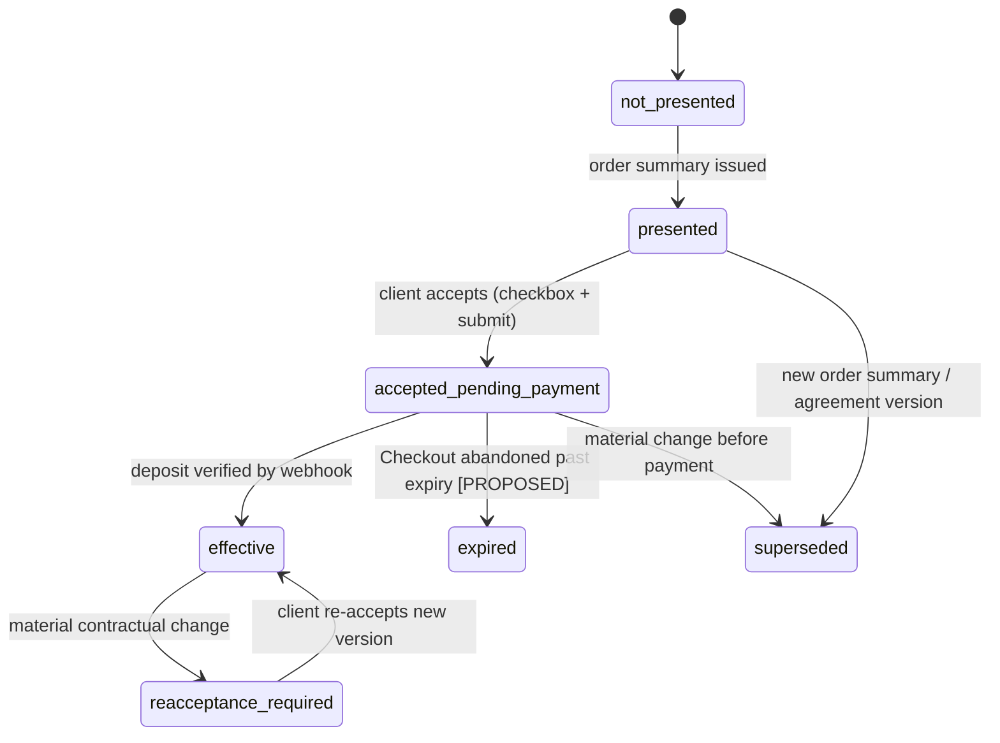

# 04 — Agreement and Billing

| Field | Value |
|---|---|
| Version | 0.1.0 |
| Status | **Draft — pending owner sign-off** |
| Decisions | OI-05, OI-13, OI-14, OI-15, OI-16, OI-17, OI-19 |
| Open issues | OI-26, OI-27, OI-28, OI-29, OI-30, OI-34, OI-35, OI-36, OI-37, OI-39 |

> Nothing in this document authorizes any Stripe operation. No Stripe products, prices, customers, subscriptions, or Checkout configurations were created, queried, or modified in preparing it.

## 1. Agreement lifecycle **[APPROVED OI-13]**

There is **one** versioned *Website Development & Maintenance Services Agreement*. Each project gets a **project-specific order summary** that is incorporated by reference.

- The owner-authored draft (v1.0, outside the repository) makes the agreement effective "upon electronic acceptance and successful initial payment." This is why acceptance and effectiveness are separate states.
- **[PENDING OI-34]** The final legal text is pending. Phase 3 test mode may use the draft only with a visible "DRAFT — not for production use" marker **[PROPOSED]**.

## 2. Agreement versioning and immutable copy **[APPROVED OI-13]**

Each agreement version record holds:
- the version label (for example `1.0`)
- the canonical text (stored immutably)
- a SHA-256 hash of the canonical bytes
- the effective-from date
- a status (`draft` / `approved` / `retired`)
- the approval reference

Rules **[PROPOSED]**:
- Version records are insert-only. A text change is a new version.
- The hash is computed over a canonical serialization (UTF-8, normalized line endings) and verified on read.
- Clients are only ever shown `approved` versions in production.

## 3. Acceptance evidence **[APPROVED OI-13]**

| Evidence | Source |
|---|---|
| Agreement version ID and document hash | Version record |
| Order summary ID and its snapshot hash **[PROPOSED]** | Order summary |
| Client business legal name, project ID | Project record |
| Signer user ID, verified email, full name | Auth and user profile |
| Signer authority representation and title | Acceptance form **[PENDING OI-28]** |
| Scope and price snapshot (package, cents values, maintenance price) | Order summary |
| Acceptance timestamp (server UTC) | Server |
| IP address, user agent, request ID | Server request **[PROPOSED]** |
| Checkbox state was unchecked by default, then affirmatively checked | UI contract and server validation |

**Workflow: accept agreement**

| Element | Specification |
|---|---|
| Actors | Client (authorized signer) |
| Preconditions | Active membership. Order summary `presented`. Agreement version `approved` (or `draft` in test mode). No existing effective acceptance for this order summary. |
| Inputs | Explicit `accepted = true`, authority representation, signer name/title |
| Records | `agreement_acceptances` (insert-only) |
| Transitions | `presented → accepted_pending_payment` |
| Permissions | Client membership on the project. Staff **cannot** accept on a client's behalf (03 §4). |
| Failure states | Stale order summary (superseded) → reject and reload; hash mismatch → reject and alert |
| Idempotency | One acceptance per (order summary, signer). A resubmission returns the existing record. |
| Audit | `agreement.accepted` |
| Negative tests | Pre-checked or missing checkbox value rejected; acceptance for another project rejected; acceptance of a superseded summary rejected |

## 4. Order summaries and reacceptance

The order summary is an immutable snapshot. It holds:
- the package key
- package total, deposit, and balance (cents)
- the maintenance price (cents/month)
- the Stripe Price IDs used (§5–§6)
- included scope items
- optional project notes approved by staff **[PROPOSED]**

**Material change** (requires a new order summary and re-acceptance) **[APPROVED OI-13]**. **[PROPOSED]** definition:
- any change to price, deposit, balance, maintenance rate, package, or scope
- a new agreement version with substantive changes

Non-material corrections, such as a typo in the business name, are audited staff edits with no price effect, pending owner confirmation of this definition.

## 5. Package pricing and live Stripe catalog reference **[APPROVED OI-14, OI-15]**

### 5.1 Package pricing (integer cents)

| Package key | Package | Total | Deposit (20%) | Balance (80%) |
|---|---|---|---|---|
| `essential` | Essential | 80000 ($800.00) | 16000 ($160.00) | 64000 ($640.00) |
| `professional` | Professional | 149500 ($1,495.00) | 29900 ($299.00) | 119600 ($1,196.00) |
| `advanced` | Advanced | 249500 ($2,495.00) | 49900 ($499.00) | 199600 ($1,996.00) |
| `signature` | Signature | 349500 ($3,495.00) | 69900 ($699.00) | 279600 ($2,796.00) |
| `prestige` | Prestige | 499500 ($4,995.00) | 99900 ($999.00) | 399600 ($3,996.00) |

Maintenance: **9900 cents ($99.00) per month**.

### 5.2 Live catalog reference — owner-supplied

> **LIVE MODE IDENTIFIERS.** These are Stripe Price **identifiers**, not credentials. They were supplied by the owner as previously verified against the live catalog. They were **not** queried from or verified against Stripe in this change set. Production integration must re-verify each ID's amount, currency, type (one-time vs recurring), interval, and active status in the authorized live environment before use **[VERIFY-PROVIDER, OI-39]**. They must never be used in non-production environments.

| Package | Deposit Price ID (one-time) | Balance Price ID (one-time) |
|---|---|---|
| Essential | `price_1UeTToGhzSDGlgsAGdFFdvH5` | `price_1UeTVuGhzSDGlgsAjhF4PVBa` |
| Professional | `price_1UeTXyGhzSDGlgsAlp8GFdH1` | `price_1UeTYvGhzSDGlgsAUT6n2Wbk` |
| Advanced | `price_1UeTaZGhzSDGlgsAuMiOBTxu` | `price_1UeTbSGhzSDGlgsAU4xNByks` |
| Signature | `price_1UeTcIGhzSDGlgsAxytYFM2U` | `price_1UeTcrGhzSDGlgsAOFvImCjA` |
| Prestige | `price_1UeTdvGhzSDGlgsAGsSJXCqB` | `price_1UeTeKGhzSDGlgsAhJassjEw` |

| Product | Recurring Price ID (monthly) |
|---|---|
| Website Care & Maintenance ($99/month) | `price_1UeCtAGhzSDGlgsAoVGWX4eh` |

Catalog rules **[APPROVED OI-14]**:
- Existing live products, prices, customers, and subscriptions are preserved.
- Legacy and custom products stay preserved and are excluded from standard package selection.
- No new or duplicate prices are created, and no inline (`price_data`) pricing is used.
- The mapping is versioned. A change to any ID is a recorded change (08 §6).
- **[PROPOSED]** The application keeps a versioned catalog mapping (package key → environment → Price IDs, plus expected cents). At startup or deploy time, a verification compares the Stripe price amounts against the expected cents, and fails closed on mismatch.

## 6. Test-mode catalog mapping **[PENDING OI-30]**

| Package | Test Deposit Price ID | Test Balance Price ID |
|---|---|---|
| Essential | *unresolved* | *unresolved* |
| Professional | *unresolved* | *unresolved* |
| Advanced | *unresolved* | *unresolved* |
| Signature | *unresolved* | *unresolved* |
| Prestige | *unresolved* | *unresolved* |
| Maintenance (recurring) | *unresolved* | — |

Phase 3 cannot begin implementation until these are supplied by the Owner and verified to match §5.1 amounts.

## 7. Integer-cents calculation policy **[APPROVED OI-15]**

- All amounts are integer USD cents. Floating-point arithmetic on money is prohibited.
- `deposit = round_half_up(total × 20 / 100)` using integer arithmetic. **[PROPOSED]** formula: `deposit = (total × 20 + 50) div 100` for non-negative totals.
- `balance = total − deposit`. Invariant: `deposit + balance = total`.
- All five standard packages produce exact cents (§5.1). Rounding matters only for possible future non-standard totals.
- Snapshots are immutable once the order summary is presented.
- Discounts, taxes, refunds, disputes, and maintenance charges are **separate** ledger entries. They never alter the snapshot (§12).
- **[PROPOSED]** Verification: the configured Stripe deposit and balance price amounts must equal the calculated values. A mismatch blocks Checkout creation.

## 8. Initial Checkout composition **[APPROVED OI-17]**

| Attribute | Value |
|---|---|
| Checkout mode | `subscription` |
| Line item 1 | Package **deposit** Price ID (one-time), quantity 1 |
| Line item 2 | **Maintenance** Price ID (recurring monthly, 9900), quantity 1 |
| First invoice total | **deposit + 9900 cents**: one deposit charge plus **one** maintenance period. Never deposit + 19800. |
| Subsequent billing | 9900 cents monthly from the subscription billing anchor (purchase date) |

Expected initial totals:

| Package | Deposit | + Maintenance | = Initial charge |
|---|---|---|---|
| Essential | 16000 | 9900 | **25900 ($259.00)** |
| Professional | 29900 | 9900 | **39800 ($398.00)** |
| Advanced | 49900 | 9900 | **59800 ($598.00)** |
| Signature | 69900 | 9900 | **79800 ($798.00)** |
| Prestige | 99900 | 9900 | **109800 ($1,098.00)** |

**[VERIFY-PROVIDER]** One-time prices in subscription-mode Checkout are added to the first invoice only. Confirm this against current Stripe documentation in Phase 3.

**Workflow: start initial Checkout**

| Element | Specification |
|---|---|
| Actors | Client |
| Preconditions | Acceptance exists in `accepted_pending_payment` for the current order summary. No verified deposit. No open initial session for this project (or reuse it) **[PROPOSED]**. |
| Server actions | Resolve the Price IDs from the order summary snapshot (not from client input). Create or reuse the Stripe Customer for the client business. Create the Checkout Session with metadata `project_id`, `order_summary_id`, `acceptance_id`, `environment`. |
| Records | `checkout_sessions` (session ID, type `initial`, status) |
| Idempotency | Stripe idempotency key derived from `order_summary_id` and attempt number **[PROPOSED]** |
| Concurrency | A unique constraint allows at most one *open* initial session per project. Double-click returns the same session. |
| Failure states | Price verification mismatch → block and alert; Stripe API error → retryable message, no state change |
| Audit | `checkout.session_created` |

## 9. Subscription billing lifecycle **[APPROVED OI-16, OI-17]**

- The subscription starts at initial purchase and bills during development. The agreement must accurately disclose prelaunch and postlaunch services. **[APPROVED OI-16]**
- Renewal outcomes are recorded from webhooks only.
- Failed renewals use Stripe retry behavior **[VERIFY-PROVIDER]** and raise billing holds as defined under **[PENDING OI-26]**.
- Self-service payment-method updates or cancellation through the Stripe Customer Portal: **[PENDING OI-29]**.
- Cancellation, refund, and third-party-charge terms: **[DEFERRED OI-35]**.
- **[APPROVED OI-21]** Closing a portal account does **not** cancel the Stripe subscription. Cancellation is a separate, explicit billing action.

## 10. Final Checkout **[APPROVED OI-17]**

| Attribute | Value |
|---|---|
| Mode | `payment` |
| Line item | Package **balance** Price ID (one-time), quantity 1 |
| Amount | Balance from the order summary snapshot (§5.1) |
| Preconditions **[PROPOSED]** | Agreement `effective`. Deposit verified. The approval gate is satisfied for the current released preview (05 §7). No open final session. Balance not already settled. |
| Records | `checkout_sessions` (type `final`) |
| Idempotency, concurrency, audit | As in §8 |

Whether final payment may be requested *before* client approval is not specified by the baseline. **[PROPOSED]** It may not, matching the draft agreement §3, which says the review comes before the final payment request.

## 11. Verified webhook handling **[APPROVED OI-17]**

Rules:
1. Every event's Stripe signature is verified against the environment's webhook secret using the raw request body. Unverified requests are rejected (400) and logged.
2. **Idempotency.** `webhook_events.stripe_event_id` is unique. A duplicate delivery returns 200 and has no side effects.
3. **Ordering.** Handlers are order-independent. State changes are derived from object state (re-fetching the object from Stripe where needed **[PROPOSED]**), not from event order alone.
4. **A successful redirect is never proof of payment.** The success page shows "payment processing" until the webhook-derived state is `verified`.
5. **Environment check.** The event's `livemode` must match the environment. A mismatch is rejected and alerted.
6. **Metadata check.** `project_id` and `order_summary_id` must resolve, and the amounts must equal the snapshot. A mismatch → quarantine the event for Owner review; it never marks anything verified.

**[PROPOSED]** Events in scope **[VERIFY-PROVIDER]**:

| Event | Effect |
|---|---|
| `checkout.session.completed` | Record completion. Deposit or balance verified only if `payment_status = paid`. |
| `checkout.session.async_payment_succeeded` / `_failed` | Delayed payment methods |
| `invoice.paid` | Ledger: deposit and first maintenance (initial); maintenance renewals |
| `invoice.payment_failed` | Failed payment record; hold evaluation (OI-26) |
| `customer.subscription.created` / `updated` / `deleted` | Subscription state mirror |
| `charge.refunded` / `refund.*` | Refund ledger entries |
| `charge.dispute.created` / `closed` | Dispute ledger entries and holds (OI-37) |

**Payment verification definition [APPROVED OI-17; wording PROPOSED]:** A deposit or balance is **verified** only when a signature-verified Stripe event for the corresponding Checkout Session or invoice has been processed, the amount and currency match the immutable snapshot, and the corresponding ledger entry is posted.

## 12. Financial ledger **[APPROVED OI-15, OI-17, OI-19]**

The ledger is append-only. Entries are never edited. Corrections are reversing entries **[PROPOSED]**.

| Entry type | Source |
|---|---|
| `deposit_charge` | Webhook |
| `maintenance_charge` | Webhook (initial and renewals) |
| `balance_charge` | Webhook |
| `refund` | Webhook (policy: OI-35) |
| `dispute_opened` / `dispute_won` / `dispute_lost` | Webhook (OI-37) |
| `tax` | Webhook, if tax is enabled (OI-36) |
| `discount` | Order summary or Stripe coupon (policy pending) |
| `balance_adjustment` | Owner-authorized contractual adjustment **[PENDING OI-27]** |

Each entry holds:
- `project_id` and type
- signed integer cents and currency
- Stripe object IDs
- the related snapshot
- `posted_at`
- actor (for manual entries)
- reason and amendment reference (for adjustments)
- audit event ID

There is **no** entry type or action that records a payment as received without a Stripe event. **[APPROVED OI-19]**

## 13. Reconciliation **[APPROVED OI-17]**

**[PROPOSED]**
- A scheduled job (daily) compares, per project, the ledger totals against Stripe invoice, charge, and refund data and against the order summary snapshot.
- A mismatch creates an Owner queue item and an alert. It never auto-corrects payment state.
- A backfill job can replay missed webhooks by listing events, using the same idempotent handler.

## 14. Billing holds **[APPROVED OI-17; rules PENDING OI-26]**

- Holds are records with type, trigger source, `placed_at`, `cleared_at`, and clearing evidence.
- Every *active* hold that blocks publication fails the publication gate (06 §2).
- **[PROPOSED]** An Owner manual hold can be placed and cleared by the Owner. System holds (derived from Stripe state) clear only when the underlying state resolves.
- The draft agreement §12 (suspension after 7 days' written notice) needs a notice record and timer if adopted under OI-26.

## 15. Deferred policies

| Policy | Issue | Effect until resolved |
|---|---|---|
| Agreement final text | OI-34 | Test mode only, with draft marker |
| Refunds and cancellation | OI-35 | Ledger supports entries; no automated refunds **[PROPOSED]** |
| Tax | OI-36 | No tax collection in test mode |
| Disputes | OI-37 | Record and hold only; manual Owner response |

## 16. Payment-related acceptance tests **[PROPOSED]**

| ID | Test |
|---|---|
| T-PAY-01 | For each package, the initial Checkout's first invoice totals deposit + 9900 cents (table §8). The maintenance line appears exactly once. |
| T-PAY-02 | `deposit + balance = total` and the deposit equals `round_half_up(20%)` for all packages and for property-based random totals |
| T-PAY-03 | A webhook with an invalid signature is rejected and changes no state |
| T-PAY-04 | Visiting the success URL without a processed webhook leaves the deposit `pending` and intake locked |
| T-PAY-05 | Replaying the same event ID (×N, concurrently) posts each ledger entry exactly once |
| T-PAY-06 | Out-of-order delivery (`invoice.paid` before `checkout.session.completed`) produces the correct final state |
| T-PAY-07 | An event whose amount differs from the snapshot is quarantined and never verifies payment |
| T-PAY-08 | A `livemode` mismatch for the environment is rejected |
| T-PAY-09 | Final Checkout cannot be created before deposit verification and current-release approval |
| T-PAY-10 | No API or UI path exists that records a payment as received without a Stripe event (code search plus negative API test) |
| T-PAY-11 | A client cannot create a Checkout Session for another project (cross-tenant) |
| T-PAY-12 | Price verification mismatch blocks Checkout creation |
| T-AGR-01 | The acceptance checkbox renders unchecked. The server rejects acceptance without an explicit true value. |
| T-AGR-02 | Initial Checkout cannot be created without a current acceptance |
| T-AGR-03 | Acceptance evidence includes every §3 field. The stored hash matches the version text. |
| T-AGR-04 | A material change moves the state to `reacceptance_required` and blocks gated actions until re-acceptance |
| T-AGR-05 | Staff cannot accept on a client's behalf |
