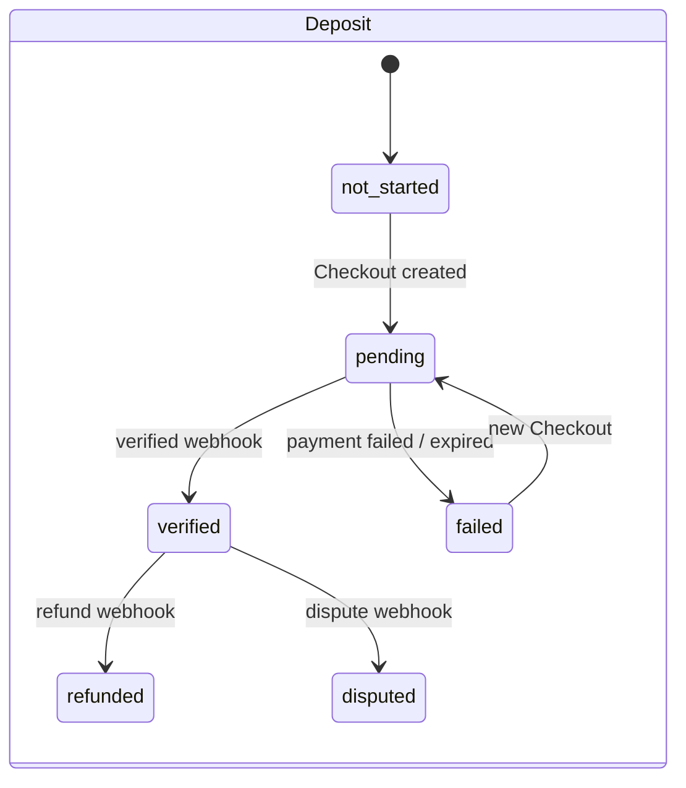
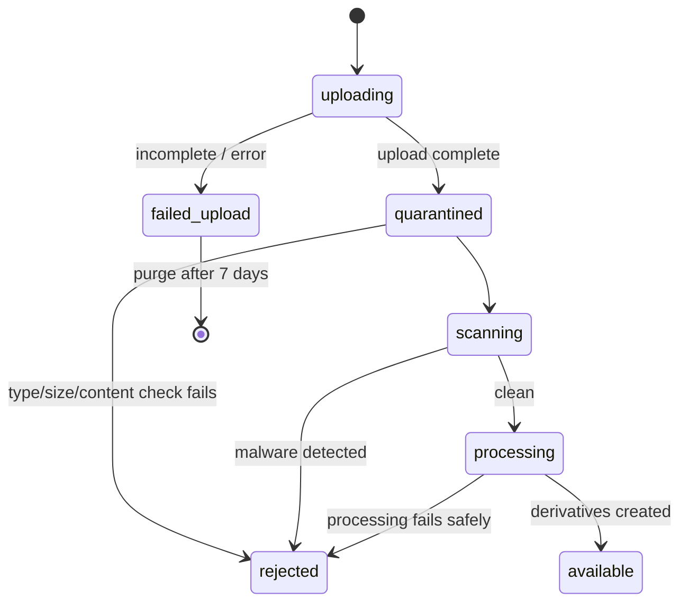

# 05 — Project Lifecycle and Uploads

| Field | Value |
|---|---|
| Version | 0.4.4 |
| Status | **Approved** (Owner, 2026-11-23, consolidated execution plan approval). v0.4.0: R1/R2 release tags (OI-68): staff-recorded preview releases, staff-performed and recorded outreach, and the R1 approval wording. Earlier: v0.3.2 automatic final payment (OI-17 revised). v0.4.1 adds §9 queue visibility for **OI-72** (Owner decision, 2026-11-24); no other approved text or value is changed. v0.4.2 (**OI-74**, 2026-11-24): intake also requires an active payment authorization (§3); the R1 approval label and T-LC-14 move to R1. v0.4.3 (**OI-79**, Owner decision 2026-11-24): resolved values for uploads, image limits, scanner retries, the quarantine review threshold, domain-expiry warnings, release precondition, and intake corrections (§3, §5.4). v0.4.4 (Owner direction, 2026-11-24): authoritative scan-result rules (§5.5) after the PR #19 CI root cause; tests T-UP-14 to T-UP-19. No release requirement is weakened. |
| Decisions | OI-05, OI-09, OI-18, OI-20, OI-25, OI-26, OI-31, OI-39, OI-42, OI-43, OI-45, OI-46, OI-68, OI-72 |
| Open issues | None |
| Dependencies | DEP-06, DEP-07 |

**Release placement [APPROVED OI-68]:** everything in this document is **[R1]** unless tagged **[R2]**.

## 1. Principle **[APPROVED OI-05]**

Each lifecycle dimension has its **own** state, derived from authoritative records. There is **no** single editable "project status" field. Any displayed summary status is computed, and it is never used to decide payment or publication eligibility.

## 2. Independent state machines

| Dimension | States | Authoritative source |
|---|---|---|
| Agreement | `not_presented → presented → accepted_pending_payment → effective` (+ `superseded`, `reacceptance_required`, `expired`) | Acceptance and order summary records (04 §1) |
| Deposit | `not_started → pending → verified` (+ `failed`, `refunded`, `disputed`) | Webhook-derived ledger (04 §11–§12) |
| Intake | `locked → open → submitted → accepted_by_staff` (+ `changes_requested`) | Intake records |
| Development | `not_started → in_progress → ready_for_preview` (+ `paused`) | Staff-recorded milestones (informational, never a gate) |
| Preview approval | Per release: `released → approved` / `superseded` / `withdrawn` | Preview release and approval records (§6–§7) |
| Final balance | `not_due → due → pending → verified` (+ `failed`, `refunded`, `disputed`, `settled_by_adjustment` **[APPROVED OI-27]**, meaning paid + Owner-authorized adjustments = owed, never a fabricated payment). **[APPROVED OI-17, revised 2026-11-23]** `due` on the client's final approval (§7); `pending` once the final-balance invoice is open for payment (R1: on its Stripe-hosted page) or the automatic charge is attempted (R2); `failed` → `pending` when the client completes payment on the Stripe-hosted page for the same invoice (04 §10). | Webhook-derived ledger |
| Holds | Zero or more active holds (billing and fulfillment holds are distinct types) | Hold records (04 §14) **[APPROVED OI-25, OI-26, OI-37, OI-45]** |
| Service termination | `none → under_owner_review → termination_authorized → effective → maintenance_ceased → offboarded / transferred` (+ `withdrawn`). Independent of the Stripe subscription status. | Owner-authorized termination records (04 §9.1.1) **[APPROVED OI-46]** |
| Publication | `not_eligible → eligible → authorized → deploying → live_unverified → live_verified` (+ `failed`, `rolled_back`) | Gate evaluation and deployment records (06) |

Transition rules:
- **[APPROVED OI-05, OI-17]** The deposit and final balance states change **only** through webhook processing (04 §11).
- **[PROPOSED]** Development milestones can be set by staff, but they do not satisfy any gate.

## 3. Intake requirements

| Element | Specification |
|---|---|
| Actors | Client (primary); Owner and Admin (audited corrections, **[APPROVED OI-79 item 7]**) |
| Preconditions | Deposit `verified` **[APPROVED baseline journey step 6]**, **and** `payment_authorization_ready` from the financial status interface (04 §8.1) **[APPROVED OI-74]** |
| Inputs | Business legal and display name, contact info (phone, email, address), service areas, services offered, logo(s), photos, brand guidelines (optional), website preferences (style references, color preferences, pages wanted), domain information (existing domain / needs domain) |
| Records | `intake_submissions` (versioned drafts; the submitted version is immutable). Staff corrections create a new version and never alter the original submission; each correction records the actor, time, and a required reason **[APPROVED OI-79 item 7]**. |
| States | `open → submitted → accepted_by_staff` or `changes_requested → submitted` |
| Autosave | Drafts are saved server-side **[PROPOSED]** |
| Failure states | Validation errors per field; upload errors (§5) |
| Audit | `intake.submitted`, `intake.changes_requested`, `intake.accepted`, `intake.edited_by_staff` |
| Retention | Abandoned intake: 90 days (07 §6) |

The exact field list and required/optional flags are **[PROPOSED]** above, for owner refinement.

## 4. Project asset uploads **[APPROVED OI-20]**

- Storage is private Supabase Storage, isolated per project by path prefix and policy (03 §8–§9).
- Uploads are authorized on the server. **[PROPOSED]** The server issues a short-lived, single-object upload URL scoped to the project path, only after checking type, size, and quota.
- **Versioning:** a replaced asset creates a new version. Prior versions are retained per 07 §6.
- **Usage tracking [APPROVED OI-42]:** used and unused assets must be clearly distinguished. **[PROPOSED]** Each asset version carries a `used` flag. The flag is set irreversibly when the version is incorporated into any released preview or final deliverable, derived from that release's asset manifest. Assets never incorporated are **unused**, and follow the 90-day post-closure retention rule (07 §6).
- **No automatic publication.** An asset reaches a client website only through a staff-built preview release and the publication gates (06).
- Upload and access history are audited.

## 5. File limits, validation, and quarantine **[APPROVED OI-20]**

### 5.1 Quotas

| Limit | Value |
|---|---|
| Files per project | 100 |
| Storage per project | 2 GB |
| Exceptions | Admin-approved, within authorization rules, audited |

### 5.2 Per-file limits

| Category | Types | Max size |
|---|---|---|
| Logos | PNG, JPG, WEBP, SVG | 15 MB |
| Photos | JPG, PNG, WEBP, HEIC | 25 MB |
| Brand guidelines | PDF | 25 MB |
| Business documents | PDF, DOCX | 20 MB |
| Video | MP4, MOV | 250 MB |
| Other | Any | Admin approval required |

### 5.3 Pipeline

Rules:
1. **[APPROVED]** Validate actual content, not just extension or declared MIME type. **[PROPOSED]** Check magic bytes; reject mismatches and polyglots.
2. **[APPROVED OI-31]** Every upload stays in quarantine until malware scanning finishes. A **failed scan blocks both access and fulfillment**: the asset becomes `rejected` and cannot be downloaded, previewed, or used in a release. A failed scan produces an audit record and an **actionable notification** to the client (re-upload guidance) and to staff (07 §4). The scanning **vendor is selected after provider and cost verification** (DEP-07). Until a vendor is in place, nothing leaves `quarantined` in any environment that handles real client data.
3. **[APPROVED]** SVG must be sanitized. **[PROPOSED]** Strip scripts, event handlers, external references, and `foreignObject`. Keep the original in quarantine storage, and serve only the sanitized output.
4. **[APPROVED]** HEIC must be handled. **[PROPOSED]** Convert to JPEG/WEBP derivatives and keep the original.
5. **[APPROVED]** Safe image/video processing. **[PROPOSED]** Run in an isolated worker with dimension and pixel limits (decompression-bomb protection), and strip EXIF location metadata from derivatives.
6. **[APPROVED]** Resumable large uploads must be addressed. **[VERIFY-PROVIDER OI-39]** Check Supabase Storage resumable (TUS) support and object size limits against the 250 MB video limit.
7. Quota is checked at upload-URL issuance and again at completion **[PROPOSED]**. Concurrent uploads must not exceed quota (a transactional reservation).

### 5.4 Resolved values **[APPROVED OI-79, Owner 2026-11-24]**

| # | Item | Value |
|---|---|---|
| 1 | Units in §5.1–§5.2 | **Decimal**: 1 MB = 1,000,000 bytes; 1 GB = 1,000,000,000 bytes |
| 2 | Upload review queue (§9): "quarantined beyond the SLA" | A file still quarantined **24 hours** after upload is flagged for review |
| 3 | Domain expiries queue (§9): "approaching the end of the initial term" | Warning **60 days** before the registration's expiry |
| 4 | Decompression-bomb limits (§5.3 rule 5) | At most **12,000 px per side and 100 megapixels**. Dimensions are read from the file header and checked **before** any full decode; decoding is bounded in memory and processing time; malformed or oversized images are rejected before expensive processing wherever possible. No unapproved dependency is introduced (OI-80) |
| 6 | Release precondition (§6) | A preview can be released only when intake is `accepted_by_staff`. **No override** |
| 7 | Intake corrections (§3) | Owner and Admin; original submission, correction history, actor, and reason preserved; existing authorization and tenant isolation apply |
| 8 | Scanner errors (§5.3) | The file stays **quarantined**. Bounded retries with backoff; after the last retry the file goes to the Upload review queue. No unscanned file is ever released |

Item 5 (security findings) is in 06 §2 and §7.

### 5.5 Authoritative scan results **[Owner direction, 2026-11-24; implements §5.3 "no unscanned file is released"]**

1. **Deterministic order.** Every scan result carries a database-assigned, strictly increasing sequence number. Every insert takes the upload row lock first, so sequence order is the order in which results were accepted for that upload. Timestamps and random IDs never decide authority.
2. **Scan attempts.** Each entry into `scanning` creates a new scan attempt. A result must name the current attempt; a result for an earlier attempt, a duplicate, or a replay is recorded as **non-authoritative** and never moves the upload toward release.
3. **Malware always wins.** A `malicious` result is accepted and acted on in **any** non-terminal state and from any attempt, including after a clean result: the upload is rejected, and if it was already available, access is revoked, audited, and the Owner is alerted. A malicious result for the same bytes at any time permanently blocks release.
4. **Errors and invalid results.** An `error`, an unpermitted scanner, or an invalid result for the current attempt returns the upload to quarantine (bounded retries, 05 §5.4 item 8); a later clean result counts only if it belongs to a newer attempt.
5. **Exact bytes.** The authoritative clean result must match the SHA-256 computed by the server from the stored quarantine object. Processing re-reads the object and verifies that hash before producing a derivative; the released object's hash is computed by the server from the object written to the released path.
6. **Release eligibility** is unchanged and still requires all of: status `processing`, the authoritative result clean by a permitted scanner for the exact stored bytes, and no `malicious` result ever recorded for those bytes.

## 6. Preview release versioning **[APPROVED OI-18]**

- A **preview release** is an immutable, uniquely identified artifact released to the client. **[PROPOSED]** It is identified by a sequential release number per project, the source commit SHA, the deployment ID, and the preview URL.
- **[R1, OI-68]** Staff create the release record by entering the source commit SHA, deployment ID, and preview URL of a build they have deployed to a protected preview. The record is immutable once released. **[R2]** The portal builds and records releases itself.
- **Internal drafts** (unreleased builds) are not visible to the client, and they do not affect existing approvals.
- Releasing a new preview marks earlier releases `superseded` for approval purposes. Their records and approvals are preserved.
- Release records are insert-only. Only `withdrawn` (with a reason) may be applied after release.

## 7. Client approval workflow **[APPROVED OI-18, OI-03]**

| Element | Specification |
|---|---|
| Actors | Client with active membership on the project |
| Preconditions | A release in `released` state is the project's current release |
| Inputs | Explicit approval action on that release ID, plus an optional comment. The action is labeled **Approve Website & Authorize Final Payment** **[APPROVED OI-17, revised 2026-11-23; R1 by OI-74]**. |
| Payment authorization **[APPROVED OI-17, revised 2026-11-23, by OI-68, and by OI-74]** | The approval makes the previously disclosed outstanding balance due, creates the single final-balance invoice (04 §10), and authorizes its automatic collection (04 §3.1). With an `active` payment authorization (04 §8.1) the invoice is charged automatically; otherwise, or when the charge fails or needs authentication, the client pays the same invoice on its Stripe-hosted page. **[PROPOSED]** The approval screen shows that amount from the order summary snapshot before the client confirms. Approving an already-approved release, or approving after the balance is pending, verified, or settled, never starts a second charge. |
| Records | `preview_approvals` (release ID, user ID, timestamp, IP/UA **[PROPOSED]**) — insert-only. The final-balance charge record references the approval ID (04 §10). |
| Gate rule | The approval gate passes only if an approval exists **for the current released release ID** |
| Silence | **Never** treated as approval. No timer converts silence into approval. **[APPROVED OI-18, OI-25]** |
| Nonresponsive client | §7.1 **[APPROVED OI-25]** |
| Permissions | Owner/Admin cannot approve on a client's behalf |
| Concurrency | Approving a release that was superseded between page load and submission is rejected with a reload prompt |
| Idempotency | A repeat approval of the same release by the same user returns the existing record |
| Audit | `preview.released`, `preview.approved`, `preview.superseded`, `preview.withdrawn` |

The owner-authored draft agreement §3 gives the client five business days to identify material deviations. **[PROPOSED]** The portal shows this as an informational review window only. It does not change the explicit-approval rule.

### 7.1 Nonresponsive client escalation **[APPROVED OI-25]**

**[R1, OI-68]** The day 3 and day 7 reminders and the day-7 Admin notification are performed by staff and recorded in the portal as outreach records (`approval.reminder_1_sent`, `approval.reminder_2_sent`, `approval.admin_notified`, with channel, date, and summary). The "Approval outreach due" queue (§9) shows what is due each day. **[R2]** The system sends them from the outbox.

Days are calendar days in America/Detroit, counted from the local release date of the **current** released preview. Day *N* is the release date + *N* (02 §13). **[APPROVED OI-43]** Releasing a new preview restarts the schedule.

| Day | Action | Actor | Audit event |
|---|---|---|---|
| 0 | Preview released. The client is asked to give explicit approval or request revisions. | System / staff | `preview.released` |
| 3 | First reminder to the client | System (outbox) | `approval.reminder_1_sent` |
| 7 | Second reminder to the client, plus an Admin notification | System (outbox) | `approval.reminder_2_sent`, `approval.admin_notified` |
| 14 | Personal follow-up escalation. Staff record the outreach (channel, date, summary). | Staff | `approval.personal_followup_recorded` |
| 21+ | An `approval_nonresponsive_hold` **may** be applied, but only after documented outreach exists (§7.2) | Owner or Admin **[APPROVED OI-45]** | `approval_hold.placed` |

Rules **[APPROVED OI-25]**:
- Silence never constitutes approval.
- The hold does **not** cancel the subscription, waive any balance, or satisfy any publication requirement.
- A client response (approval or revision request) stops the schedule.
- Every step is auditable.

### 7.2 Day-21 approval hold **[APPROVED OI-45]**

`approval_nonresponsive_hold` is a **fulfillment** hold. It is a separate type from every billing hold, and it never represents an approved preview.

| Aspect | Rule |
|---|---|
| Preconditions | Day ≥ 21 for the current release, and documented outreach exists, including the day-14 personal follow-up record |
| Apply | Owner or Admin, with a reason |
| Pauses | Active development work and nonessential fulfillment activity. **[PROPOSED]** Publication is also blocked through G8 while the hold is active (06 §2). |
| Preserved | Client portal access; preview access; the client's ability to approve or to request revisions; the explicit-approval gate G3 |
| Never | Cancels the maintenance subscription; waives balances; affects already-published websites; treats silence as approval |
| Client response | An approval or revision request from an authorized client on the current release is recorded normally. An approval made during the hold is a valid G3 approval. Either response creates an `approval_hold_review` queue item for administrative review. |
| Qualifying client response | An explicit approval or revision request on the current release by an authorized client **[PROPOSED definition]** |
| Clear | Owner at any time, with a reason. Admin only after a qualifying client response. |
| Resumption | A recorded resumption decision, for example: resume development, proceed to final payment, or remain held |
| Audit | `approval_hold.placed` (actor, authorization, reason, outreach evidence IDs, timestamp); `approval_hold.client_response`; `approval_hold.cleared`; `approval_hold.resumption_decided` |
| Display | **[PROPOSED]** Labeled "Paused: awaiting your preview response". It is never shown as a billing status or as approved. |

## 8. Revision handling **[PROPOSED]**

- The client may submit revision requests against a release. Each request is linked to the release ID, with structured comments.
- Staff classify each request as in-scope or out-of-scope. Out-of-scope work requires a new order summary and re-acceptance (04 §4) before it is performed under a price change.
- A revision cycle ends with a new released preview, which requires a new approval.

## 9. Derived administrative queues **[APPROVED OI-05]**

Queues are **computed** from authoritative state. They are never maintained by hand. **[PROPOSED]** set:

| Queue | Derivation |
|---|---|
| Awaiting acceptance | Order summary `presented`, no acceptance |
| Awaiting deposit | Acceptance exists, deposit not `verified` |
| Intake pending | Deposit `verified`, intake not `submitted` |
| Intake review | Intake `submitted` |
| In development | Intake accepted, no current release |
| Awaiting client approval | Current release with no approval |
| Approval outreach due **[R1]** | Current release unapproved at day 3 or day 7 with no matching outreach record (OI-25) |
| Approval follow-up due | Current release unapproved at day 14 with no recorded personal follow-up (OI-25) |
| Approval hold eligible | Current release unapproved at day 21+ with documented outreach (OI-25) |
| Payment recovery | Failed maintenance renewal within the 7-day recovery period (OI-26) |
| Cancellation milestones | Effective cancellations with M1 (12 business days) or M2 (60 calendar days) approaching or passed, or required notices due (OI-35) |
| Domain expiries | Spotlight-registered domains approaching the end of their initial one-year term **[PROPOSED]** |
| Disputes | Open disputes, ordered by evidence due date (OI-37) |
| Approval hold review | A client responded while `approval_nonresponsive_hold` is active (OI-45) |
| Billing hold Owner review | `maintenance_payment_hold` is active and no Owner decision is recorded (OI-46) |
| Stripe cancellation exceptions | A Stripe subscription was deleted without an authorized termination (OI-46) |
| Retention due | Unused assets 90 days after closure; used assets 12 months after closure (OI-42) |
| Awaiting final payment | Approval current, balance not `verified` |
| Ready for publication review | All gates pass except Owner authorization |
| Blocked by hold | Any active blocking hold |
| Publication verification failed | Publication `failed` or verification failed |
| Upload review | Assets `quarantined` beyond the SLA or `rejected`; type-exception requests |
| Reconciliation mismatches | 04 §13 |
| Service inquiries | 06 §11 |

**Queue visibility [APPROVED OI-72]:**
- **Owner only:** Disputes, Billing hold Owner review, Stripe cancellation exceptions, Reconciliation mismatches, and the detail of Payment recovery (invoice, amounts, attempts).
- **Owner and Admin, as derived states only** (03 §4): Awaiting deposit and Awaiting final payment show "requirement satisfied / unsatisfied"; Payment recovery shows "payment recovery required"; Blocked by hold shows "billing-related operational hold" or the fulfillment hold type; Ready for publication review shows publication eligibility; any Owner-only queue item appears to Admin only as "Owner intervention required". No amount, payment record, payment method, or dispute evidence is shown to Admin.
- **Owner and Admin:** all other queues.
- Enforced by the database and the server, as in 03 §4, not by hiding UI elements.

## 10. Client notification triggers

The event catalog is in [07 §4](07-NOTIFICATIONS-PRIVACY-AND-DESIGN.md#4-event-catalog-proposed). Lifecycle triggers: deposit verified, intake changes requested, preview released, approval reminders, final payment action required (failed charge or authentication needed), final payment verified, publication live. **[R1, OI-68]** Each trigger writes its outbox row (07 §2) and appears in the portal; email delivery through Resend is **[R2]**.

## 11. Acceptance tests **[PROPOSED]**

| ID | Test |
|---|---|
| T-LC-01 | Intake routes and actions are denied until the deposit is `verified` and `payment_authorization_ready` is true (OI-74; 04 T-PAY-18) |
| T-LC-02 | No API exists to set deposit or balance state directly. Only the webhook handler changes them. |
| T-LC-03 | Derived queues match the state for seeded fixture projects in every combination |
| T-LC-04 | A submitted intake version is immutable. Staff edits create audited new versions. |
| T-LC-05 | A client can approve only the current released preview of their own project |
| T-LC-06 | After release *n+1*, the approval gate fails until *n+1* is approved. The approval for *n* is still stored. |
| T-LC-07 | An unreleased internal draft does not supersede the current approval |
| T-LC-08 | No scheduled job or timer creates an approval |
| T-LC-09 | Staff cannot create an approval record |
| T-LC-14 | **[R1, OI-74]** The approval action is labeled "Approve Website & Authorize Final Payment". Approving the current release starts exactly one final-balance charge (04 T-PAY-13). Approving a superseded release starts none. |
| T-UP-01 | Each category rejects files over its size limit and disallowed types |
| T-UP-02 | Renamed executables, extension/MIME mismatches, and polyglots are rejected |
| T-UP-03 | Malicious SVG (script, `onload`, external `href`) is sanitized. The sanitized output contains no active content. |
| T-UP-04 | The 101st file and uploads beyond 2 GB are rejected, including under concurrent uploads |
| T-UP-05 | Assets in `quarantined` or `scanning` cannot be downloaded by clients or used in releases |
| T-UP-06 | Cross-tenant: client A cannot upload into, list, or download from project B paths |
| T-UP-07 | Failed uploads are purged after 7 days |
| T-UP-08 | Uploading an asset never changes any preview or live site |
| T-UP-09 | A failed scan makes the asset `rejected`, blocks its download and release use, and sends client and staff notifications (OI-31) |
| T-UP-10 | **[OI-79]** Limits use decimal units (a file of 1 byte over the decimal limit is rejected) |
| T-UP-11 | **[OI-79]** An image over 12,000 px on either side or over 100 megapixels, or with a malformed header, is rejected before full decoding; decoding a hostile image stays within the memory and time bounds |
| T-UP-12 | **[OI-79]** A scanner error keeps the file quarantined; retries are bounded with backoff; exhausting them routes the file to the Upload review queue; the file is never served at any point |
| T-UP-13 | **[OI-79]** A file quarantined for more than 24 hours appears in the Upload review queue; a domain within 60 days of expiry appears in the Domain expiries queue |
| T-UP-14 | Several results recorded in one transaction (identical timestamps) are ordered by sequence; release always uses the last accepted result, deterministically |
| T-UP-15 | Concurrent result submissions for one upload serialize on the row lock; the sequence matches acceptance order; delayed responses for an earlier attempt are non-authoritative |
| T-UP-16 | An unpermitted-scanner clean result followed by a permitted clean result for a newer attempt releases only through the newer one; the reverse order never releases |
| T-UP-17 | A clean result followed by a `malicious` result (any attempt, any non-terminal state, or after release) rejects the upload and blocks or revokes access; a clean result followed by an `error` returns it to quarantine |
| T-UP-18 | A stale or replayed clean result (earlier attempt, duplicate, or re-sent after a newer malicious, error, or invalid result) never supersedes it and never releases the file |
| T-UP-19 | A result whose SHA-256 differs from the stored quarantine object, or a stored object changed after scanning, blocks release; the released object's hash is server-computed |
| T-LC-10 | **[R2]** Reminders are sent on days 3 and 7, the Admin notification on day 7, and the follow-up queue entry appears on day 14. A new release restarts the schedule. (OI-25) |
| T-LC-11 | The approval hold cannot be placed without a recorded personal follow-up. Placing it never creates an approval or alters billing. |
| T-LC-12 | During an approval hold, the client can view the preview, approve it, or request revisions. The approval satisfies G3, and a review queue item is created. (OI-45) |
| T-LC-13 | An approval hold does not change portal access, subscription status, balances, or any published site |
| T-LC-15 | **[R1]** A staff-recorded release is immutable once released, requires a commit SHA, deployment ID, and preview URL, and cannot be created by a client. Outreach records for days 3 and 7 are required before the "Approval outreach due" queue clears. The R1 approval screen shows the outstanding balance from the snapshot and does not state or imply an automatic charge. |
| T-LC-16 | **[OI-79]** Releasing a preview while intake is not `accepted_by_staff` is rejected for every actor; no override exists |
| T-LC-17 | **[OI-79]** Owner and Admin can correct intake only with a reason; the original submission and every earlier version stay unchanged and readable; actor and reason are recorded; another project's staff-facing intake is unreachable by clients, and a client cannot correct intake |
| T-UP-10 | Incorporating an asset into a released preview sets `used`. The flag never reverts. Assets that were never incorporated are reported as unused. (OI-42) |
