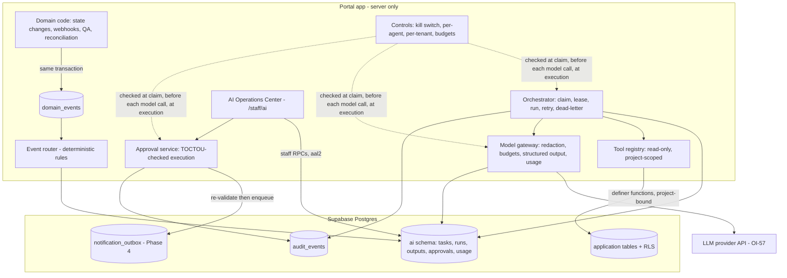
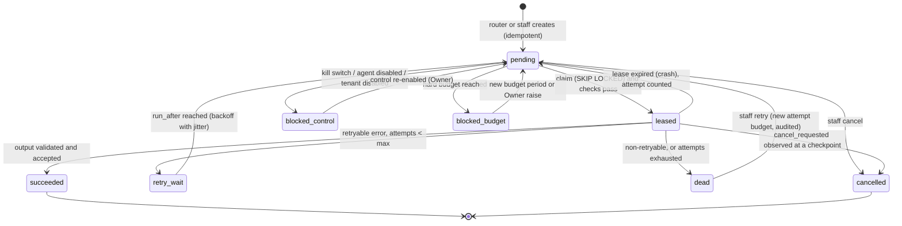

# AI Operations Ecosystem — Proposed Architecture

| Field | Value |
|---|---|
| Document | Proposed design (architecture planning only) |
| Version | 0.1.0 |
| Status | **PROPOSED — not approved, not implementation authorization.** Requires Owner decisions OI-56 to OI-62 before any implementation phase can be authorized. |
| Date | 2026-11-23 |
| Applies to | Spotlight Marketing Client Portal (`portal.spotlight-marketing.co`) |
| Precedence | Below every approved decision (08) and approved specification (01–07). Where this proposal conflicts with them, they win and the conflict is listed in §16. |

**How to read this document.** Findings are labeled:

| Label | Meaning |
|---|---|
| **VERIFIED** | Checked in the repository, GitHub, or the cached provider reference during this assignment, with the evidence cited |
| **INFERRED** | Follows from verified facts, but not directly observed |
| **PROPOSED** | A design choice made in this document. Not binding. |
| **UNKNOWN** | Could not be determined. Must be verified before reliance. |
| **[VERIFY-PROVIDER]** | A provider capability, limit, or price that must be re-checked against current official documentation before implementation (OI-39) |

Nothing in this document creates, modifies, or configures any service, credential, migration, or runtime code.

---

## Contents

1. [Current-state repository and deployment audit](#1-current-state-repository-and-deployment-audit)
2. [System architecture and component boundaries](#2-system-architecture-and-component-boundaries)
3. [Agent responsibility and permission matrix](#3-agent-responsibility-and-permission-matrix)
4. [Event taxonomy, schemas, and idempotency](#4-event-taxonomy-schemas-and-idempotency)
5. [Database schema proposal](#5-database-schema-proposal)
6. [Tenant isolation and threat model](#6-tenant-isolation-and-threat-model)
7. [Orchestrator state machine, retries, leases, cancellation, recovery](#7-orchestrator-state-machine-retries-leases-cancellation-and-recovery)
8. [Model gateway and tool execution contracts](#8-model-gateway-and-tool-execution-contracts)
9. [Approval and authorization workflows (TOCTOU)](#9-approval-and-authorization-workflows-toctou-protections)
10. [Evaluation and regression testing](#10-agent-evaluation-and-regression-testing)
11. [Monitoring, alerts, cost ceilings, incident response](#11-monitoring-alerts-cost-ceilings-and-incident-response)
12. [Admin AI Operations Center (MVP UI)](#12-admin-ai-operations-center-mvp-ui)
13. [Incremental rollout and rollback](#13-incremental-rollout-and-rollback)
14. [Recurring infrastructure and model costs](#14-recurring-infrastructure-and-model-costs)
15. [Implementation backlog and PR boundaries](#15-implementation-backlog-and-pr-boundaries)
16. [Integration with the portal roadmap: conflicts and decisions](#16-integration-with-the-portal-roadmap-conflicts-and-required-decisions)

---

## 1. Current-state repository and deployment audit

### 1.1 Repository and pull-request state (VERIFIED, 2026-11-23)

| Item | Finding | Evidence |
|---|---|---|
| `main` head | `8749ba463bdfe1225cebf33bfb442fa1ccec3a12` (merge of PR #5, automatic final payment) | `git rev-parse origin/main` |
| Phase 2 PR #4 | Open, not draft, not merged. Head `ea61ac6ae7187159343e925795f023e676c79d9a`. | GitHub API `pulls/4` |
| PR #4 checks | 5 of 5 passed on `ea61ac6` (CI run #14): lint/types/format/unit; database, integration, and e2e (local Supabase); Lighthouse; dependency audit; gitleaks | GitHub check-runs API |
| PR #4 `mergeable_state` | **`blocked`**. No reviews exist. The cause is **UNKNOWN**: the ruleset cannot be read with the tools available in this session. One possible cause: the `protect-main` ruleset now requires approvals or other conditions; the documented setting was "pull request required, 0 approvals, no status checks" (08 v0.3.1). | GitHub API |
| OI-53 | Open: Owner confirmation of the Phase 2 implementation notes N-1 to N-8 (03 §18.1, on the PR #4 branch) | PR #4 description; OPEN-ISSUES on the PR #4 branch |
| Phase 3 | Not authorized (CLAUDE.md §1) | CLAUDE.md |
| Production | Not authorized; no hosted environment exists | CLAUDE.md; 03 §15 |

### 1.2 Architecture and stack (VERIFIED from approved specs and code)

| Area | Finding | Evidence |
|---|---|---|
| Application | One Next.js 16.4.6 App Router app, strict TypeScript 6.0.3, React 19.3.1, Node 24.22.3, pnpm 12.21.0 | `package.json`; 02 §1, §3 |
| Hosting (approved) | **Vercel** for the portal and for each client site; GitHub Actions for CI | OI-10, OI-32; 02 §1–§3 |
| Hosting (actual) | **No deployment exists.** No Vercel project, no hosted Supabase project. | CLAUDE.md §1; DEP-14 |
| Render | **Not referenced anywhere** in the repository or decisions | Repository search (case-sensitive `\bRender\b`: no matches) |
| Claude / Anthropic API | **Not in the approved stack, dependencies, environment contract, or vendor inventory** (07 §8) | `package.json`; `src/config/env-schema.ts`; 07 §8 |
| Database | Supabase Postgres, local stack only (CLI 3.2.0), RLS on every table, security-definer helpers in an unexposed `private` schema, `public` SECURITY INVOKER RPC wrappers | PR #4 migration `20261123060000_phase2_auth_tenancy.sql` |
| Auth and roles | Invitation-only email OTP. Roles: Owner, Admin, Client (Fulfillment is defined but disabled, OI-03). Staff need aal2 TOTP; high-risk actions need MFA within 5 minutes. Live checks on membership, profile status, session, and factor. | PR #4; 03 §3–§7 |
| Tenancy | **Single agency, many client businesses and projects** (OI-09). Multi-agency SaaS tenancy is excluded (01 §4). A "tenant" in this proposal therefore means a **client business and its projects**. | OI-09; 01 §4–§5 |
| Audit | Append-only `public.audit_events` (triggers plus `private.record_audit_event`). No update or delete for any role, including `service_role`. | PR #4; 03 §11 |
| Phase 2 tables | `profiles`, `staff_roles`, `client_businesses`, `projects`, `invitations`, `project_memberships`, `audit_events`, `private.rate_limits` | PR #4 migration |
| Phase 3–4 tables | **Specified, not built**: `agreement_acceptances`, `checkout_sessions`, `balance_adjustments`, ledger (04 §12), `webhook_events` (04 §11), `intake_submissions`, `preview_approvals`, release-specific QA records (06 §6), `publication_authorizations`, `notification_outbox` (07 §2) | 04–07 |
| Jobs and queues | **No job runner, queue, cron, or worker exists.** 02 §1 plans "scheduled + queued jobs: outbox, reconciliation, retention" on Vercel. 07 §2 specifies a durable outbox drained by a worker, with backoff and `dead` status. | 02 §1; 07 §2 |
| Event handling | Only audit events. **No domain-event table or event bus.** Stripe webhooks are specified (04 §11) but not built. | Repository; 04 §11 |
| CI | 5 jobs, actions pinned to SHAs, read-only permissions, local Supabase in CI, gitleaks, Lighthouse | `.github/workflows/ci.yml` |
| Monitoring | Vendor not selected (DEP-12). No alerting exists. | 02 §8; DEP-12 |
| ADRs / decisions | Decision register `docs/08` (OI-01–OI-46, OI-48–OI-49, OI-54–OI-55 on their branches); open issues in `OPEN-ISSUES.md` | 08; OPEN-ISSUES |
| MVP scope | **"Autonomous AI agents" is explicitly excluded from the MVP** and needs a separate Owner decision (01 §4, README) | 01 §4 |

### 1.3 Findings that shape this design

1. **INFERRED — the agents have little data to work with until Phases 3–4 exist.** Intake, QA evidence, the outbox, the ledger, and reconciliation are all Phase 3–4 deliverables. Before then, only Project Intelligence has useful input, and even that input is thin (projects, memberships, invitations, audit).
2. **VERIFIED — the repository already has the right primitives:**
   - definer functions in `private` with `search_path = ''`
   - append-only audit with request IDs
   - live authorization checks
   - fresh-MFA reauthentication
   - a specified outbox pattern with backoff and dead-lettering
   - CI with a real local database

   The AI platform should reuse them, not introduce a parallel stack.
3. **VERIFIED — scope conflict.** 01 §4 excludes autonomous AI agents. This proposal keeps humans in control (observation, drafts, approvals; no autonomous external actions), but it is still a scope addition that needs an Owner decision (OI-56).
4. **VERIFIED — new vendor.** An LLM provider is a new subprocessor that receives client personal data. 07 §8 and DEP-05 require a vendor-inventory entry and DPA review (OI-57).
5. **UNKNOWN — Vercel execution limits** (function maximum duration, cron frequency, concurrency on the chosen plan) **[VERIFY-PROVIDER]**. They decide whether Vercel functions can host the worker (OI-58).

### 1.4 OI-53 impact assessment

| OI-53 note | Effect on this architecture | Blocks design? | Blocks implementation? |
|---|---|---|---|
| N-1, N-2 (invitation flows) | None | No | No |
| N-3 (MFA freshness by any `totp` entry) | Approval of high-risk AI actions reuses `mfa_is_fresh()`. The disposition must be final before approvals depend on it. | No | Yes, indirectly: AI approvals build on Phase 2 |
| N-4, N-5 (live session checks, staff policies) | The worker is not a user session and never relies on staff policies; it uses its own database role (§6.3). Operations Center reads use the same staff policies. | No | Yes, indirectly |
| N-6 (rate limits) | None; AI budgets and limits are separate | No | No |
| N-7 (resend audit) | None | No | No |
| N-8 (secret-key use beyond the three listed uses) | **Directly relevant.** Running the worker on the Supabase secret key would widen RLS-bypassing access further. This proposal avoids that with a dedicated least-privilege database role (OI-62). The Owner's N-8 disposition should be consistent with OI-62. | No | Yes |

**Conclusion.** OI-53 does not change this design. Implementation cannot start until Phase 2 (PR #4) is merged, because every AI component depends on Phase 2's roles, policies, and audit. So OI-53 is on the critical path.

---

## 2. System architecture and component boundaries

### 2.1 Approach (PROPOSED)

- **One platform, five configurations.** A single orchestrator, model gateway, tool registry, approval service, and usage ledger. Each of the five roles is a **versioned agent definition** (prompt template, tool allow-list, output schema, model, limits), not a separate service.
- **Workflows, not open-ended agents.** Every role is a code-controlled workflow:
  1. deterministic preparation
  2. at most one bounded model call, or a short loop with a fixed maximum number of read-only tool calls
  3. schema validation
  4. a deterministic post-check

  None of the five tasks needs open-ended autonomous exploration. A hosted agent product (for example Claude Managed Agents) is **not** proposed: it adds a sandbox, session state, and vendor-held history that these bounded tasks do not need, and it would weaken data-retention control.
- **Postgres is the queue and the system of record.** Tasks, runs, outputs, approvals, and usage live in Postgres (Supabase), with `SELECT … FOR UPDATE SKIP LOCKED` leases. This is the same pattern the specified outbox (07 §2) needs. No managed queue, vector database, agent framework, or microservice is proposed (§2.4).
- **The worker runs inside the existing application** as server-only code, triggered on a schedule (OI-58 decides the host). It has no browser exposure.
- **Deterministic first.** Each role starts from facts computed by ordinary code: completeness checks, derived queues (05 §9), QA results (06 §6), reconciliation mismatches (04 §13). The model only interprets, prioritizes, explains, or drafts.

### 2.2 Components



| Component | Responsibility | Must never |
|---|---|---|
| Domain code (existing and planned phases) | Owns business state. Emits `domain_events` in the same transaction as the state change. | Call the model or the orchestrator synchronously |
| Event router | Maps event type to agent tasks using a static, versioned rule table. Deduplicates by idempotency key. | Be influenced by model output |
| Orchestrator | Claims tasks with leases, runs the agent workflow, writes runs and outputs, retries with backoff, dead-letters | Create tasks for itself or other agents (§7.6) |
| Model gateway | The only module that calls the LLM provider. It redacts input, enforces budgets and limits, validates structured output, records usage and model identity. | Accept tools that have side effects; log raw secrets |
| Tool registry | Typed, read-only, project-scoped tools backed by `ai_private` definer functions | Accept a tenant or project identifier from the model |
| Approval service | Converts an approved draft into an action after re-validating every precondition in one transaction | Execute anything without a current, matching approval |
| AI Operations Center | Staff UI: observability, approvals, controls | Expose AI internals to clients |
| Controls | Global stop, per-agent disable, per-tenant restriction, budgets | Be bypassable by any code path |

### 2.3 Action classes (PROPOSED, binding on every agent definition)

| Class | Meaning | Who sees it | Example |
|---|---|---|---|
| **O — Observation** | Read-only analysis stored as an output | Staff only | "Intake is missing service-area details" |
| **D — Draft** | A proposed artifact; no effect until a human acts | Staff only | A client email draft |
| **A — Approval-required action** | A specific effect, executed only after explicit human approval and re-validation | Effect reaches a client or a record | Sending an approved email through the outbox |
| **X — Explicitly authorized automatic action** | An effect with no per-instance approval, listed by the Owner per agent | — | **None at launch.** Any X action requires a separate Owner decision. |

**Forbidden for every agent, permanently in this design.** Agents never:
- initiate charges, refunds, or subscription changes
- change contracts, agreements, or order summaries
- set or clear holds
- record payments or settlements
- record client approvals or acceptances
- mark QA as passed
- authorize publication or deploy
- change roles, memberships, or invitations
- send any external message without approval

These map directly to the existing gates: CLAUDE.md §4; OI-17, OI-19, OI-22, OI-33.

### 2.4 Technology choices and alternatives

| Need | Proposed | Alternatives considered | Why not (now) |
|---|---|---|---|
| Queue | Postgres table with `SKIP LOCKED` leases | Supabase Queues / `pgmq` extension; managed queue (SQS, Cloud Tasks) | Expected load is tens to low hundreds of tasks per day (§14). A plain table needs no new extension or vendor, is visible in SQL, and is testable with pgTAP. Revisit `pgmq` if throughput exceeds ~10 tasks per second or claim contention appears. **[VERIFY-PROVIDER]** `pgmq` availability on the chosen Supabase plan. |
| Scheduler | Vercel Cron calling a protected route that drains the queue (if OI-58 chooses Vercel) | `pg_cron` + `pg_net`; separate always-on worker (for example Render) | `pg_cron` is a new component (see OI-54's reasoning). An always-on host adds a vendor outside OI-10. Decided in OI-58. |
| LLM API | Anthropic Messages API with the official TypeScript SDK (`@anthropic-ai/sdk`), behind the gateway | Managed Agents; other providers; agent frameworks | Bounded workflows do not need hosted agent sessions. Frameworks add abstraction and dependencies without measurable value. Provider choice is OI-57. |
| Retrieval | Direct, project-scoped SQL tool reads | Vector database / embeddings | All context is structured, per project, and small. No semantic search need has been demonstrated. |
| Output validation | JSON Schema structured outputs, plus zod validation on the server | Free-text parsing | Deterministic validation is required for every output. |

---

## 3. Agent responsibility and permission matrix

### 3.1 Roles (PROPOSED)

| # | Agent | Trigger | Deterministic preparation (no model) | Model adds | Output (class) | Data dependency (phase) |
|---|---|---|---|---|---|---|
| 1 | **Intake Intelligence** | `intake.submitted.v1`; staff on demand | Completeness check of required intake fields; asset counts by category and scan status | Quality and ambiguity review of free-text answers; prioritized gaps; suggested clarifying questions | `intake_review.v1` (O); optional clarification draft for Communications (D, via a human click) | Phase 4 (`intake_submissions`, asset metadata). **Never** file contents in v1. |
| 2 | **Project Intelligence** | Daily schedule; `preview.released.v1`; hold events; staff on demand | Derived queues and state per project (05 §9); overdue calculations on the approved calendar (02 §13) | Narrative summary, blockers, suggested next steps | `project_brief.v1` per project (O); `portfolio_digest.v1` across projects, staff-only (O) | Phase 2 (thin); Phases 3–4 (useful) |
| 3 | **Website QA Intelligence** | `qa.result_recorded.v1` | QA checklist results, Lighthouse/axe/Playwright artifacts and metrics already produced by deterministic tooling for one release ID | Explanation of failures, likely causes, prioritized fix list, a client-facing plain-language summary draft | `qa_interpretation.v1` (O); summary draft (D) | Phase 4 (06 §6 QA records). The model **never** fetches websites. |
| 4 | **Communications Intelligence** | Staff request ("draft a message"), or a human converting another agent's suggestion | Template selection, recipient resolution (active members only), project facts | Context-aware wording within a template and tone guide | `client_message_draft.v1` (D), then an approval request (A) | Phase 4 (outbox, Resend). Drafts can exist earlier; **sending cannot.** |
| 5 | **Revenue Operations Intelligence** | `reconciliation.mismatch_detected.v1`; `invoice.payment_failed.v1`; daily | Deterministic reconciliation result (04 §13): ledger vs Stripe vs snapshot, with mismatch amounts in integer cents | Exception explanation, grouping, suggested investigation steps, citing evidence IDs | `revops_exception_brief.v1` (O), **Owner-only** | Phase 3 (ledger, `webhook_events`, reconciliation) |

### 3.2 Permission matrix (PROPOSED)

✅ allowed · ❌ never · 👤 only through human approval

| Capability | Intake | Project | QA | Comms | RevOps |
|---|---|---|---|---|---|
| Read intake answers (one project) | ✅ | ❌ | ✅ (for content-accuracy checks) | ✅ (minimized) | ❌ |
| Read asset metadata (names, categories, scan state) | ✅ | ✅ | ✅ | ❌ | ❌ |
| Read asset **file contents** | ❌ (v1) | ❌ | ❌ | ❌ | ❌ |
| Read project state and derived queues | ✅ | ✅ | ✅ | ✅ | ✅ |
| Read QA evidence (one release) | ❌ | summary only | ✅ | summary only | ❌ |
| Read minimized billing metadata (§8.4) | ❌ | status flags only | ❌ | status flags only | ✅ |
| Read raw Stripe objects, card or payment-method data | ❌ | ❌ | ❌ | ❌ | ❌ |
| Call the Stripe API | ❌ | ❌ | ❌ | ❌ | ❌ |
| Read other projects in the same task | ❌ | portfolio digest only, staff-only output | ❌ | ❌ | ❌ |
| Fetch URLs / browse | ❌ | ❌ | ❌ | ❌ | ❌ |
| Write application state | ❌ | ❌ | ❌ | ❌ | ❌ |
| Create a client-message draft | ❌ | ❌ | ✅ (summary draft) | ✅ | ❌ |
| Send a client message | ❌ | ❌ | 👤 | 👤 | ❌ |
| Create tasks for any agent | ❌ | ❌ | ❌ | ❌ | ❌ |
| Output visible to Admin | ✅ | ✅ | ✅ | ✅ | ❌ (Owner-only, matching the financial audit rule in 03 §9.3) |

### 3.3 Human roles (aligned with 03 §4)

| Action | Owner | Admin | Client |
|---|---|---|---|
| View AI outputs (non-financial) | ✅ | ✅ | ❌ |
| View RevOps outputs and usage costs | ✅ | ❌ | ❌ |
| Approve or reject a client-message draft | ✅ (aal2) | ✅ (aal2) **[PENDING OI-60]** | ❌ |
| Global stop / per-agent disable | ✅ (fresh MFA) | Stop only (no fresh MFA needed to *stop*) **[PROPOSED]** | ❌ |
| Re-enable, change budgets, change model, enable an X action | ✅ (fresh MFA) | ❌ | ❌ |
| Per-tenant AI restriction | ✅ (fresh MFA) | ❌ | ❌ |
| Retry or cancel a dead task | ✅ | ✅ | ❌ |

---

## 4. Event taxonomy, schemas, and idempotency

### 4.1 Envelope (PROPOSED)

Every domain event and AI event uses one envelope:

| Field | Type | Rule |
|---|---|---|
| `event_id` | uuid | Immutable identity, generated by the database |
| `event_type` | text | `<aggregate>.<verb_past>.v<major>`, for example `intake.submitted.v1` |
| `schema_version` | int | Payload schema version; additive changes only within a major version |
| `occurred_at` | timestamptz | Database time of the state change |
| `client_business_id`, `project_id` | uuid | Tenant scope; `project_id` required for project-scoped events |
| `aggregate_type`, `aggregate_id`, `aggregate_version` | text, uuid, bigint | Source record and its version; `(event_type, aggregate_id, aggregate_version)` is unique, so a state change is emitted once |
| `correlation_id` | uuid | Shared by every event, task, run, and approval in one causal chain; propagated from the request ID (`x-request-id`, existing in Phase 2) |
| `causation_id` | uuid, nullable | The direct parent (event, task, or output) |
| `causation_depth` | smallint | Parent depth + 1. Hard maximum 2 (§7.6). |
| `actor_type`, `actor_id` | text, uuid | `user`, `system`, `stripe`, `ai_task` |
| `payload` | jsonb | **Identifiers and minimal facts only.** Tools fetch details under scope. Validated against the registered schema. |

### 4.2 Event catalog (PROPOSED)

| Event type | Producer (phase) | Payload (minimal) | Routed to |
|---|---|---|---|
| `intake.submitted.v1` | Intake submit (4) | `intake_submission_id`, `version` | Intake |
| `intake.changes_requested.v1` | Staff action (4) | `intake_submission_id` | Project |
| `preview.released.v1` | Release (4) | `release_id`, `release_number` | Project |
| `preview.approved.v1` | Client approval (4) | `release_id`, `approval_id` | Project |
| `qa.result_recorded.v1` | QA record (4) | `qa_result_id`, `release_id`, `checklist_version` | QA |
| `hold.placed.v1` / `hold.cleared.v1` | Holds (3–4) | `hold_id`, `hold_type` | Project |
| `payment.verified.v1` | Webhook processing (3) | `ledger_entry_id`, `kind` (`deposit` / `balance` / `maintenance`) | Project |
| `invoice.payment_failed.v1` | Webhook processing (3) | `ledger_ref`, `kind` | RevOps, Project |
| `reconciliation.mismatch_detected.v1` | Reconciliation job (3) | `reconciliation_run_id`, `mismatch_id` | RevOps |
| `schedule.tick.v1` | Scheduler | `schedule_key`, `period` (for example `2026-11-23`) | Project (daily), RevOps (daily) |
| `staff.draft_requested.v1` | Staff action | `template_key`, `source_output_id` (optional) | Comms |
| `ai.task.{created,claimed,succeeded,failed,dead,cancelled}.v1` | Orchestrator | `task_id`, `attempt`, `error_code` | None (observability) |
| `ai.approval.{requested,approved,rejected,expired,executed,execution_failed}.v1` | Approval service | `approval_id`, `content_hash` | None (observability) |
| `ai.control.changed.v1` | Controls | `control_key`, `old`, `new` | None (also audited) |

### 4.3 Idempotency strategy (PROPOSED)

Delivery is assumed **at least once** at every hop.

| Hop | Duplicate source | Guard |
|---|---|---|
| State change → event | Retried transaction, double submit | Unique `(event_type, aggregate_id, aggregate_version)`; emitted in the **same transaction** as the state change (the 07 §2 outbox rule) |
| Stripe → webhook → event | Stripe redelivery | Existing design: unique `webhook_events.stripe_event_id` (04 §11). Events are emitted only by the deterministic handler after verification. |
| Event → task | Router reprocessing | Unique `ai.tasks.idempotency_key` = `agent_key:event_id` (event-triggered) or `agent_key:project_id:period` (scheduled) |
| Task → run | Lease expiry, crash, retry | A run is keyed by `(task_id, attempt)`; only one **accepted** output per task (partial unique index) |
| Run → model call | Network retry | The gateway records `request_fingerprint` (prompt hash + definition version). A retry within the same attempt reuses the attempt's run row. Model calls themselves are not idempotent, so a duplicate call costs tokens but cannot duplicate an accepted output. |
| Approval → action | Double click, retry | Approval row lock + status transition `approved → executing → executed`. Outbox idempotency key = `approval_id`. |
| Router cursor | Restart | Consumer cursor table `ai.event_cursors(consumer, last_event_id, last_occurred_at)`, advanced in the same transaction that creates tasks |

---

## 5. Database schema proposal

### 5.1 Placement and access (PROPOSED)

- New schema **`ai`**: data tables, **not exposed** through the Supabase Data API **[VERIFY-PROVIDER: exposed-schemas setting]**.
- New schema **`ai_private`**: security-definer functions with `search_path = ''`. This follows the Phase 2 `private` pattern.
- **Staff UI** reads through `public` SECURITY INVOKER RPC wrappers that call `ai_private` functions. Those functions check `private.is_staff()`, `is_aal2()`, and `session_is_active()`; RevOps and cost reads also check `is_owner()`.
- **Worker** connects as a dedicated Postgres role `ai_worker` (§6.3, OI-62), with `EXECUTE` on specific `ai_private` functions only and no table grants.
- `domain_events` lives in `public` with RLS enabled, no client grants, and staff read through RPCs. It is written only by definer functions and triggers.
- All money is **integer cents**. Model cost is integer **micro-USD**, as an estimate.
- RLS is enabled on every table, even where no role has direct grants (defense in depth; T-TEN-05 style catalog checks extended to `ai`).

### 5.2 Tables (PROPOSED, abbreviated DDL)

```sql
-- Domain events (shared by all consumers; append-only)
create table public.domain_events (
  event_id uuid primary key default gen_random_uuid(),
  event_type text not null check (event_type ~ '^[a-z_]+\.[a-z_]+\.v[0-9]+$'),
  schema_version int not null,
  occurred_at timestamptz not null default now(),
  client_business_id uuid references public.client_businesses(id),
  project_id uuid references public.projects(id),
  aggregate_type text not null,
  aggregate_id uuid not null,
  aggregate_version bigint not null,
  correlation_id uuid not null,
  causation_id uuid,
  causation_depth smallint not null default 0 check (causation_depth between 0 and 2),
  actor_type text not null check (actor_type in ('user','system','stripe','ai_task')),
  actor_id uuid,
  payload jsonb not null default '{}',
  unique (event_type, aggregate_id, aggregate_version)
);  -- + append-only triggers, as for audit_events

-- Versioned agent definitions (insert-only; one active row per agent_key)
create table ai.agent_definitions (
  id uuid primary key default gen_random_uuid(),
  agent_key text not null check (agent_key in ('intake','project','qa','comms','revops')),
  version int not null,
  model_id text not null,                    -- exact provider model string
  model_params jsonb not null,               -- effort, max_tokens, timeouts
  prompt_template_sha256 text not null,      -- template lives in the repository; the hash pins it
  output_schema_key text not null,           -- for example 'intake_review.v1'
  tool_allowlist text[] not null,
  max_tool_calls smallint not null default 0 check (max_tool_calls <= 8),
  max_attempts smallint not null default 3 check (max_attempts <= 5),
  run_timeout_ms int not null,
  max_concurrency smallint not null default 2,
  action_classes text[] not null,            -- subset of {O,D,A}; X requires a separate Owner flag
  eval_report_ref text not null,             -- passing evaluation run for this version (§10)
  approved_by uuid not null references public.profiles(id),
  approved_at timestamptz not null,
  is_active boolean not null default false,
  unique (agent_key, version)
);
create unique index on ai.agent_definitions (agent_key) where is_active;

-- Controls: kill switch and per-agent enablement (single rows; every change audited)
create table ai.controls (
  key text primary key,                      -- 'global' | 'agent:intake' | ...
  enabled boolean not null,
  reason text,
  changed_by uuid references public.profiles(id),
  changed_at timestamptz not null default now()
);

-- Per-tenant restrictions (default: AI disabled for a business until enabled)
create table ai.tenant_policies (
  client_business_id uuid primary key references public.client_businesses(id),
  ai_enabled boolean not null default false,
  allowed_agents text[] not null default '{}',
  comms_drafts_allowed boolean not null default false,
  changed_by uuid not null, changed_at timestamptz not null default now()
);

-- Tasks: the durable queue
create table ai.tasks (
  id uuid primary key default gen_random_uuid(),
  agent_key text not null,
  agent_definition_id uuid not null references ai.agent_definitions(id),  -- pinned at creation
  scope text not null check (scope in ('project','portfolio')),
  client_business_id uuid, project_id uuid,  -- required when scope = 'project'
  idempotency_key text not null unique,
  trigger_event_id uuid references public.domain_events(event_id),
  correlation_id uuid not null, causation_id uuid,
  causation_depth smallint not null check (causation_depth between 0 and 2),
  status text not null default 'pending' check (status in
    ('pending','leased','succeeded','retry_wait','dead','cancelled','blocked_budget','blocked_control')),
  priority smallint not null default 5,
  attempts smallint not null default 0,
  run_after timestamptz not null default now(),
  lease_owner text, lease_expires_at timestamptz,
  cancel_requested boolean not null default false,
  last_error_code text,
  created_at timestamptz not null default now(),
  finished_at timestamptz,
  check (scope = 'portfolio' or (project_id is not null and client_business_id is not null))
);
create index on ai.tasks (status, priority, run_after) where status in ('pending','retry_wait');

-- Runs: one per attempt
create table ai.runs (
  id uuid primary key default gen_random_uuid(),
  task_id uuid not null references ai.tasks(id),
  attempt smallint not null,
  started_at timestamptz not null default now(), finished_at timestamptz,
  status text not null check (status in ('running','succeeded','failed','timed_out','cancelled','refused','invalid_output')),
  model_id_requested text, model_id_served text,     -- the served model may differ (fallback)
  provider_request_id text,
  input_fingerprint_sha256 text,                     -- redacted prompt plus context identifiers
  context_refs jsonb not null default '[]',          -- identifiers of every record read
  input_tokens int, output_tokens int, cache_read_tokens int, cache_write_tokens int,
  cost_estimate_microusd bigint,
  latency_ms int, error_code text,
  unique (task_id, attempt)
);

-- Tool calls (arguments and results stored redacted and size-capped)
create table ai.tool_calls (
  id bigint generated always as identity primary key,
  run_id uuid not null references ai.runs(id),
  seq smallint not null, tool_name text not null,
  args_redacted jsonb not null, result_sha256 text, result_bytes int,
  status text not null check (status in ('ok','denied','error','truncated')),
  duration_ms int, unique (run_id, seq)
);

-- Outputs: validated, schema-versioned, evidence-linked (append-only)
create table ai.outputs (
  id uuid primary key default gen_random_uuid(),
  task_id uuid not null references ai.tasks(id),
  run_id uuid not null references ai.runs(id),
  output_schema_key text not null,
  content jsonb not null,                    -- passed zod and JSON Schema validation
  evidence_refs jsonb not null,              -- every claim cites an input record identifier
  evidence_check text not null check (evidence_check in ('passed','failed')),
  visibility text not null check (visibility in ('staff','owner')),
  accepted boolean not null default false,
  created_at timestamptz not null default now()
);
create unique index on ai.outputs (task_id) where accepted;

-- Drafts and approvals (TOCTOU-checked, §9)
create table ai.approval_requests (
  id uuid primary key default gen_random_uuid(),
  output_id uuid not null references ai.outputs(id),
  draft_version int not null,                -- staff edits create a new version and a new request
  action_type text not null check (action_type in ('send_client_message')),
  project_id uuid not null, recipient_membership_id uuid not null,
  content_sha256 text not null,
  context_fingerprint_sha256 text not null,  -- facts the draft relied on
  status text not null default 'pending' check (status in
    ('pending','approved','rejected','expired','executing','executed','execution_failed','stale')),
  expires_at timestamptz not null,
  decided_by uuid, decided_at timestamptz, decided_aal text, decision_reason text,
  executed_at timestamptz, outbox_id uuid,
  unique (output_id, draft_version)
);

-- Usage ledger (append-only) and budgets
create table ai.usage_ledger (
  id bigint generated always as identity primary key,
  run_id uuid not null references ai.runs(id),
  agent_key text not null, client_business_id uuid,
  period_month date not null,
  input_tokens int not null, output_tokens int not null,
  cache_read_tokens int not null default 0, cache_write_tokens int not null default 0,
  cost_estimate_microusd bigint not null,
  price_table_version text not null,         -- which reviewed price table was used
  recorded_at timestamptz not null default now()
);
create table ai.budgets (
  scope text not null,                       -- 'global' | 'agent:<key>' | 'tenant:<uuid>'
  period text not null check (period in ('day','month')),
  soft_limit_microusd bigint not null, hard_limit_microusd bigint not null,
  changed_by uuid not null, changed_at timestamptz not null default now(),
  primary key (scope, period)
);
create table ai.budget_reservations (        -- reserve the estimate before a call; settle after
  run_id uuid primary key references ai.runs(id),
  reserved_microusd bigint not null, settled boolean not null default false
);

create table ai.event_cursors (consumer text primary key, last_occurred_at timestamptz, last_event_id uuid);
```

Audit: every control change, definition activation, approval decision, execution, dead-letter, retry, and cancellation writes `public.audit_events` with `category = 'ai'`. The financial-adjacent RevOps items use the existing `financial` category, so the 03 §9.3 rule (Admins never read financial audit rows) applies unchanged.

### 5.3 Retention (PROPOSED, PENDING OI-61)

| Record | Proposed retention | Reason |
|---|---|---|
| `ai.tasks`, `ai.runs`, `ai.usage_ledger` | 12 months (aligned with security logs, OI-40) | Operational and cost audit |
| `ai.tool_calls.args_redacted`, `ai.outputs.content` | 90 days, then content nulled and hashes kept | Minimization; contains client data |
| Approved and sent drafts | As the outbox and notification records (07 §6) | They become client communications |
| Raw prompts | **Not stored.** Only fingerprints and context identifiers, so a prompt can be rebuilt from the definition version and records. | Minimization |

---

## 6. Tenant isolation and threat model

### 6.1 Isolation rules (PROPOSED)

1. **The scope is bound at task creation, from the event, never from the model.** A task carries `project_id` and `client_business_id`. Every tool receives scope from the orchestrator context. **No tool has a project, business, or user identifier parameter.**
2. **The database enforces scope.** Tool functions take `p_task_id` and resolve the project from `ai.tasks` inside the definer function. A worker bug cannot request another project, because no function accepts one.
3. **One project per model context.** A project-scoped run's context contains only that project's records. Portfolio digests (Project Intelligence) are **staff-only outputs** and can never feed a client draft. The schema enforces this: `approval_requests` requires `project_id`, and the source output must have `scope = 'project'`, checked in the definer function.
4. **Recipient binding.** A client draft's recipient must be an **active membership of the same project**, re-checked at execution (§9).
5. **Per-tenant switch.** `ai.tenant_policies.ai_enabled` defaults to `false`. The router creates no task for a disabled business.
6. **No cross-tenant caches.** Prompt caching covers only the static prefix: system prompt, tool definitions, output schema. Tenant data always sits after the last cache breakpoint.

### 6.2 Threat model (PROPOSED)

| # | Threat | Vector | Controls | Residual risk |
|---|---|---|---|---|
| T1 | **Prompt injection** | Intake answers, client messages, QA page text, file names, Stripe metadata | Untrusted content is passed only as clearly delimited data blocks, never as instructions. Agents have **no side-effecting tools**, so injected instructions can at most distort an output. Output is schema-validated and checked against evidence (§8.3). Output from injection-bait inputs is flagged by a classifier rule set (for example "ignore previous", URLs, instructions to staff). Every effect needs human approval. | A distorted output may mislead a reviewer. Mitigated by evidence links and the UI showing source excerpts. |
| T2 | **Data exfiltration** | The model writes links or embeds data in a draft sent to a client or an attacker | Drafts render as plain text only (no Markdown images, no auto-linking). URLs in drafts are flagged and must match an allow-list (portal domain, the client's own domain). Recipients are fixed to active project members. No outbound tool exists. | Low |
| T3 | **Cross-tenant leakage** | Tool bug, context mixing, cache reuse | §6.1 rules 1–3 and 6. pgTAP tests prove each tool returns nothing for another project. Integration tests seed two tenants and assert no foreign identifiers appear in context or output. | Low |
| T4 | **Over-privileged worker** | Secret-key compromise, SQL injection in a tool | Dedicated `ai_worker` role with `EXECUTE` on specific functions only. No `service_role`. Static analysis plus tests forbid raw SQL in tools. | Depends on OI-62 feasibility **[VERIFY-PROVIDER]** |
| T5 | **Secret or sensitive data in prompts or logs** | Tokens, OTPs, emails, card data, IPs | Tools return allow-listed fields only. The gateway runs a deterministic redaction pass (§8.2). Logs carry identifiers and hashes, never content. A static test forbids logging gateway payloads. | Low |
| T6 | **Cost exhaustion** | Event floods, repeated retries, huge inputs, runaway loops | Budget reservation before every call. Hard ceilings (global, per agent, per tenant). Per-agent concurrency and task rate limits. Input size caps. `max_tool_calls` ≤ 8. Causation depth ≤ 2. Kill switch. | Low |
| T7 | **TOCTOU on approvals** | State changes between approval and execution | §9: content hash, context fingerprint, live authorization, recipient re-check, expiry, single-transaction execution | Low |
| T8 | **Hallucination presented as fact** | Model invents facts | Every claim needs `evidence_refs` that exist in the run's `context_refs`; unsupported claims fail validation. The UI labels output "AI-generated, not verified" and shows the evidence. Financial and QA verdicts always come from deterministic sources. | Medium: summaries can still mislead. Human review stays mandatory for anything sent. |
| T9 | **Replay or duplicate events** | Redelivery, restarts | §4.3 idempotency keys and unique constraints | Low |
| T10 | **Unauthorized control changes** | Admin or compromised session re-enables an agent or raises budgets | Owner-only with fresh MFA, audited. Stop is allowed for Admins; start is not. | Low |
| T11 | **Provider outage or behavior change** | API errors, model deprecation, refusals | Bounded retries. `refused` is a terminal run status with human follow-up. Model IDs are pinned per definition. A model change requires an evaluation pass and Owner activation. Core portal workflows never depend on AI. | Low (functional degradation only) |
| T12 | **Vendor data handling** | The provider retains or uses data | Vendor DPA review (DEP-05), retention settings and zero-data-retention eligibility verified **[VERIFY-PROVIDER]**, minimization, optional inference geography | Pending OI-57 |
| T13 | **Insider misuse** | Staff mine client data through AI | Staff already have this access (03 §4). AI reads are audited per task, and Owner-only scopes (RevOps) are preserved. | Unchanged from Phase 2 |

### 6.3 Worker identity (PROPOSED, PENDING OI-62)

- **Preferred:** a Postgres `LOGIN` role `ai_worker`, created by migration, with a password held only in the deployment secret store.
  - It connects through the Supabase connection pooler **[VERIFY-PROVIDER: pooler support for custom roles, connection limits]**.
  - Its grants are `USAGE` on `ai_private` and `EXECUTE` on the listed functions only.
  - Every function checks that the global control is enabled.
- **Fallback, if the pooler cannot support it:** `service_role` restricted by code review and a static boundary, as Phase 2's admin client is. This weakens T4 and must be an explicit Owner decision.

---

## 7. Orchestrator state machine, retries, leases, cancellation, and recovery

### 7.1 Task state machine (PROPOSED)



### 7.2 Claiming and leases (PROPOSED)

- `ai_private.claim_tasks(p_worker text, p_max int)` runs in one transaction:
  1. Selects `pending` tasks with `run_after <= now()`, ordered by `(priority, created_at)`, `FOR UPDATE SKIP LOCKED`, limited by `p_max`.
  2. Excludes agents at their concurrency limit: counts `leased` tasks per agent, serialized with a per-agent advisory transaction lock.
  3. Checks the controls (global, agent, tenant) and budget headroom.
  4. Sets `leased`, `lease_owner`, `lease_expires_at = now() + run_timeout + margin`, `attempts += 1`.
  5. Creates the `ai.runs` row.
- **Heartbeat:** `extend_lease(task, worker)` is called between workflow steps and only succeeds if the caller still owns the lease. A worker that loses its lease stops and discards its result.
- **Lease recovery:** each drain cycle first resets expired leases to `pending` (counting the attempt) or to `dead` when attempts are exhausted.
- **Fencing:** `complete_task(task, worker, attempt, output)` succeeds only if `lease_owner` and `attempts` match the caller. A stale worker can therefore never overwrite a newer attempt.

### 7.3 Retries (PROPOSED)

| Error class | Examples | Retry? |
|---|---|---|
| Transient provider | 429, 5xx, connection reset, timeout | Yes. SDK-level retries are kept low (≤ 2) inside one attempt. Then a task-level backoff of 1 min, 5 min, 30 min with ±20% jitter, `max_attempts` default 3. Honor `retry-after`. |
| Invalid output | Schema or evidence validation failed | Once, with the validation error appended. Then `dead` (`invalid_output`). |
| Refusal | `stop_reason = refusal` | No. Terminal `refused`, with a human review item. |
| Policy or scope violation | Tool denied, scope mismatch, injection rule hit | No. `dead`, and a security event is recorded. |
| Budget or control | Hard ceiling, kill switch | No retry; the task moves to `blocked_*` |
| Internal bug | Exception in deterministic code | One retry, then `dead` |

Total wall-clock per task is bounded by `max_attempts × (run_timeout + backoff)`. SDK retries multiply time and cost within one attempt (each retry is a full request), so the gateway sets both the SDK `timeout` and `maxRetries` explicitly.

### 7.4 Cancellation and timeouts

- Staff cancellation sets `cancel_requested`. The worker checks it before each model call and each tool call, and aborts in-flight HTTP requests with an `AbortSignal`. Pending tasks are cancelled immediately.
- Each model call has a request timeout; each run has an overall timeout (`run_timeout_ms`). Exceeding it ends the run as `timed_out`, which is retryable.
- The global kill switch: claims stop, the gateway refuses new calls, the approval service refuses execution, and in-flight runs stop at their next checkpoint.

### 7.5 Dead letters and recovery

- A `dead` task creates an Operations Center queue item with the error class, last run, and evidence.
- Staff can **retry** (resets attempts, audited, still subject to controls and budgets) or **cancel**.
- Bulk recovery after an outage is a "retry all dead tasks for agent X since T" action, rate-limited by the normal concurrency limits.

### 7.6 No recursion

- Agents cannot create tasks, events, or approvals. They return outputs only.
- A follow-up (for example "draft a clarification email" from an intake review) is a **suggestion field** in the output. A human converts it into a `staff.draft_requested.v1` event with `causation_id = output_id` and `causation_depth = parent + 1`.
- `causation_depth` is capped at 2 by check constraints on events and tasks.
- Per-agent task-creation rate limits (for example ≤ 200 per hour, PROPOSED) catch event storms.

---

## 8. Model gateway and tool execution interface contracts

### 8.1 Gateway contract (PROPOSED, TypeScript interface; documentation only)

```ts
// src/server/ai/gateway.ts (server-only; the only importer of the provider SDK — ESLint rule)
export interface GenerateRequest<T> {
  taskId: string;                // binds budget, scope, audit, correlation
  runId: string;
  definition: AgentDefinition;   // pinned version: model id, params, schema, limits
  system: string;                // rendered from a versioned template (no tenant data)
  inputBlocks: UntrustedBlock[]; // tenant data, delimited and labeled as data
  outputSchema: ZodSchema<T>;    // also sent as JSON Schema for structured output
  tools?: ToolDescriptor[];      // read-only, allow-listed by the definition
  signal: AbortSignal;
}

export type GenerateResult<T> =
  | { ok: true; output: T; usage: Usage; modelServed: string; providerRequestId: string;
      stopReason: "end_turn" }
  | { ok: false; code: "refused" | "invalid_output" | "timeout" | "provider_error"
      | "budget_exceeded" | "control_disabled" | "input_too_large" | "max_tokens";
      retryable: boolean; usage?: Usage };

export interface Usage {
  inputTokens: number; outputTokens: number;
  cacheReadTokens: number; cacheWriteTokens: number;
  costEstimateMicroUsd: number; priceTableVersion: string;
}
```

Gateway steps, in order:
1. Check controls and the tenant policy.
2. Enforce input size caps.
3. **Redact** (§8.2).
4. **Reserve the budget**: a worst-case estimate from input tokens (provider token counting **[VERIFY-PROVIDER]**) plus `max_tokens` × output price.
5. Call the provider, with the request timeout and abort signal.
6. Check `stop_reason` before reading content. Handle `refusal`, `max_tokens`, and `end_turn`.
7. Validate the structured output with zod.
8. Run the evidence check (§8.3).
9. Settle the reservation to actual usage.
10. Record usage and the served model identity.

**Provider-specific notes** (from the Anthropic reference cached 2026-11-03; all **[VERIFY-PROVIDER]** at implementation):

| Topic | Note for the gateway design |
|---|---|
| Models | Current IDs include `claude-opus-5-5` (Opus 5.5), `claude-sonnet-5-5` (Sonnet 5.5), and `claude-haiku-5-5` (Haiku 5.5). The ID is stored exactly per definition, with no date suffix. The model per agent is an **Owner decision** informed by evaluations (OI-59), not chosen by cost alone. |
| Structured output | Use JSON Schema structured outputs (`output_config.format`, or the SDK's parse helper). Strict tool schemas are available. **Forced `tool_choice` (`any` / `tool`) is rejected on current models**, so the design must not depend on forcing a tool call. |
| Thinking and effort | On Opus 5.5, thinking cannot be disabled. Cost and latency are controlled with `output_config.effort`; its default on Opus 5.5 is `medium`, so the gateway sets it explicitly per definition. Thinking tokens bill as output tokens, so budgets must include them. |
| Refusals | `stop_reason: "refusal"` (HTTP 200) must be handled explicitly. Server-side refusal fallbacks exist as a beta; if enabled, **`model_id_served` can differ from the requested model** and must be recorded and covered by evaluations. Proposed: off by default, Owner-enabled per definition. |
| Caching | Caching is a prefix match; place stable content first (tools → system → static instructions) and tenant data last. Verify cache hits through the usage cache-read token counts. Caches are model-scoped. |
| Batch | The Message Batches API runs asynchronously at about 50% of standard cost. It suits nightly Project or RevOps digests where latency does not matter. |
| Retries and timeouts | The SDK retries 408/409/429/5xx by default (2 retries), and timeouts are retried, so wall-clock can reach timeout × (retries + 1). The gateway sets both explicitly and keeps the task-level backoff as the main retry layer. |
| Data retention | Retention terms and zero-data-retention eligibility vary by model and feature (for example, some features are not ZDR-eligible, and Fable 5.2 requires 30-day retention). **Confirm the organization's retention configuration and DPA before sending client data (OI-57).** |
| Inference geography | A per-request inference-geography parameter exists on current models; consider US-only processing for client data **[VERIFY-PROVIDER]**. |

### 8.2 Redaction and minimization (PROPOSED)

- **Allow-list first:** tools return only the fields each agent needs (§3.2). For example, Comms gets the recipient's first name and the project name, not email addresses.
- **Deterministic redaction pass** on all input blocks: email addresses (except an allow-listed first-party domain), phone numbers, card-number patterns (Luhn), IBAN and account-number patterns, JWTs, `sb_*` / `sk_*` / `rk_*` / `whsec_*` / `re_*` key patterns, OTP-like 6-digit codes near words such as "code" or "OTP", IP addresses, URLs with query tokens.
- **Never sent to the model:**
  - OTPs, invitation tokens, token hashes, cookies, keys
  - payment-method details, raw Stripe objects
  - IP addresses and user agents from audit rows
  - uploaded file contents (v1)
- **Output post-filter:** the same patterns. A hit fails the output (`invalid_output`) and records a security event.

### 8.3 Evidence check (PROPOSED)

Every output schema includes `claims[]: { text, evidence_refs: string[] }` (or the equivalent per field). The validator confirms that:
- every `evidence_ref` is in the run's `context_refs`
- numeric claims about money match the deterministic source exactly, in integer cents
- severity and blocking labels for QA are copied from the deterministic QA result, never generated

### 8.4 Tool contract (PROPOSED)

```ts
// src/server/ai/tools/registry.ts
export interface ToolDefinition<I, O> {
  name: string;                     // e.g. "get_intake_submission"
  agents: AgentKey[];               // allow-list; also enforced by agent definitions
  description: string;              // static; part of the cached prefix
  input: ZodSchema<I>;              // NO tenant/project/user identifiers; strict, additionalProperties false
  output: ZodSchema<O>;             // allow-listed fields only
  maxResultBytes: number;           // truncate and mark
  sideEffects: "none";              // the only permitted value
  handler(ctx: ToolContext, input: I): Promise<O>;
}
export interface ToolContext {      // provided by the orchestrator, never by the model
  taskId: string; runId: string; correlationId: string;
  db: AiWorkerConnection;           // ai_worker role; calls ai_private.tool_* (p_task_id, ...)
}
```

Initial tools (PROPOSED; all read-only, all resolve scope from `p_task_id`):

| Tool | Agents | Returns |
|---|---|---|
| `get_project_overview` | all | Project name, business display name, state machines (05 §2), active holds (type only) |
| `get_derived_queues` | project | The 05 §9 queue entries for this project |
| `get_intake_submission` | intake, qa, comms | Latest submitted intake version: allow-listed fields |
| `get_asset_inventory` | intake, project, qa | Asset counts and metadata (category, scan state, `used` flag) |
| `get_qa_result` | qa | QA checklist results and metrics for the task's release ID |
| `get_billing_status` | project, comms | Flags only: deposit verified, balance due/verified, hold types |
| `get_reconciliation_mismatch` | revops | Mismatch record: amounts in cents, Stripe object identifiers, ledger entry identifiers |
| `get_message_context` | comms | Template, tone guide, recipient first name, recent staff-approved messages (subjects only) |

---

## 9. Approval and authorization workflows (TOCTOU protections)

### 9.1 Client-message approval flow (PROPOSED)

```mermaid
sequenceDiagram
  participant S as Staff (Owner/Admin, aal2)
  participant UI as Ops Center
  participant AP as ai_private.approve / execute
  participant DB as Postgres
  participant OB as notification_outbox (Phase 4)
  S->>UI: open draft v3 (content, evidence, recipient)
  UI->>AP: approve(approval_id, content_sha256 shown)
  AP->>DB: lock row; verify pending, not expired, hash matches, approver authorized now
  AP->>DB: status = approved, decided_by, decided_aal, audit
  AP->>DB: execute (same or immediately following transaction): lock; re-verify all checks
  AP->>OB: insert outbox row (idempotency key = approval_id)
  AP->>DB: status = executed, outbox_id, audit
```

### 9.2 Checks at approval **and again at execution** (PROPOSED)

| # | Check | Fails as |
|---|---|---|
| 1 | Global control, the Comms agent control, and the tenant policy `comms_drafts_allowed` are enabled | `blocked_control` |
| 2 | Approver is active staff with aal2 and a live session; Owner-or-Admin rule per OI-60; fresh MFA if OI-60 requires it | `forbidden` |
| 3 | Approval is `pending` (approve) or `approved` (execute), and `expires_at > now()` (proposed 72 hours) | `expired` |
| 4 | `content_sha256` of the stored draft version equals the hash the approver saw (sent from the UI) | `stale` (the content changed) |
| 5 | Recipient membership is still `active`, the recipient profile is active, and the project is not archived | `stale` |
| 6 | `context_fingerprint_sha256` recomputed now equals the stored value. It covers the facts the draft cites: for example a balance status or release number. | `stale`, which requires a new draft or re-approval |
| 7 | The source output is project-scoped, accepted, evidence-checked, and for the same project | `forbidden` |
| 8 | No other approval for the same output and version has been executed (unique outbox key) | No-op (idempotent) |

- **Execution is a single database transaction:** row lock, re-checks, outbox insert, status change, and audit. Delivery stays with the outbox worker (07 §2), which has its own retries.
- **Edits:** a staff edit creates `draft_version + 1` and a new approval request. The prior request becomes `rejected` (superseded).
- **Approval and sending are separate permissions in data.** Approving is recorded even when execution later fails (`execution_failed`, retryable by staff).
- **Separation of duties** (approver ≠ draft requester) is **not proposed** for a two-person business, but the schema allows it later.

### 9.3 Existing gates are untouched

- **Billing:** payment state changes only through verified, idempotent webhooks (04 §11). RevOps reads results; it cannot change them.
- **Publishing:** gates G1–G8 and the Owner's authorization (06 §2–§3) are unchanged. QA Intelligence cannot create QA evidence or a pass.
- **Approval of the website:** only the client can approve (05 §7). No agent may represent a client's approval.

---

## 10. Agent evaluation and regression testing

### 10.1 Test layers (PROPOSED)

| Layer | What | Where | Runs |
|---|---|---|---|
| Database | Schema, grants, RLS, tool functions' scope, state transitions, idempotency constraints, causation-depth limit, approval re-validation | pgTAP in `supabase/tests/` | Every PR (existing CI job) |
| Orchestrator | Claim races, lease expiry, fencing, crash recovery, cancellation, backoff, dead-letter, kill switch | Vitest integration against local Supabase, with a **fake model** | Every PR |
| Gateway | Redaction cases, budget reservation and settlement, refusal and max-tokens handling, schema-invalid output, served-model recording | Vitest with recorded provider responses (no network) | Every PR |
| Agent quality | Golden synthetic cases per agent: expected findings, forbidden content, evidence coverage | `evals/<agent>/cases/*.json`, scored by deterministic graders first; optional rubric grading reviewed by a human | Manually or nightly with a capped budget and a test credential (needs separate authorization); **required before activating any definition version** |
| Security | Prompt-injection corpus (instructions in intake fields, page text, client messages, file names), exfiltration attempts (links, images), cross-tenant seeds | Same harness | Before activation; nightly |
| End to end | Ops Center flows: view output, approve, stale-draft rejection, kill switch | Playwright | Every PR (with a fake model) |

### 10.2 Activation gate (PROPOSED)

An agent definition version can be activated only if:
1. its evaluation report shows **100% schema validity**, **100% evidence-reference validity**, **0 cross-tenant identifiers**, and **0 successful injection effects**
2. task-quality scores are ≥ the previous version on the same cases (no regression beyond an Owner-set tolerance)
3. the report is linked in `eval_report_ref`
4. the Owner approves with fresh MFA

Changing the model ID, prompt template, tools, or schema creates a new version and needs a new evaluation.

### 10.3 Proposed acceptance tests (IDs reserved for this design)

| ID | Test |
|---|---|
| T-AI-01 | Every `ai` and `ai_private` object passes the catalog checks: RLS on, no `anon` grants, definer functions with `search_path=''` and not executable by `public` |
| T-AI-02 | No tool function accepts a project, business, or user identifier; each resolves scope from the task. A task for project A cannot read project B (pgTAP, all tools). |
| T-AI-03 | Duplicate events, duplicate router runs, and concurrent claims create exactly one task and at most one accepted output |
| T-AI-04 | A crashed worker's lease expires; the task is retried; a stale worker cannot complete it (fencing) |
| T-AI-05 | With the global stop on: no claims, no model calls, no approval executions. Admins can stop; only the Owner with fresh MFA can restart. |
| T-AI-06 | Hard budget reached: no model call is made, and tasks become `blocked_budget`. Settlement never exceeds the reservation plus provider over-run tolerance. |
| T-AI-07 | An agent output cannot create a task; `causation_depth > 2` is rejected |
| T-AI-08 | Approval execution fails as `stale` if the content hash, recipient membership, project state, or context fingerprint changed, or the approval expired; the outbox gets no row |
| T-AI-09 | Double-approve or concurrent execute inserts exactly one outbox row |
| T-AI-10 | The redaction corpus produces no secret, token, OTP, card, or key pattern in gateway input or in logs |
| T-AI-11 | Output with unsupported claims (evidence not in context) or money values not equal to the source is rejected |
| T-AI-12 | Injection corpus: no output contains instructions addressed to staff as facts, no unapproved URL, and no tool misuse |
| T-AI-13 | RevOps outputs and AI cost data are invisible to Admin and to clients; AI internals are invisible to clients |
| T-AI-14 | Core portal flows (payments, approvals, publishing) pass with every agent disabled (no dependency on AI) |
| T-AI-15 | No agent code path imports the Stripe SDK, the outbox insert function, or any state-changing function (static test) |

---

## 11. Monitoring, alerts, cost ceilings, and incident response

### 11.1 Signals (PROPOSED; computed by SQL views, shown in the Ops Center)

| Signal | Alert threshold (proposed) |
|---|---|
| Queue depth and oldest `pending` age per agent | Oldest > 30 min |
| `dead` tasks in 24 h | ≥ 1 (notify); ≥ 5 (page the Owner) |
| Run failure rate per agent (24 h) | > 20% |
| `invalid_output` or `refused` rate | > 10% |
| Redaction or injection rule hits | Any hit, as a security event |
| p95 run latency per agent | > 2× baseline |
| Spend per day / month vs budget | 50% / 80% soft; 100% hard stop |
| Approval backlog age | Oldest pending > 48 h |
| Lease expirations per hour | > 3 (worker instability) |
| Control state | Any change is notified and audited |

Alert delivery depends on DEP-12 (monitoring vendor) and Resend (Phase 4). **Interim, PROPOSED:** the Operations Center health banner plus a daily staff digest through the outbox once it exists.

### 11.2 Cost ceilings (PROPOSED defaults; values are Owner decisions, OI-59)

| Scope | Soft | Hard |
|---|---|---|
| Global, monthly | 80% of the Owner-set ceiling | 100%, then all agents are blocked |
| Per agent, daily | 80% | 100% |
| Per tenant, monthly | 80% | 100% (protects against one client's data volume) |
| Per run | — | `max_tokens` and input caps per definition |

### 11.3 Incident response (PROPOSED; extends 07 §9)

1. **Contain:** the Owner or Admin activates the global stop (Ops Center, one action). If a key compromise is suspected, the Owner rotates the provider key in the provider console and the deployment secret store.
2. **Assess:** filter runs, tool calls, and outputs by time window, agent, and tenant. The audit and correlation IDs give the causal chain.
3. **Classify:**
   - cross-tenant leakage
   - personal data sent to the vendor beyond the allow-list
   - an unapproved message sent (should be impossible; treat as critical)
   - cost incident
   - quality incident
4. **Remediate:**
   - disable the definition version
   - roll back to the prior version
   - add evaluation cases reproducing the issue
   - fix and re-evaluate
5. **Notify:** follow 07 §9 for personal-data incidents, including vendor notification duties under the DPA.
6. **Restart:** the Owner, with fresh MFA, after a written post-incident note.

---

## 12. Admin AI Operations Center (MVP UI)

Routes under `/staff/ai`. Server-rendered and guarded like Phase 2 staff pages (`requireStaff`; `requireOwner({ fresh: true })` for controls). Nonce CSP and no inline styles. AI text is rendered as **plain text** (no HTML or Markdown rendering). Every AI output is labeled "AI-generated — verify before use."

| Page | Content | Actions | Roles |
|---|---|---|---|
| `/staff/ai` Overview | Global state; per-agent status (enabled, version, model, queue depth, failure rate); budget gauges; health alerts | Stop all (Owner, Admin); start (Owner, fresh MFA) | Owner; Admin (no costs) |
| `/staff/ai/tasks` | Filterable task list: agent, project, status, created, attempts | Cancel pending; retry dead | Owner, Admin |
| `/staff/ai/tasks/[id]` | Timeline: trigger event, runs, tool calls (redacted arguments), output with evidence links to source records, served model, tokens, cost (Owner only), correlation chain | Retry, cancel; "Draft a message from this" (creates a Comms request) | Owner, Admin (RevOps tasks Owner-only) |
| `/staff/ai/approvals` | Inbox of pending drafts: recipient, project, draft text, evidence, context facts, expiry, diff against the previous version | Approve, reject (reason), edit (creates a new version) | Per OI-60 |
| `/staff/ai/settings` | Agent definitions and versions with evaluation reports; per-tenant policies; budgets | Activate a version; enable or disable an agent; set budgets; per-tenant toggles (all Owner, fresh MFA, audited) | Owner |
| Project page panel | Latest Project brief and Intake or QA interpretation for this project | Link to task detail | Owner, Admin |

Clients see no AI pages. An approved and sent message appears to the client as a normal portal or email notification. Whether to disclose AI assistance is OI-60.

---

## 13. Incremental rollout and rollback

### 13.1 Stages (PROPOSED; each needs separate written Owner authorization)

| Stage | Scope | Model calls | Exit criteria |
|---|---|---|---|
| AI-0 | This design and Owner decisions OI-56 to OI-62 | None | Decisions recorded in 08 |
| AI-1 | Platform core: schema, controls, router, orchestrator, gateway with a **fake model**, Ops Center read-only | None | T-AI-01 to T-AI-07, T-AI-13 to T-AI-15 pass in CI |
| AI-2 | Real provider in **local and test environments only**, with synthetic data; evaluation harness | Test credential, capped budget | Activation gate (§10.2) for the first agent |
| AI-3 | Project Intelligence in **shadow mode** (Owner-only visibility) | Yes | Two weeks of runs with zero security events; Owner review of usefulness |
| AI-4 | QA and Intake Intelligence (after the Phase 4 data exists), shadow then staff-visible | Yes | Same, per agent |
| AI-5 | Communications drafts plus the approval workflow, with sending through the outbox | Yes | T-AI-08 to T-AI-12 pass; Owner sign-off of templates and tone |
| AI-6 | RevOps Intelligence (after the Phase 3 ledger and reconciliation) | Yes | Owner sign-off |
| Production | Any of the above in production | — | Production launch authorization and hosted environments (DEP-14), DPA (OI-57) |

### 13.2 Rollback

- **Fastest:** the global stop or a per-agent disable. No deploy is needed, and core workflows are unaffected (T-AI-14).
- **Version rollback:** reactivate the previous agent definition version (insert-only history).
- **Code rollback:** revert the PR. Migrations are forward-only and additive (03 §16). AI tables are self-contained, and no core table depends on them. A dropped feature leaves inert tables, removed later by an expand/contract migration.
- **Data:** outputs and drafts are never the source of truth for any business state, so a rollback never requires data repair in core tables.

---

## 14. Recurring infrastructure and model costs

### 14.1 Infrastructure (INFERRED; no new vendor is proposed)

| Item | Incremental cost | Assumption / verification |
|---|---|---|
| Supabase Postgres (tables, functions) | ~Negligible storage at the volumes below (well under 1 GB per year) | Depends on the plan chosen in OI-50 **[VERIFY-PROVIDER]** |
| Worker execution | Vercel function invocations for a drain every 1–5 minutes (≈ 8,600–43,200 per month) plus run time | Plan limits on cron frequency, duration, and invocations **[VERIFY-PROVIDER]** (OI-58). A separate host (for example Render) would add a fixed monthly fee and a new vendor. |
| Monitoring | Covered by DEP-12 | — |
| LLM provider | Usage-based; see §14.2 | Vendor and contract per OI-57 |

### 14.2 Model cost model (assumptions are explicit; prices are reference values to re-verify)

**Reference prices.** These come from the Anthropic API reference cached on 2026-11-03, per million tokens, input / output. **They are not live quotes; verify on the provider's pricing page before budgeting.**
- `claude-opus-5-5`: $4.00 / $20.00 (cache reads $0.20)
- `claude-sonnet-5-5`: $2.00 / $10.00
- `claude-haiku-5-5`: $0.10 / $0.50 (prompts up to 100K tokens)
- Batch processing: about 50% of standard

**Volume assumptions** (ASSUMED, per active project per month). Output includes an assumed allowance for thinking tokens, which bill as output.

| Agent | Runs | Input tokens per run | Output tokens per run (incl. thinking) |
|---|---|---|---|
| Intake | 3 | 8,000 | 3,500 |
| Project (daily brief) | 30 | 6,000 | 2,000 |
| QA | 6 | 10,000 | 3,500 |
| Comms | 12 | 5,000 | 1,800 |
| RevOps | 4 | 4,000 | 1,800 |
| **Total per project-month** | **55** | **≈ 340,000** | **≈ 120,000** |

**Estimated model cost per active project-month**, before prompt-caching savings:

| Model (if chosen for all agents) | Calculation | ≈ Cost |
|---|---|---|
| `claude-opus-5-5` | 0.34 × $4 + 0.12 × $20 | **≈ $3.76** |
| `claude-sonnet-5-5` | 0.34 × $2 + 0.12 × $10 | ≈ $1.88 |
| `claude-haiku-5-5` | 0.34 × $0.10 + 0.12 × $0.50 | ≈ $0.09 |

| Active projects | Opus 5.5 (all agents) | Notes |
|---|---|---|
| 10 | ≈ $38 / month | Plus evaluation runs |
| 25 | ≈ $94 / month | |
| 50 | ≈ $188 / month | |

- **Evaluations (ASSUMED):** about 50 cases × 5 agents × (8k in + 3k out) per full run, ≈ 2.0M input + 0.75M output tokens, ≈ **$23 per full run on Opus 5.5**. Run per definition change and optionally nightly at a reduced case count.
- **Main cost drivers:**
  - the number of active projects
  - the daily brief frequency (the largest volume; Batch could halve it)
  - thinking tokens at the chosen effort level
  - input size of QA evidence
- **Caveats:**
  - real numbers must replace these assumptions after AI-2, measured through `ai.usage_ledger`
  - the model per agent is an Owner decision after evaluations (OI-59). This document does not recommend downgrading models for cost without evaluation evidence.

### 14.3 Engineering effort (ESTIMATE, AI-assisted development, one engineer, excluding review wait time)

| Stage | Estimate |
|---|---|
| AI-1 platform core | 8–12 days |
| AI-2 provider integration and evaluation harness | 4–6 days |
| AI-3 Project Intelligence | 3–4 days |
| AI-4 QA and Intake | 5–7 days (after Phase 4) |
| AI-5 Comms and approvals | 5–7 days (after the Phase 4 outbox) |
| AI-6 RevOps | 3–5 days (after Phase 3) |
| **Total** | **≈ 28–41 engineering days**, spread across the portal phases they depend on |

---

## 15. Implementation backlog and PR boundaries

Each PR is separately authorized. CI must be green, cross-tenant tests are mandatory, and no merge happens without the Owner.

| PR | Title | Depends on | Priority | Contents | Acceptance tests |
|---|---|---|---|---|---|
| PR-AI-0 | Architecture proposal (this document) and decision issues | — | P0 | Docs only | Owner review |
| PR-AI-1 | `ai` schema, controls, tenant policies, budgets, `domain_events`, `ai_worker` role | Phase 2 merged; OI-56, OI-62 | P0 | Migration, pgTAP, catalog checks | T-AI-01, T-AI-02 (scaffold), T-AI-05 (database part), T-AI-07 |
| PR-AI-2 | Event router and orchestrator with a fake model | PR-AI-1; OI-58 | P0 | Claim, lease, heartbeat, fencing, retry, dead-letter, cancel; drain route; integration tests | T-AI-03, T-AI-04, T-AI-05, T-AI-06 (with a fake price table) |
| PR-AI-3 | Model gateway: redaction, structured output, budgets, usage | PR-AI-2; OI-57, OI-59 | P0 | Gateway module, ESLint boundary, recorded-response tests; **no live calls in CI** | T-AI-06, T-AI-10, T-AI-11 |
| PR-AI-4 | Tool registry and read-only project-scoped tools | PR-AI-1 | P0 | `ai_private.tool_*` functions, zod contracts, pgTAP scope tests | T-AI-02, T-AI-15 |
| PR-AI-5 | Ops Center (read-only plus controls) | PR-AI-2 | P1 | `/staff/ai` pages, Playwright with a fake model | T-AI-05 (UI), T-AI-13, T-AI-14 |
| PR-AI-6 | Evaluation harness and injection corpus | PR-AI-3, PR-AI-4 | P1 | `evals/` structure, graders, report format; live runs need a test credential (separate authorization) | T-AI-12 |
| PR-AI-7 | Project Intelligence v1 (shadow) | PR-AI-3 to PR-AI-6 | P1 | Definition, template, schema, eval cases | Activation gate §10.2 |
| PR-AI-8 | QA Intelligence v1 | Phase 4 QA records | P2 | Same pattern | Activation gate |
| PR-AI-9 | Intake Intelligence v1 | Phase 4 intake | P2 | Same pattern | Activation gate |
| PR-AI-10 | Communications drafts and the approval workflow | Phase 4 outbox; OI-60 | P2 | Approval tables and functions, inbox UI, outbox integration | T-AI-08, T-AI-09 |
| PR-AI-11 | RevOps Intelligence v1 | Phase 3 ledger and reconciliation | P3 | Owner-only outputs | T-AI-13 and the activation gate |
| PR-AI-12 | Monitoring views, alert hooks, runbook | PR-AI-2; DEP-12 | P2 | SQL views, alert integration, runbook doc | Alert simulation tests |

---

## 16. Integration with the portal roadmap: conflicts and required decisions

### 16.1 Conflicts with approved documents (escalated, not resolved here)

| # | Conflict | Approved source | Proposed resolution (needs Owner decision) |
|---|---|---|---|
| C-AI-1 | "Autonomous AI agents" are **excluded from the MVP** | 01 §4; README | OI-56: approve a human-in-the-loop AI operations extension as a **post-MVP or later-phase scope item**, with no autonomous external actions; amend 01 §4 accordingly |
| C-AI-2 | The development sequence has five phases; AI fits none | OI-02; CLAUDE.md §3 | OI-56: add AI stages (§13.1) as a separately authorized track, interleaved after the phases that supply their data |
| C-AI-3 | An LLM provider is not in the vendor inventory or stack | 07 §8; 02 §3; OI-11 | OI-57: approve the provider, data categories, DPA, retention configuration, and inference geography |
| C-AI-4 | Worker host: the request names Render, which is not referenced in the repository; approved hosting is Vercel | OI-10 | OI-58: Vercel functions and cron (default) vs a separate worker host |
| C-AI-5 | The Phase 2 secret-key boundary allows only listed uses | 03 §9.1 rule 6; OI-53 N-8 | OI-62: a dedicated `ai_worker` database role instead of the secret key |
| C-AI-6 | Retention schedules do not cover AI records | 07 §6; OI-21, OI-40 | OI-61 |

### 16.2 Required Owner decisions (registered in `OPEN-ISSUES.md` with this PR)

| ID | Decision | Recommendation |
|---|---|---|
| OI-56 | Scope and roadmap placement of the AI operations extension | Approve as a post-MVP, human-in-the-loop track. Start AI-1 only after Phase 3 is merged; enable each agent only when its data exists. |
| OI-57 | LLM provider, contract, data categories, retention, geography | Anthropic API under a reviewed DPA, the minimal data categories in §3.2 and §8.2, retention verified, US inference if available |
| OI-58 | Worker execution substrate | Vercel cron and functions if the plan's limits fit measured run times; otherwise revisit |
| OI-59 | Budgets, model per agent, refusal-fallback policy | The Owner sets monthly and daily ceilings. Choose models per agent from evaluation results. Fallbacks off by default. |
| OI-60 | Client-communication approval rules and AI disclosure | Owner or Admin approval at aal2 (fresh MFA not required); 72-hour expiry; whether and how to disclose AI assistance needs legal input (DEP-03) |
| OI-61 | Retention of AI records | As in §5.3 |
| OI-62 | Worker database identity | Dedicated `ai_worker` role (verify pooler support); `service_role` fallback only by explicit decision |

### 16.3 Portal roadmap integration points

| Portal phase | AI integration point | Constraint |
|---|---|---|
| Phase 2 (PR #4, awaiting OI-53) | Roles, policies, audit, MFA freshness, and the request ID are the foundation | AI-1 cannot start before Phase 2 is merged |
| Phase 3 (not authorized) | Emits `payment.verified`, `invoice.payment_failed`, and `reconciliation.mismatch_detected` domain events from deterministic webhook and reconciliation code; supplies the ledger for RevOps | The event emission design (§4) should be adopted in Phase 3 even if AI is deferred, because it costs little and also serves the outbox and monitoring |
| Phase 4 (not authorized) | Intake, QA records, previews, and the outbox (07 §2) feed Intake, QA, and Comms. Comms sends **only** through the outbox. | No agent may affect G1–G8 or client approval |
| Phase 5 (not authorized) | Monitoring vendor (DEP-12), production readiness, retention jobs (including OI-54's cleanup), AI incident runbook | Production use of AI needs production launch authorization |

**Exact safe next action:** the Owner reviews this proposal (draft PR) and records decisions OI-56 to OI-62. Separately, the Owner resolves OI-53 and merges PR #4 when satisfied. No AI implementation should begin until OI-56 is approved and a specific AI stage is authorized in writing.
